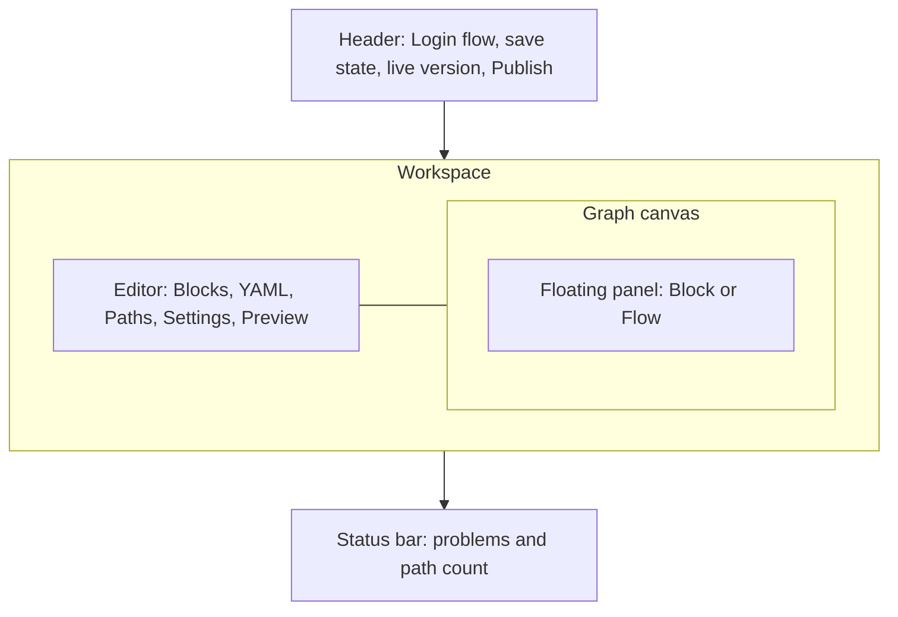

# Edit and publish a flow

This page is a guide to the **Login flow** page of the Admin UI, where you build a tenant's sign in. It covers the blocks editor, the YAML editor, the paths the checker finds, the flow's settings, the graph, publishing, and the **Versions** page. It is for flow authors. You do not need to know the YAML to follow it.

> [!NOTE]
> This page writes keyboard shortcuts with `⌘`. On Windows and Linux, press `Ctrl` instead.

## The workspace layout

Open a tenant, then select **Login flow** in the sidebar. The diagram shows the parts of the workspace.



- The **header** shows the page name, the save state of the draft, the live version (**live** and a short hash), and **Publish**.
- The **editor** on the left has five tabs: **Blocks**, **YAML**, **Paths**, **Settings** and **Preview**. Under the tabs is a toolbar with the current tab's state on the left and its actions on the right.
- The **graph** on the right draws the same draft. A panel floats over its right side. It shows the selected block's inspector, or help when no block is selected.
- The **status bar** at the bottom shows errors, warnings and the number of paths.

Drag the line between the editor and the graph to resize them. The console remembers the sizes in this browser. When the graph is narrow, the panel docks beside it instead of floating over it. On a phone, the page shows one pane at a time: choose **Editor** or **Graph**.

Every edit, in either the blocks or the YAML, changes the same draft. The console saves and checks it 400 ms after you stop. See [How drafts work](overview.md#how-drafts-work).

> [!NOTE]
> A flow written before blocks existed opens with a yellow banner: **This flow uses screens and handlers instead of blocks**. The server refuses such a flow until you select **Upgrade to blocks**. Upgrading keeps only the first comment of the YAML.

## Build the flow in the Blocks tab

The **Blocks** tab shows the draft as a tree of blocks. A block is one part of a flow: a built in credential such as **Password**, or a piece of logic such as **Choose**.

### Read the tree

The tree has up to two sections, each with a step count:

- **Sign in** holds the steps of the sign in, from the **Identifier** on. If the flow asks for consent, the **Consent** block and every step after it appear under a **Consent** heading. The heading says "runs after sign in, on the consent challenge". These steps run only after the sign in succeeded, when the authorization server asks for consent.
- **Approve** holds the steps that a phone runs to approve a QR code sign in ([ADR 0032](../adr/0032-delivered-one-time-codes-and-qr-sign-in.md)). The YAML gets an `approve` section only once this section has steps.

Inside a section:

- A line joins steps that run in order.
- A **Choose** shows its options in a box, with "or" between them. The box heading says **The user picks one**, or names the hook that picks.
- A **Group** shows its steps under **In order**.
- Small chips under a block show what else it does: its condition (`if`), its attempts, its settings, its hooks and a fail reason.
- A red or yellow count on a row is the number of errors or warnings on that block.

### Add a block

Select **Add block** in the toolbar, or press `/` anywhere outside a text field. Type to search, then press `Enter` or select a block. The blocks come in two groups.

| Group | Block | What it does |
|---|---|---|
| Steps | **Identifier** | Asks who is signing in, then finds the account. Always the first step. |
| Steps | **Password** | Verifies a password. |
| Steps | **Passkey** | Signs in with a passkey. |
| Steps | **Add passkey** | Offers to create a passkey, once signed in. |
| Steps | **One time code** | A code from an authenticator app, an email or a text message. You switch the kind in the inspector. |
| Steps | **Add phone** | Adds a phone number that the person proves with a texted code, once signed in. |
| Steps | **Enroll TOTP** | Sets up an authenticator app. |
| Steps | **QR code** | Shows a QR code that the person scans and approves on their phone. |
| Steps | **Approve QR code** | On the phone: the person picks the number the other device shows. The last **Approve** step. |
| Steps | **Consent** | Asks to share data with the client. Runs after sign in, on the consent challenge. |
| Logic | **Choose** | Offers two or more credential blocks. The user or a hook picks one. |
| Logic | **Code by** | A **Choose** of one time codes: the app if enrolled, a text if phone codes are on, else email. |
| Logic | **Group** | Runs nested steps in order, for example under one condition. |
| Logic | **Set** | Writes a value into `vars`. |
| Logic | **Fail** | Ends the sign in with a reason. |

The line at the bottom of **Add block** says where the block goes:

- If you selected a list heading, such as a section title or **The user picks one**, the block goes to the end of that list. Select a heading to add blocks inside a **Choose** or a **Group** without dragging.
- If you selected a block, the new block goes after it.
- Otherwise, the block goes to the end of **Sign in**, before **Consent**.

The **Identifier** always goes first, and **Approve QR code** always goes to the end of **Approve**.

### Why a block is disabled

**Add block** never offers a block that would break the flow. A disabled block shows the reason under its name. These are the reasons the console gives:

| Reason | What to do |
|---|---|
| The Identifier is always the first step | Add other blocks after the Identifier. |
| The flow already starts with the Identifier | The section has its Identifier. A section has only one. |
| An option is one credential block, or Fail | A **Choose** option cannot be a **Group**, **Set** or another **Choose**. |
| Consent is a step of its own | Add **Consent** as a step, not inside a **Choose** or **Group**. |
| Consent comes after every credential step | Move **Consent** after the last credential. |
| Steps after Consent run once signed in; put credentials before it | Select a step before **Consent**. |
| The Identifier already asks for the password | The **Identifier** uses **With password**, so no **Password** block is needed. |
| Approve QR code goes in the Approve section | Select the **Approve** heading first. |
| The Approve section asks for no consent | Add **Consent** to **Sign in** only. |
| Disallowed in General settings | The tenant's **Handlers** or **Screens** allowlist leaves this block out. See [General settings](tenant-settings.md#general-settings). |
| No email delivery for this tenant (or no text message delivery) | The operator has not set where codes go: `faye.tenants.<id>.delivery.email` or `.sms`. |

### Drag and drop

Drag a block by its row to move it. While you drag, gaps open only where the block can go and the flow still compiles. A drop is therefore never refused. You can also drag a block into a **Choose** or a **Group**.

### Use the keyboard

Click the tree once to give it focus. Then:

| Keys | What it does |
|---|---|
| `↑` `↓` | Select the block above or below. |
| `⌘↑` `⌘↓` | Move the selected block up or down, where it may go. |
| `⌫` or `Delete` | Delete the selected block. |
| `Esc` | Clear the selection. |
| `/` | Open **Add block**. |
| `⌘Z`, `⇧⌘Z` | Undo, redo. The console keeps 100 steps. |

When you delete a block, a message says **Deleted** with the block's id and offers **Undo**. If you delete an option and its **Choose** keeps only one option, that option becomes the step. It keeps the condition and hooks of the **Choose**.

## Edit a block in the inspector

Select a block in the tree or in the graph. The floating panel shows **Block** and opens the inspector. To close the panel, select **Hide panel**. To open it again, select **Block** or **Flow** at the top right of the graph.

The inspector shows only the settings that the selected block takes ([ADR 0030](../adr/0030-blocks-with-fixed-screens-and-handlers.md)).

### Step ID, move and delete

The top row holds the block's **Step ID**, or **Option ID** for an option of a **Choose**. Type a new id and press `Enter`. An id starts with a letter and uses `a` to `z`, `0` to `9`, `-` and `_`. Step ids are unique across the flow. Option ids are unique within their **Choose**.

**Move up**, **Move down** and **Delete** sit on the same row. A button is off when the move or delete would break the flow, and its label says why. For example, you cannot delete the **Identifier**.

If the checker found problems in this block, they appear under the top row.

### Condition

Every block except the **Identifier** can have a condition. Turn on **Only if** to add one. Without a condition, the block always runs. With one, a step that fails the condition is skipped, and an option that fails it is not offered.

The condition builder has a list of tests:

1. Choose how the tests combine: **all**, **any** or **none** of them must hold.
2. In each test, type or pick a path, such as `user.has_totp` or `vars.risk`. The field suggests common paths and the `vars` names that **Set** blocks write.
3. Pick an operator, and a value if the operator needs one.

| Operator | Holds when |
|---|---|
| **is true** | The path is true. |
| **is false** | The path is not true. |
| **=** | The path equals the value. |
| **≠** | The path does not equal the value. |
| **contains** | The list at the path contains the value. |
| **excludes** | The list at the path does not contain the value. |
| **>** | The path is greater than the value, an integer. |
| **<** | The path is less than the value, an integer. |
| **is set** | The path has a value. |
| **is not set** | The path has no value. |

Select **Add condition** for another test, or **Add group** for a nested group with its own **all**, **any** or **none**. The line under the builder shows the whole condition as text. The builder writes the same predicate that you would write in YAML. For example, "**all** of `vars.risk` **=** `high`" is `if: { eq: [vars.risk, high] }`. The [Flow DSL reference](../reference/dsl.md) lists every path a condition can read.

### Settings of each block

| Block | Settings |
|---|---|
| **Identifier** | **View**: **Identifier first** asks for the password on a second screen. **With password** asks for both on one screen. **Passkey autofill** offers saved passkeys in the identifier field, and is unavailable with password. **Attempts** appears only with password. |
| **Password**, **Passkey**, **One time code**, **Enroll TOTP**, **QR code**, **Add phone** | **Attempts**: how many tries the person gets before the step fails. The field says **default** or **tenant default** until you change it. |
| **One time code** | **Kind**: **Authenticator app**, **Email** or **Text message**. A kind is off when the tenant has no delivery for it. |
| **Add passkey**, **Add phone** | **Required**: on, the person must enroll. Off, the person may skip with **Not now** ([ADR 0038](../adr/0038-required-enrollment.md)). |
| Blocks that show a screen | **Path**: the URL path where the Login UI shows the block's screen. Leave it empty for the default ([ADR 0029](../adr/0029-screen-paths.md)). |
| **Choose** | **Picked by**: **User** or **Hook**. With **Hook**, choose the hook in **Picker**. **Hook** is off until the flow has a hook. A **Choose** needs two or more options. |
| **Set** | **Vars**: name and value pairs. Select **Add var** for another. |
| **Fail** | **Reason**: the failure reason, an id such as `denied`. |
| **Group** | No settings. Add steps under it in the tree. |

If you choose **With password** while the flow also has a **Password** block, the inspector warns that the block "asks for the password again" and offers **Remove**.

Hand written YAML can give a block a key that it does not take. The inspector then shows an **Unsupported keys** group, with the reason and a **Remove** button for each key. The draft fails the check until you remove them.

### Hooks

The **Hooks** group attaches the flow's hooks to the block:

- **Before** runs the hook once before the block, before all of its attempts.
- **After** runs the hook once after the block has run. A **Fail** block has no **After**, because nothing runs after it.

A hook can set `vars` or fail the step. It cannot complete a sign in. To write a hook, go to the **Hooks** page. See [Hooks](../flows/hooks.md).

## Edit the YAML

The **YAML** tab shows the draft as text. It is the same draft as the **Blocks** tab: an edit in one shows in the other. This example is the shipped flow `apps/server/faye-app/src/main/resources/flows/risk-totp.yaml`:

```yaml
flow: risk-totp
version: 1

hooks:
  risk:
    file: risk.js
    capabilities: { http: [ip-reputation] }
    timeout_ms: 500

login:
  steps:
    identify:
      block: identifier
      after: risk
    credential:
      block: password
    second-factor:
      if: { eq: [vars.risk, high] }
      alternative:
        totp:
          if: user.has_totp
          block: totp
        enroll:
          if: { not: user.has_totp }
          block: enroll-totp
```

The editor helps you as you type:

- Press `Ctrl+Space` to show completions. The editor completes keys, block ids after `block:`, hook ids after `before:`, `after:` and `pick:`, a block's settings under `with:`, and paths and operators in `if:`.
- The server's errors and warnings appear as marks in the left margin at their line. Hold the pointer over a mark to read it.
- The YAML tab has its own undo. Press `⌘Z` inside the editor.

If the YAML does not parse, the toolbar shows **YAML does not parse**. The **Blocks** tab then shows the parser's message and a **Fix in YAML** button. The graph keeps showing the last draft that parsed, marked **last valid draft**.

> [!WARNING]
> An edit in the **Blocks** tab rewrites the YAML. Only the comment at the top of the document survives. The **Settings** tab shows that comment as the flow's description. Comments anywhere else are lost.

For the full YAML syntax, see [Flow syntax](../flows/flow-syntax.md) and the [Flow DSL reference](../reference/dsl.md).

## Read the status bar and the Problems list

The status bar at the bottom shows the result of the last check:

- **checking…** while the server checks the draft.
- **No problems**, or a count of errors and warnings. Select the count to open **Problems**.
- A count of paths. Hold the pointer over it to see how many paths succeed and how many fail.
- The selected path, when you picked one in the **Paths** tab. Select **×** to clear it.

In **Problems**, select a problem to go to it. If it belongs to a block, the **Blocks** tab opens with that block selected. Otherwise the **YAML** tab opens. Each problem shows its line number.

## Check every path in the Paths tab

The **Paths** tab lists every way the draft can end, as the checker enumerates it. Each path shows whether it succeeds, its entry, and the amr and acr that a succeeding path issues. The engine computes amr and acr from the credentials that the path verifies. Nothing in a flow can set them.

Select a path to highlight it in the blocks and the graph. Select it again, or the **×** on the graph's **path** badge, to clear it. Use **All**, **Succeed** and **Fail** in the toolbar to filter the list. Each shows its count. In a path, `›` separates the steps and options it goes through.

The **Path budget** at the top shows, per entry, how many paths it has against the checker's limit of 10,000. The bar is green under half, yellow to three quarters and red past that. Paths multiply with every alternative, condition and retry, so a red entry has little room left. An entry over the limit is an error: the draft cannot be published until you split the entry or remove branches.

If the draft has errors, the tab shows **No paths** until you fix them.

## Change flow settings in the Settings tab

The **Settings** tab holds what the flow says about itself. Its toolbar reads **Publishes with the draft, except time limits**.

### Flow

| Field | What it is |
|---|---|
| **Name** | The flow's name, the `flow:` key of the YAML. |
| **ID** | The hash of the live version, set on publish. **Not published** when there is none. Select **Copy ID** to copy it. |
| **Tenant** | The tenant this flow belongs to. Read only. |
| **Version** | The `version:` key of the YAML, a whole number from 1. |
| **Description** | The comment at the top of the YAML. |

**Shape** shows the flow's entries (`login`, or `login · consent`) and how many steps and hooks it has.

### Time limits

**Time limits** set how long a person has to finish each kind of entry ([ADR 0035](../adr/0035-flow-settings-per-entry-kind.md)). There is one group per entry kind that the server runs: **Sign in** (`authenticate`), **Consent** (`consent`), and the approve entry of QR code sign in (`approve`). Each group has two fields, in minutes:

- **Time limit**: how long after its start a person can still answer.
- **Idle timeout**: how long after the last answer a person can still answer.

Leave a field empty to use the deployment's limit, `faye.flow-ttl`, which is 30 minutes in the shipped configuration. A limit is at least 1 minute and at most that deployment limit. The idle timeout cannot be longer than the time limit.

Time limits are tenant settings, not part of the draft. Select **Save limits** to save them, or **Discard** to drop your changes. They apply to sign ins that start after you save, with no publish. A sign in that has started keeps the limits it started with. When a sign in passes its limit, the Login UI says "This sign in timed out. Go back to the app and start again."

## Read the graph

The graph draws the draft from top to bottom. Each section starts with its title and ends with an end node: **signed in** for the sign in, **consented** after the consent steps, and **approved** after the approve steps. The options of a **Choose** and the steps of a **Group** branch to the right.

- Select a node to select its block. The inspector opens.
- A node flashes briefly when an edit changes its block.
- The badge at the top left says **draft**, or **last valid draft** while the YAML does not parse. While a path or a preview run is highlighted, a second badge says **path** or **preview run**.

To move around the graph:

- Drag the canvas, or scroll, to pan. Hold `Shift` to scroll sideways.
- Hold `⌘` and scroll, or pinch, to zoom toward the pointer.
- Use the buttons at the bottom left: **Zoom out**, the zoom level (select it to reset to 100%), **Zoom in**, and **Fit width**.

Select **Full screen (new tab)** to open the graph alone at `/view/{tenant}`. That page shows the draft, read only. It follows your edits in the console while both are open in the same browser, and reloads the draft when you come back to the tab. Select **Edit** to go back to the workspace.

## Publish

Select **Publish** in the header. The button is off while the check runs and while the draft has errors. Hold the pointer over it to see the reason. Warnings do not stop a publish.

The server compiles the draft and checks it again under the tenant's current settings. Among other things, the checker requires that:

- The YAML follows the block rules: the **Identifier** first, one credential block or a **Fail** per option, **Consent** after every credential, and only the keys each block takes.
- Every handler and screen is allowed by the tenant's **General** settings, and every hook's egress target is granted to the tenant.
- Every succeeding path verifies a credential for the person who signs in.
- If the tenant requires MFA, every succeeding path reaches `faye:2fa`.
- Each entry has at most 10,000 paths, and at most 32 hook runs and 5,000 ms of hook time.

The [Core IR specification](../ir-spec.md) lists every check. [Security](../understand/security.md) explains why they exist.

If the check passes, a message says **Published** with the new hash. The version is live at once, and the header's **live** badge changes. If the check fails, a message says **Not published: the flow has errors**, and the status bar lists the problems.

Publishing does not clear the draft. Sign ins that are in progress finish on the version they started on.

## Compare and roll back on the Versions page

Select **Versions** in the sidebar. The left side lists every published version, newest first. Each row shows **Version** and its number, when it was published, and the first 8 characters of its hash. The live version has a green **Live** badge. A version published before Faye kept publish times shows **Date not recorded**.

Select a version to compare it with the draft. The right side shows the version's YAML against the draft, line by line. The bar above it shows the version, an arrow to **draft**, and how many lines the draft adds and removes. If the server kept no YAML for the version, the page says **No YAML stored for this version. Showing IR.**

### Load a version into the draft

Select **Load into draft**. The version's YAML replaces the draft, and a message says **Loaded into draft** with **Undo**. The live version does not change. Edit the draft, then publish it as usual.

### Make an earlier version live

To roll back, select a version that is not live, then select **Make live**. The console asks you to confirm:

> **Make version N live?** New sign ins use this version immediately. Sign ins in progress finish on their current version. The draft is unchanged.

The server checks the version again under the tenant's current settings before it makes it live. A version that passed when it was published can fail now, for example after you turned on **Require MFA**. In that case a message says the version was not made live, with the checker's errors. On success, a message says the version is live.

## Next steps

- [Preview a draft](preview.md) before you publish it.
- [Hooks](../flows/hooks.md): write the JavaScript that **Before**, **After** and **Picker** run.
- [Tenant settings, applications and users](tenant-settings.md): the policy that every publish is checked against.
