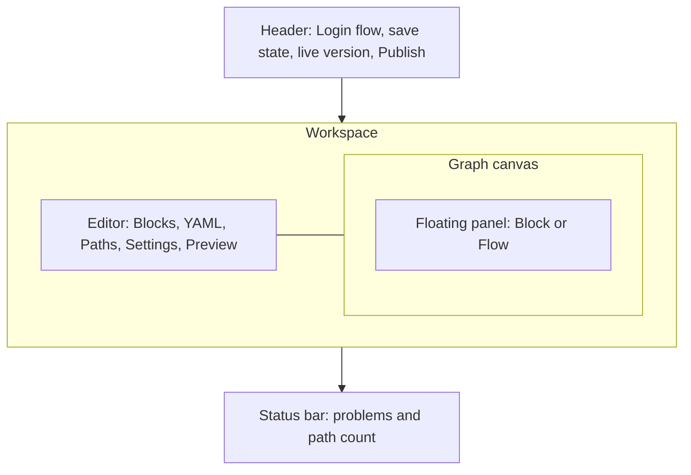

# Edit and publish a flow

This page is a guide to the **Login flow** page of the Admin UI, where you build a tenant's sign in. It covers the blocks editor, the YAML editor, the paths the checker finds, the flow's settings, the graph, publishing, and the **Versions** page. This page is for flow authors. You do not need to know YAML to follow this page.

> [!NOTE]
> This page writes keyboard shortcuts with `⌘`. On Windows and Linux, press `Ctrl` instead.

## The workspace layout

Open a tenant, then select **Login flow** in the sidebar. The diagram shows the parts of the workspace.



- The **header** shows the page name, the save state of the draft, the live version (**live** and a short hash), and **Publish**.
- The **editor** on the left has five tabs: **Blocks**, **YAML**, **Paths**, **Settings** and **Preview**. Under the tabs is a toolbar with the current tab's state on the left and its actions on the right.
- The **graph** on the right draws the same draft. A panel floats over the right side of the graph. The panel shows the selected block's inspector, or help when no block is selected.
- The **status bar** at the bottom shows errors, warnings and the number of paths.

Drag the line between the editor and the graph to resize them. The console remembers the sizes in this browser. If the graph is narrow, the panel sits beside the graph instead of over it. On a phone, the page shows one pane at a time: choose **Editor** or **Graph**.

Every edit, in either the blocks or the YAML, changes the same draft. The console saves and checks the draft 400 ms after you stop editing. See [How drafts work](overview.md#how-drafts-work).

> [!NOTE]
> A flow written before blocks existed opens with a yellow banner: **This flow uses screens and handlers instead of blocks**. The server refuses this kind of flow until you select **Upgrade to blocks**. Upgrading keeps only the first comment of the YAML.

## Build the flow in the Blocks tab

The **Blocks** tab shows the flow as a tree of blocks, and the block inspector edits the selected block. [Build a flow with blocks](blocks.md) covers both: adding, moving and deleting blocks, why a block can be disabled, the keyboard, conditions, the settings of each block, and hooks.

## Edit the YAML

The **YAML** tab shows the draft as text. The **YAML** tab and the **Blocks** tab show the same draft. An edit in one tab shows in the other. This example is the shipped flow `apps/server/faye-app/src/main/resources/flows/risk-totp.yaml`:

```yaml
flow: risk-totp
version: 1

hooks:
  risk:
    file: risk.js
    capabilities: { http: [ip-reputation] }
    timeout_ms: 500

login:
  steps:
    identify:
      block: identifier
      after: risk
    credential:
      block: password
    second-factor:
      if: { eq: [vars.risk, high] }
      alternative:
        totp:
          if: user.has_totp
          block: totp
        enroll:
          if: { not: user.has_totp }
          block: enroll-totp
```

The editor helps you as you type:

- Press `Ctrl+Space` to show completions. The editor completes keys, block ids after `block:`, and hook ids after `before:`, `after:` and `pick:`. It also completes a block's settings under `with:`, and paths and operators in `if:`.
- The server's errors and warnings appear as marks in the left margin at their line. Hold the pointer over a mark to read it.
- The YAML tab has its own undo. Press `⌘Z` inside the editor.

If the YAML does not parse, the toolbar shows **YAML does not parse**. The **Blocks** tab then shows the parser's message and a **Fix in YAML** button. The graph keeps showing the last draft that parsed, marked **last valid draft**.

> [!WARNING]
> An edit in the **Blocks** tab rewrites the YAML. Only the comment at the top of the YAML stays. The **Settings** tab shows that comment as the flow's description. All other comments are lost.

For the full YAML syntax, see [Write flows in YAML](../flows/flow-syntax.md) and the [Flow DSL reference](../reference/dsl.md).

## Read the status bar and the Problems list

The status bar at the bottom shows the result of the last check:

- **checking…** while the server checks the draft.
- **No problems**, or a count of errors and warnings. Select the count to open **Problems**.
- A count of paths. Hold the pointer over the count to see how many paths succeed and how many fail.
- The selected path, when you selected a path in the **Paths** tab. Select **×** to clear it.

In **Problems**, select a problem to go to it. If the problem belongs to a block, the **Blocks** tab opens with that block selected. Otherwise the **YAML** tab opens. Each problem shows its line number.

## Check every path in the Paths tab

The **Paths** tab lists every way the draft can end, as the checker finds them. Each path shows its entry and whether it succeeds. A succeeding path also shows the amr (authentication methods references) and acr (authentication context class reference) that it issues. The engine computes amr and acr from the credentials that the path verifies. Nothing in a flow can set them.

Select a path to highlight it in the blocks and the graph. To clear the highlight, select the path again, or select the **×** on the graph's **path** badge. Use **All**, **Succeed** and **Fail** in the toolbar to filter the list. Each filter shows its count. In a path, `›` separates the steps and options that the path goes through.

The **Path budget** at the top shows how many paths each entry has, compared with the checker's limit of 10,000. The bar is green below half of the limit, yellow up to three quarters, and red above that. Every alternative, condition and retry multiplies the number of paths. So a red entry has little room left. An entry over the limit is an error. You cannot publish the draft until you split the entry or remove branches.

If the draft has errors, the tab shows **No paths** until you fix them.

## Change flow settings in the Settings tab

The **Settings** tab holds the details of the flow itself. Its toolbar reads **Publishes with the draft, except time limits**.

### Flow

| Field | What it is |
|---|---|
| **Name** | The flow's name, the `flow:` key of the YAML. |
| **ID** | The hash of the live version, set on publish. Shows **Not published** when there is no live version. Select **Copy ID** to copy it. |
| **Tenant** | The tenant this flow belongs to. Read only. |
| **Version** | The `version:` key of the YAML, a whole number from 1. |
| **Description** | The comment at the top of the YAML. |

**Shape** shows the flow's entries (`login`, or `login · consent`) and how many steps and hooks it has.

### Time limits

**Time limits** set how long a person has to finish each kind of entry ([ADR 0035](../adr/0035-flow-settings-per-entry-kind.md)). There is one group per entry kind that the server runs: **Sign in** (`authenticate`), **Consent** (`consent`), and the approve entry of QR code sign in (`approve`). Each group has two fields, in minutes:

- **Time limit**: how long after the entry starts a person can still answer.
- **Idle timeout**: how long after the last answer a person can still answer.

Leave **Time limit** empty to use the deployment's limit, `faye.flow-ttl`, which is 30 minutes in the shipped configuration. Leave **Idle timeout** empty for no idle timeout. A limit is at least 1 minute and at most the deployment's limit. The idle timeout cannot be longer than the time limit.

Time limits are tenant settings, not part of the draft. Select **Save limits** to save them, or **Discard** to remove your changes. The limits apply to sign ins that start after you save, with no publish. A sign in that has started keeps the limits it started with. When a sign in passes its limit, the Login UI says "This sign in timed out. Go back to the app and start again."

## Read the graph

The graph draws the draft from top to bottom. Each section starts with its title and ends with an end node. The end node is **signed in** for the sign in, **consented** after the consent steps, and **approved** after the approve steps. The options of a **Choose** and the steps of a **Group** branch to the right.

- Select a node to select its block. The inspector opens.
- A node flashes briefly when an edit changes its block.
- The badge at the top left says **draft**, or **last valid draft** while the YAML does not parse. While a path or a preview run is highlighted, a second badge says **path** or **preview run**.

To move around the graph:

- Drag the canvas, or scroll, to move the view. Hold `Shift` to scroll sideways.
- Hold `⌘` and scroll, or pinch, to zoom toward the pointer.
- Use the buttons at the bottom left: **Zoom out**, the zoom level (select it to reset to 100%), **Zoom in**, and **Fit width**.

Select **Full screen (new tab)** to open the graph alone at `/view/{tenant}`. That page shows the draft, read only. While both pages are open in the same browser, the full screen page shows your edits from the console. The full screen page reloads the draft when you come back to its tab. Select **Edit** to go back to the workspace.

## Publish

Select **Publish** in the header. The button is turned off while the check runs and while the draft has errors. Hold the pointer over the button to see the reason. Warnings do not stop a publish.

The server compiles the draft and checks it again under the tenant's current settings. In short, the checker requires that the flow follows the block rules, uses only what the tenant's **General** settings allow, verifies a credential on every succeeding path, meets the tenant's multi factor authentication (MFA) policy, and stays within the limits. The [Flow DSL reference](../reference/dsl.md#how-a-flow-file-is-processed) describes each stage of the check, and lists every [error and its fix](../reference/dsl.md#checker-errors). [Security](../understand/security.md) explains why the checks exist.

If the check passes, a message says **Published** with the new hash. The version is live immediately, and the header's **live** badge changes. If the check fails, a message says **Not published: the flow has errors**, and the status bar lists the problems.

Publishing does not clear the draft. Sign ins that are in progress finish on the version they started on.

## Compare and roll back on the Versions page

Select **Versions** in the sidebar. The left side lists every published version, newest first. Each row shows **Version** and its number, when it was published, and the first 8 characters of its hash. The live version has a green **Live** badge. A version published before Faye kept publish times shows **Date not recorded**.

Select a version to compare it with the draft. The right side shows the version's YAML against the draft, line by line. The bar above the comparison shows the version, an arrow to **draft**, and how many lines the draft adds and removes. If the server kept no YAML for the version, the page says **No YAML stored for this version. Showing IR.**

### Load a version into the draft

Select **Load into draft**. The version's YAML replaces the draft, and a message says **Loaded into draft** with **Undo**. The live version does not change. Edit the draft, then publish it as usual.

### Make an earlier version live

To roll back, select a version that is not live, then select **Make live**. The console asks you to confirm:

> **Make version N live?** New sign ins use this version immediately. Sign ins in progress finish on their current version. The draft is unchanged.

The server checks the version again under the tenant's current settings before the server makes the version live. A version that passed when it was published can fail now, for example after you turned on **Require MFA**. If this happens, a message says the version was not made live, with the checker's errors. On success, a message says the version is live.

## Next steps

- [Preview a draft](preview.md) before you publish it.
- [Hooks](../flows/hooks.md): write the JavaScript that **Before**, **After** and **Picker** run.
- [Tenant settings, applications and users](tenant-settings.md): the policy that every publish is checked against.
