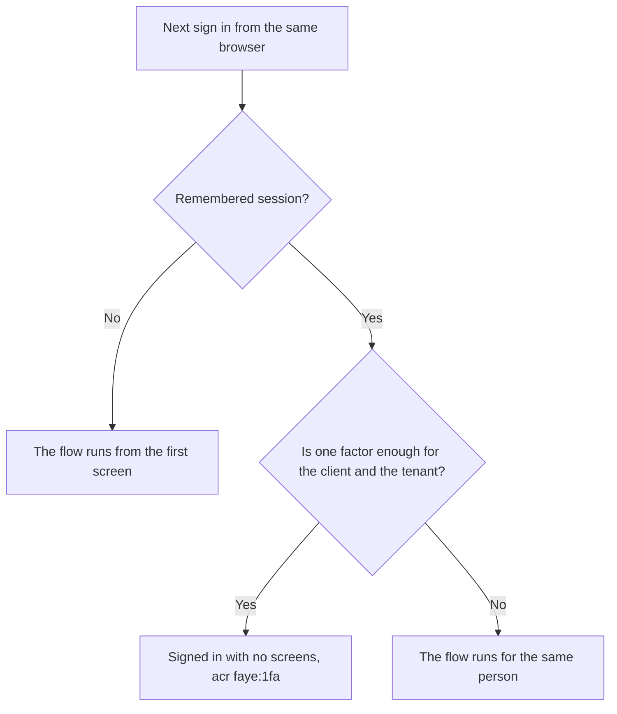

# Customize the login page

The **Customization** page sets how a tenant's login screens look, within fixed limits. It also sets which sign in options the screens offer. This page explains each setting, when it takes effect, and what you cannot change. This page is for flow authors and for anyone who owns a tenant's brand. The design is in [ADR 0033](../adr/0033-login-page-customization-and-keep-me-signed-in.md).

## Open the Customization page

Open a tenant, then select **Customization** under **Sign in** in the sidebar. The page has two parts:

- On the left, the settings: **Brand** and **Sign in options**.
- On the right, **Preview**: a small copy of the first login screen. The preview changes as you edit, before you save.

A badge in the header says where the settings come from. **From server config** means nobody has saved settings for this tenant in the console yet. **Saved in console** means someone has saved settings in the console.

## Brand

| Setting | What it does | Allowed values |
|---|---|---|
| **Name** | Shown at the top of every screen, and in the footer: "© Acme. All rights reserved." Leave it empty to hide both. | 1 to 64 characters. |
| **Logo URL** | An image shown 36 px tall above every screen, in place of the name. The name becomes the image's text alternative. | A URL that starts with `https://`. |
| **Primary color** | The color of buttons and focus rings. Pick a color, or type its value. Select **Reset color** to go back to the default. | `#rrggbb`, for example `#0f62fe`. |
| **Corner radius** | How round cards, fields and buttons are. 0 is square. | 0 to 24 px. The default is 6 px. |

The browser of the person signing in loads the logo from its URL. The Faye server never fetches the logo.

Until someone saves a name here, the screens use the tenant's display name from the server config, `faye.tenants.<id>.name`. The shipped tenants are named Acme and Bank.

## Sign in options

| Option | What the person sees |
|---|---|
| **Show password button** | A button in each password field that shows or hides what the person typed. |
| **Keep me signed in** | A checkbox on the first screen, not ticked by default. |
| **Sign up button** | A **Sign up** button under the first screen. |

### Keep me signed in

When this option is on, the first screen shows a **Keep me signed in** checkbox. The person decides. No flow, hook or setting can tick the box for the person.

If the person ticks the box and the sign in succeeds, Faye tells the authorization server that the person asked to be remembered. Ory Hydra then remembers the sign in on that browser for 30 days. Faye does not own the session. The authorization server keeps the session ([charter](../../CHARTER.md), "What Faye is not" 2).

The diagram shows what happens on the next sign in from the same browser.

A remembered session counts as one factor, `faye:1fa`. Faye reuses the remembered session only when one factor is enough for two things. The first is the level that the client asked for in `acr_values`. The second is the tenant's multi factor authentication (MFA) policy, **Require MFA**. Otherwise the flow runs, and the person must prove who they are again as the same account.

The option applies to sign ins that start after you save. You do not need to publish the flow.

> [!NOTE]
> A client that sends `prompt=login` always gets the full flow, with or without a remembered session. Previews send `prompt=login` by default for this reason.

### Sign up button

Faye does not run sign up flows yet. The **Sign up** button is a placeholder. It opens a notice that says "Sign up isn't available yet". The notice tells the person to sign in if they already have an account. The notice sends nothing to the server. Turn the button on only if you want people to see that sign up is planned.

## Save your changes

When you change a setting, a bar appears at the bottom of the page: **Unsaved changes**, with **Discard** and **Save changes**. Select **Save changes**.

The server checks the values again. If a value is not allowed, for example a logo URL that does not start with `https://`, the page lists the problem in red and saves nothing.

Saved branding and buttons appear on the next screen that the Login UI loads. This includes sign ins that are in progress. **Keep me signed in** applies to sign ins that start after the save. None of these settings is part of the draft, so you do not publish them.

## What you cannot change

The login screens are a fixed set of typed screens, such as the identifier screen, the password screen and the consent screen. The [Screens reference](../reference/screens.md) lists them. You can brand the screens, but you cannot change:

- The layout, the order of fields, or the wording on the screens.
- Fonts and the theme. The login screens have one light theme.
- Which screens exist. You cannot add your own HTML, CSS or scripts.

The flow decides what happens and in what order. Change the flow on the **Login flow** page. You cannot configure how the screens are built. The charter sets this limit in principle 6, "Configurable within bounds". Tenants configure what happens and in what order. Tenants can change the appearance only by branding the typed screens.

The limit has three reasons:

- **Security.** The login page runs no tenant scripts, so no tenant code sees what a person types. The Login UI also refuses to show inside a frame on another site.
- **Accessibility.** Each screen type is built and tested once, for every tenant.
- **Checks.** Every screen is a typed template that the engine and the checker know. A free form page goes around what the checker proves about a flow.

If a flow needs a screen that does not exist, Faye must add a new screen type to the screen protocol. This is a change to Faye, not a tenant setting.

## Next steps

- [Edit and publish a flow](flow-editor.md): change what the screens ask for, and in what order.
- [Tenant settings, applications and users](tenant-settings.md): require MFA, which also decides when a remembered session is enough.
- [Preview a draft](preview.md): see the branded screens in a real sign in.
