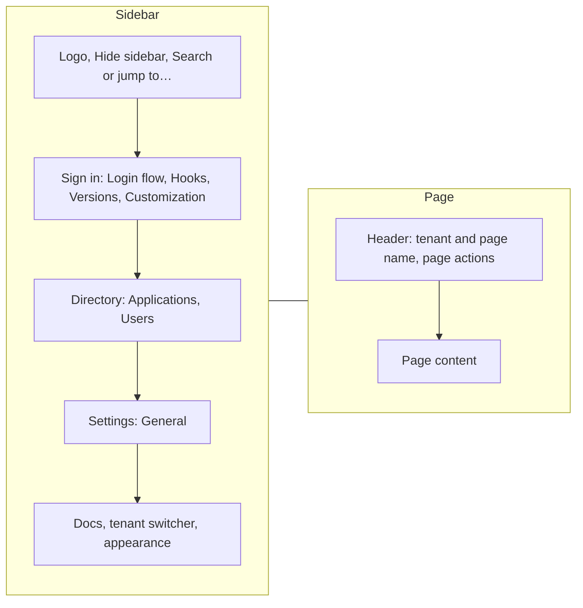
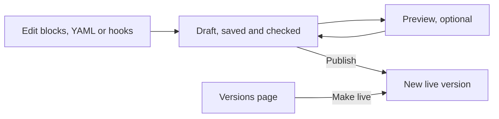

# Admin UI overview

The Admin UI is the console where you build and run each tenant's sign in. This page explains what the console is for, how to move around in it, and how a draft becomes the version that people sign in with. Read it first if you are new to the console. Flow authors and the engineers who run Faye both use it.

## What the Admin UI is for

The Admin UI runs on port 3002, at http://localhost:3002 in the local stack. With it you can:

- Edit a tenant's flow as blocks or as YAML, and see every path the checker finds.
- Preview a draft against a real OAuth client before you publish it.
- Publish a draft, compare versions, and roll back to an earlier version.
- Write and test hooks, the tenant's own JavaScript.
- Brand the login page and turn sign in options on or off.
- Set the tenant's policy: multi factor authentication (MFA), allowed handlers and screens, and block defaults.
- Look up the tenant's applications and users.

The console does not create users or OAuth clients. Both come from outside Faye, so the console shows them read only. The reasons are in [Tenant settings, applications and users](tenant-settings.md#why-applications-and-users-are-read-only).

## Keep the Admin UI on your own machine

The Admin UI has no sign in. Anyone who can open it can publish, roll back and change settings for every tenant ([ADR 0018](../adr/0018-two-tenants-and-an-open-local-console.md)).

The console talks to Faye's admin API through its own server. Faye serves the admin API only on a Unix domain socket (`FAYE_ADMIN_SOCKET`), never on a network port. It checks a bearer token (`FAYE_ADMIN_TOKEN`) on every call ([ADR 0028](../adr/0028-admin-api-on-a-unix-domain-socket.md)). The browser never sees the token. A request that changes something must also carry the header `x-faye-admin: 1`, which a form on another site cannot send.

The compose stack publishes the console on `127.0.0.1:3002` only, so other machines cannot reach it.

> [!CAUTION]
> Do not publish port 3002 on a shared network or the internet. The console signs nobody in, so whoever reaches it controls every tenant's sign in. A shared deployment needs an authenticating proxy in front of the console.

If the first page shows **Admin API request failed** with a status code, the console cannot use the admin API. Check that `FAYE_ADMIN_TOKEN` has the same value for the Faye server and for the Admin UI.

## Choose a tenant

The console opens on **Choose a tenant**, a short list with no sidebar. Each row shows the tenant's id and the state of its flow:

- A green dot and the first 8 characters of the live version's hash, when the tenant has a live version.
- **No live version**, when nothing is published yet.

Select a tenant to open its **Login flow** page. The shipped configuration has two tenants, `acme` and `bank`. A **Docs** link under the list opens these docs.

## The console frame

Inside a tenant, every page sits in the same frame. The diagram shows its parts: a sidebar on the left and the page on the right.

The top of the sidebar holds the Faye logo, which takes you back to all tenants. Next to it is **Hide sidebar**. Under them is the search field **Search or jump to…**, which opens the command palette.

The sidebar groups the tenant's pages:

| Group | Page | What you do there |
|---|---|---|
| Sign in | **Login flow** | Edit the draft as blocks or YAML, check its paths, change flow settings, preview and publish. See [Edit and publish a flow](flow-editor.md). |
| Sign in | **Hooks** | Write, test and configure the tenant's hooks. See [Hooks](../flows/hooks.md). |
| Sign in | **Versions** | Compare published versions with the draft, load one into the draft, or make one live. See [Versions](flow-editor.md#compare-and-roll-back-on-the-versions-page). |
| Sign in | **Customization** | Brand the login page and choose its sign in options. See [Customize the login page](login-page.md). |
| Directory | **Applications** | See the OAuth clients that use this tenant, and try a sign in as one. |
| Directory | **Users** | See the accounts in the tenant's user pool. |
| Settings | **General** | Require MFA, set block defaults and allowlists, and see egress grants. |

The foot of the sidebar holds three controls:

- **Docs** opens these docs inside the console.
- The tenant switcher shows the current tenant. Open it to switch to another tenant, or choose **All tenants** to go back to the list.
- The appearance menu sets **Light**, **Dark** or **System**. The console remembers the choice in this browser.

Each page has a header. It shows the tenant, the page name, and the page's actions, such as **Publish**. To make the sidebar narrow, press `⌘B` (`Ctrl+B` on Windows and Linux) or select **Hide sidebar**. The sidebar then shows only icons.

## Find a page with the command palette

Press `⌘K` (`Ctrl+K` on Windows and Linux), or select **Search or jump to…**. Type part of a name, then press `Enter`. The palette lists:

- The current tenant's pages, in the same groups as the sidebar.
- **Docs**: every page of these docs.
- **Tenants**: each tenant, and **All tenants**.
- **Console**: **Toggle sidebar**.

## See every keyboard shortcut

Hold `⌘` (`Ctrl` on Windows and Linux) on its own for half a second. A sheet with every shortcut appears. Release the key, or press any other key, to close it.

| Where | Keys | What it does |
|---|---|---|
| Anywhere | `⌘K` | Open the command palette |
| Anywhere | `⌘B` | Show or hide the sidebar |
| Anywhere | hold `⌘` | Show the shortcut sheet |
| Login flow | `↑` `↓` | Select the block above or below |
| Login flow | `⌘↑` `⌘↓` | Move the selected block up or down |
| Login flow | `⌫` | Delete the selected block |
| Login flow | `/` | Open **Add block** |
| Login flow | `⌘Z`, `⇧⌘Z` | Undo, redo |
| Login flow | `Esc` | Clear the selection |
| Login flow, YAML tab | `Ctrl+Space` | Show completions |
| Hooks | `⌘↵` | Run the test, while the **ctx** field has focus |

On Windows and Linux, press `Ctrl` wherever this table shows `⌘`. `Ctrl+Space` is the same on every system.

## I want to...

| I want to... | Go to |
|---|---|
| Add a step, such as a second factor | **Login flow**, **Blocks** tab, **Add block** |
| Change a flow in text | **Login flow**, **YAML** tab |
| See how many ways the flow can end, and the amr and acr of each | **Login flow**, **Paths** tab |
| Try the draft with a real client before publishing | **Login flow**, **Preview** tab ([Preview a draft](preview.md)) |
| Make the draft live | **Publish**, in the header of **Login flow**, **Hooks** or **Versions** |
| Undo a bad publish | **Versions**, select an earlier version, **Make live** |
| Shorten how long a person has to finish signing in | **Login flow**, **Settings** tab, **Time limits** |
| Write or test a hook | **Hooks** |
| Let a hook call an outside service | **Hooks**, **Capabilities** tab, and the tenant's egress grant in the server config |
| Change the logo, color or corner radius | **Customization** |
| Offer "Keep me signed in" | **Customization**, **Sign in options** |
| Require two factors for every sign in | **General**, **Require MFA** |
| Stop flows from using a handler or screen | **General**, **Handlers** or **Screens** |
| Try a sign in as one of the tenant's applications | **Applications**, **Try sign in** |
| Check which credentials an account has | **Users** |

## How drafts work

Each tenant has one draft: the flow's YAML, with its hooks. You change it in the **Blocks** tab, the **YAML** tab and the **Hooks** page. All three edit the same text.

The Faye server stores the draft, not your browser. Everyone who opens the console for a tenant works on the same draft. The last save wins.

### Autosave and checking

The console saves the draft 400 ms after you stop editing. Each save also asks the server to check the draft. The header shows the save state:

| State | Meaning |
|---|---|
| **Saving…** | The console is sending your change. |
| **Draft saved** | The server holds your draft. |
| **No changes** | There is no saved draft yet. The editor shows the live flow. |
| **Not saved** | The save failed. A red message in the corner says why. |

The status bar at the foot of the **Login flow** and **Hooks** pages shows what the check found. See [Read the status bar](flow-editor.md#read-the-status-bar-and-the-problems-list).

### Draft and live version

The live version is the version that new sign ins run. The header shows it as **live** followed by the first 8 characters of its hash. A version's hash is the SHA-256 of its content, so the same flow always has the same hash.

The diagram shows how a change moves from the draft to the live version.

### Publish

Select **Publish** in the header. The button is off while the check runs, and while the draft has errors. Hold the pointer over it to see why. Warnings do not stop a publish.

The server compiles and checks the draft again before it publishes. If the check passes, a message says **Published** with the new hash, and the version is live at once. If the check fails, a message says **Not published: the flow has errors**.

Publishing does not clear the draft. Sign ins that started on the old version finish on that version.

### What is not in the draft

Tenant settings are not part of the draft. **General**, **Customization** and the **Time limits** in the flow's **Settings** tab each have their own save. They apply when you save them, with no publish.

## Next steps

- [Edit and publish a flow](flow-editor.md)
- [Preview a draft](preview.md)
- [Hooks](../flows/hooks.md)
- [Customize the login page](login-page.md)
- [Tenant settings, applications and users](tenant-settings.md)
