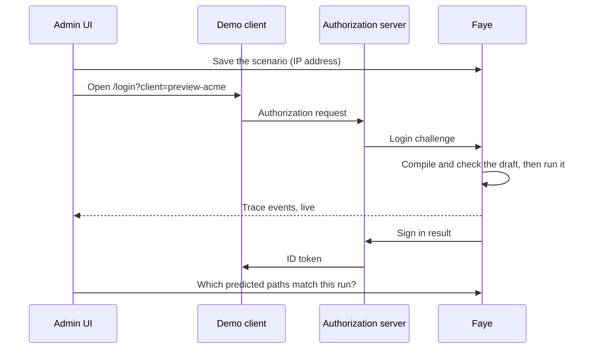

# Preview a draft

A preview runs the tenant's draft, not the live version, through a real OAuth client. You sign in as a person does, and you watch each step of the run as it happens. Then you see whether the run ended the way that the checker predicted. This page is for flow authors who want to try a change before they publish it. The design is in [ADR 0011](../adr/0011-m6-preview-loop.md).

> [!NOTE]
> This page writes keyboard shortcuts with `⌘`. On Windows and Linux, press `Ctrl` instead.

## How a preview works

Each tenant has a preview client, `preview-{tenant}`. The client is registered in the authorization server with `metadata.preview` set to `true`. When a sign in comes from that client, Faye runs the tenant's saved draft instead of the live version. Every other client keeps running the live version.

The sequence shows what happens when you select **Preview**.

In words:

1. The console saves the scenario's IP address on the server, then opens the demo client with the tenant's preview client.
2. The demo client sends an authorization request to the authorization server. The authorization server passes the sign in to Faye.
3. Faye compiles the draft and checks it under the tenant's settings. If the draft passes, Faye runs it. If the draft does not compile or fails the checker, Faye refuses the sign in.
4. The Login UI shows the draft's screens in the preview window. Faye sends each step of the run to the console as a trace event.
5. When the run ends, the console asks the server which of the checker's paths match the run, and shows the result.

If the flow asks for consent, the consent steps run on the same draft version as the sign in.

## Before you start

You need four things:

- **Previews on.** The Faye server must run with `FAYE_PREVIEW_ENABLED=true`. Without this setting, the **Preview** tab says "Previews are disabled on this server", and Faye refuses every preview client. The image turns previews on when it runs the demo (`FAYE_DEMO=true`). `deploy/dev.sh` also turns previews on.
- **A preview client.** The authorization server must have a client `preview-{tenant}` with `metadata.preview: true` and `metadata.tenant` set to the tenant. In the local stack, `deploy/bootstrap.mjs` registers `preview-acme` and `preview-bank`.
- **The demo client.** The console opens the demo client at `DEMO_CLIENT_URL`, which is http://localhost:3001 by default.
- **A saved draft with no errors.** The console saves the draft as you edit, and the server checks the draft. While the draft cannot run, the **Preview** button shows why instead of its name: **Checking…**, **Saving the draft…**, **Draft not saved**, or the number of errors to fix.

## Set up the scenario

Open the **Login flow** page and select the **Preview** tab. The tab holds the scenario: who signs in, and what the client asks for.

### Account

| Control | What it does |
|---|---|
| **Who**: **Anyone** | No account is created. You type any identifier on the first screen. |
| **Who**: **New user** | Creates a new preview account in the tenant's user pool, and passes its identifier to the demo client as `login_hint`. |
| **Identifier** | The new account's email. Select the copy button to copy it. |
| **Password** | The new account's password. The password is hidden until you hold the pointer over it or give it focus. Select the copy button to copy it. |

A preview account signs in only through a preview client, and only for the tenant that it was made for. No production client can use a preview account.

### Request

| Control | What it does |
|---|---|
| **acr_values** | The sign in level that the client asks for: none, `faye:1fa` or `faye:2fa`. |
| **prompt** | **login** by default, so a remembered session never skips the draft. Also **consent**, or none. |
| **IP address** | Replaces `request.ip` for the tenant's preview runs. Leave it empty to use the browser's address. |
| **High risk** | Sets the IP address to `203.0.113.7`, which the local `ip-reputation` service scores as high risk. Use this control to try the risk hook of the `acme` tenant. |

### Authenticator

| Control | What it does |
|---|---|
| **With TOTP** | Creates a new account that already has an authenticator app enrolled. Available only with **New user**. Each time you turn it on or off, the console creates a new account. |
| **Secret** | The time based one time password (TOTP) secret. With **With TOTP** on, the console fills it in. Otherwise, paste the secret that the **Enroll TOTP** screen shows. The current 6 digit code appears under the secret, with the seconds that the code has left and a copy button. |

### Window

Choose where the demo client opens: **Popup** or **New tab**. The console remembers the choice in this browser.

The console keeps the scenario in this browser tab, so the scenario stays when you reload the page. Select **Reset scenario** in the toolbar to clear the scenario.

## Run a preview

These steps try a change to the `acme` flow with a new account and a high risk address.

### 1. Fix the draft's errors

Check the status bar. If the status bar shows errors, fix them first. See [Read the status bar](flow-editor.md#read-the-status-bar-and-the-problems-list).

### 2. Open the Preview tab

Select **Preview** in the editor. The toolbar shows **Following trace** once the console receives the tenant's trace.

### 3. Choose who signs in

Under **Account**, select **New user**. If the flow asks for a second factor, turn on **With TOTP**.

### 4. Set the request

Under **Request**, choose `faye:2fa` in **acr_values** if you want to test a client that asks for two factors. Turn on **High risk** to make the risk hook score the sign in as high.

### 5. Select Preview

Select **Preview** in the toolbar. The button shows **Opening…**, then **Previewing…** while the run is in progress. The demo client opens in the window you chose, with the preview client, the account's identifier, `acr_values` and `prompt`. If you select the button again during a run, the preview starts again.

### 6. Sign in in the preview window

Answer the screens as a person would. Paste the identifier and password from the **Account** section. For an authenticator app code, copy the code from **Authenticator**. For a code sent by email or text message, read the code where your deployment delivers codes.

### 7. Follow the trace

Watch the **Trace** section and the blocks. See [Read the trace](#read-the-trace).

### 8. Read the result

When the run ends, the **Trace** section shows how the run ended and whether this result matches a predicted path. See [Check the run against the paths](#check-the-run-against-the-paths). The demo client also shows a **Preview run** card. See [The demo client's Preview run card](#the-demo-clients-preview-run-card).

## Read the trace

The badge in the toolbar shows the state of the trace feed: **Following trace**, **Connecting…** or **Trace disconnected**.

The **Trace** section lists the run's events as they happen. Its first line shows when the run started, the flow id with a copy button, how long the run took, and how many events it has. Each row shows the time, the event kind, the event's details, and the time since the previous event. While the run waits for the person, the last line reads "Waiting for input in the preview window".

| Event | What it means | Details |
|---|---|---|
| `start` | An entry began. | The entry, `login` or `consent`, and the start of the version hash. |
| `step` | A step began. | The step id. |
| `option` | A **Choose** chose an option. | The option id, and who chose: `only` (the only enabled option), `user`, or `hook`. |
| `screen` | The run shows a screen and waits. | The screen type, or `issuer_error` if Faye could not prepare the screen. |
| `call` | A handler ran. | The handler, `ok` or the error code, and the amr (authentication methods references) that it proved. |
| `hook` | A hook ran. | The hook id, and `ok` or the failure reason. |
| `retry` | The engine retries a failure. | The error that the engine retries. |
| `commit` | A write after a successful sign in failed. | The handler and the error code. |
| `end` | The entry ended. | `succeed` or the failure reason. A successful sign in also shows its amr and acr (authentication context class reference). |

Events carry ids and codes. They never carry what the person typed.

While the trace runs, the **Blocks** tab marks the blocks that the run went through and dims the others. The block that waits on a screen pulses and shows **waiting on screen**. The graph marks the same blocks, and the graph's badge says **preview run**. If you select a path in the **Paths** tab, that path is highlighted instead.

If the sign in succeeds and the flow asks for consent, the consent run appears in the same trace, under a **Consent** divider.

## Check the run against the paths

When the run ends, the console compares the run with the paths that the checker listed for the draft. A box under the trace shows how the run ended: a green check and the amr and acr, or a red cross and the failure reason. When the run had a consent part, there is one box for **Sign in** and one for **Consent**. Each box then says one of these:

| Message | Meaning |
|---|---|
| **Comparing with enumerated paths…** | The console is asking the server. |
| **Matches path** and the path | The run made the same choices as one enumerated path and ended the same way. The checker and the engine agree. |
| **Expected** an outcome **for this path.** | The run made the same choices as an enumerated path, but ended differently. |
| **Matches no enumerated path: the engine and the checker disagree.** | No enumerated path makes the choices this run made. |

The last two messages, in red, mean that the checker's prediction and the engine's run differ. Treat this difference as a bug, and report it with the flow and the trace.

> [!NOTE]
> The server lists the expected paths under the tenant's settings at the time that the console asks. It does not use the settings from the time of the run. If you change the tenant's settings between the run and its result, a correct run can show as a mismatch ([ADR 0011](../adr/0011-m6-preview-loop.md)).

## The demo client's Preview run card

After a preview sign in, the demo client shows the **Signed in** card and a **Preview run** card. The ID token of a preview client carries one extra claim, `faye_flow_id`. The demo client uses this claim to find the run. The tokens of production clients do not have this claim.

The **Preview run** card shows:

- The tenant, and whether the run used the draft or a published version, with the version's hash.
- **Token matches the predicted path** when the token's `amr` and `acr` match a path that the checker predicted for the run. Otherwise **Token does not match any predicted path**, with the predicted outcomes.
- The `amr` and `acr` from the ID token, and the run's events.

If the card says **Preview run not found**, the trace has expired. A run's trace expires with its flow, 30 minutes after it started.

## Next steps

- [Edit and publish a flow](flow-editor.md): publish the draft after the preview gives the result that you expect.
- [Hooks](../flows/hooks.md): the risk hook that **High risk** tests.
- [Admin UI overview](overview.md)
