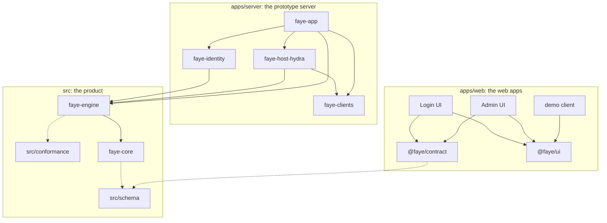

# Read the codebase

This page is a guided tour of the repository for new contributors, human or agent. It shows how the modules depend on each other, which file to open first in each folder, and an order for reading them. It ends with the rules that every change follows. [AGENTS.md](../../AGENTS.md) holds the same layout in short form.

## Product and prototype

The repository holds two things ([ADR 0034](../adr/0034-two-shippable-modules-under-src.md)):

- **The product** lives in `src/`. It is two Java libraries, `faye-core` and `faye-engine`, plus the schemas and the conformance suite. Flows compile to an intermediate representation (IR), which the engine runs. A host embeds these libraries. This build has the strictest gates: all Error Prone checks, NullAway, published sources and javadoc, reproducible jars and coverage floors.
- **The prototype** lives in `apps/`. It is a Spring Boot server, its adapters, and three web apps. It shows the product working with Ory Hydra, and it is what the Docker image runs.

A host integrates Faye by implementing the interfaces in `faye.engine.spi`. The product knows no host. `BoundaryTest` fails the build if code under `src/` names an authorization server, or if its build references anything in `apps/`, a host library or a credential library ([ADR 0025](../adr/0025-host-neutral-boundaries-for-embedding.md)).

## How the modules depend on each other

The diagram shows the build dependencies between modules. A solid arrow means "depends on". A dotted arrow means "reads" or "is generated from".

In words:

- `faye-engine` depends on `faye-core`. `faye-core` ships `ir.schema.json` on its classpath to validate the IR.
- `faye-engine` runs the conformance suite in `src/conformance` as part of its tests.
- In the prototype, `faye-identity` and `faye-host-hydra` implement interfaces of `faye-engine`. `faye-host-hydra` also implements `ClientDirectory` from `faye-clients`.
- `faye-app` wires everything together. It also uses `MockFlowHost` from the test fixtures of `faye-engine` when no Hydra is configured.
- `@faye/contract` holds TypeScript types generated from the schemas. The Login UI and the Admin UI use them.

At run time, the apps talk over HTTP. The Login UI calls the server's screen API. The Admin UI calls the server's admin API over a Unix socket ([ADR 0028](../adr/0028-admin-api-on-a-unix-domain-socket.md)). The demo client talks only to Hydra.

## The folders and what to read first

Every file in the "Read first" column exists at the path shown.

| Folder | What it holds | Read first |
|---|---|---|
| `src/schema` | The IR grammar and the screen protocol, as JSON Schema. The source of truth for Java and TypeScript. | [`ir.schema.json`](../../src/schema/ir.schema.json), [`screen.schema.json`](../../src/schema/screen.schema.json) |
| `src/conformance` | Engine test vectors that any engine implementation must pass. | [`README.md`](../../src/conformance/README.md), [`vectors/password-retry.yaml`](../../src/conformance/vectors/password-retry.yaml) |
| `src/faye-core` | `faye.ir` (IR node types and JSON codec), `faye.dsl` (YAML to IR compiler), `faye.hooks` (the JavaScript sandbox). | [`Node.java`](../../src/faye-core/src/main/java/faye/ir/Node.java), [`FlowCompiler.java`](../../src/faye-core/src/main/java/faye/dsl/FlowCompiler.java), [`HookRuntime.java`](../../src/faye-core/src/main/java/faye/hooks/HookRuntime.java) |
| `src/faye-engine` | The interpreter, the host interfaces (`spi`), the checker, the built in screens, handlers and blocks. | [`FlowHost.java`](../../src/faye-engine/src/main/java/faye/engine/spi/FlowHost.java), [`Engine.java`](../../src/faye-engine/src/main/java/faye/engine/Engine.java), [`Checker.java`](../../src/faye-engine/src/main/java/faye/check/Checker.java), [`BuiltinBlock.java`](../../src/faye-engine/src/main/java/faye/handlers/BuiltinBlock.java) |
| `src/build-logic` | The Gradle convention plugins that both builds share. | [`faye.java-conventions.gradle.kts`](../../src/build-logic/src/main/kotlin/faye.java-conventions.gradle.kts) |
| `apps/server/faye-identity` | The credential adapters over a user store: passwords (Argon2), authenticator apps (TOTP) and passkeys. | [`LocalCredentials.java`](../../apps/server/faye-identity/src/main/java/faye/identity/LocalCredentials.java) |
| `apps/server/faye-clients` | A read only view of the authorization server's clients, for the Admin UI. | [`ClientDirectory.java`](../../apps/server/faye-clients/src/main/java/faye/clients/ClientDirectory.java) |
| `apps/server/faye-host-hydra` | The host for Ory Hydra: maps login and consent challenges to the engine and back. | [`HydraFlowHost.java`](../../apps/server/faye-host-hydra/src/main/java/faye/host/hydra/HydraFlowHost.java) |
| `apps/server/faye-app` | Spring Boot wiring, the screen API, the admin API, the preview API, the SQLite stores and the shipped tenants. | [`EngineConfiguration.java`](../../apps/server/faye-app/src/main/java/faye/app/EngineConfiguration.java), [`FlowController.java`](../../apps/server/faye-app/src/main/java/faye/app/FlowController.java), [`application.yaml`](../../apps/server/faye-app/src/main/resources/application.yaml) |
| `apps/web/packages/contract` | TypeScript types generated from `src/schema`. Never edit them by hand. | [`screen.ts`](../../apps/web/packages/contract/src/screen.ts) |
| `apps/web/packages/ui` | Shared components and the theme. `login-theme.css` is the palette of the sign in screens. | [`login-theme.css`](../../apps/web/packages/ui/src/login-theme.css), [`brand-style.ts`](../../apps/web/packages/ui/src/lib/brand-style.ts) |
| `apps/web/apps/login` | The Login UI: renders each typed screen. | [`flow-page.tsx`](../../apps/web/apps/login/app/flow-page.tsx), [`flow-screen.tsx`](../../apps/web/apps/login/app/flow-screen.tsx) |
| `apps/web/apps/admin` | The Admin UI and the docs site at `/docs`. | [`lib/faye.ts`](../../apps/web/apps/admin/lib/faye.ts), [`lib/flow.ts`](../../apps/web/apps/admin/lib/flow.ts) |
| `apps/web/apps/demo-client` | The OpenID Connect application that signs in through Hydra. | [`lib/oidc.ts`](../../apps/web/apps/demo-client/lib/oidc.ts) |
| `deploy` | The compose file, the image's service tree, the seed, the client registrations and the test scripts. | [`dev.sh`](../../deploy/dev.sh), [`compose.yaml`](../../deploy/compose.yaml), [`image/scripts/init`](../../deploy/image/scripts/init) |
| `docs` | These docs, the IR specification and the decision records. | [`ir-spec.md`](../ir-spec.md), [`adr/README.md`](../adr/README.md) |
| `brand` | The Faye logo and icon. A script writes every output. | [`generate.py`](../../brand/generate.py) |

## A reading order

Read in this order. Each step builds on the one before it.

1. **[CHARTER.md](../../CHARTER.md).** Read the mission, the non goals and the principles. When two principles conflict, the earlier one wins. Every later decision points back here.
2. **[AGENTS.md](../../AGENTS.md).** Read the layout, the commands and the rules. Note the line between the product in `src/` and the prototype in `apps/`.
3. **[The IR specification](../ir-spec.md).** Read what each IR form means and how the engine must run it. Look for how a screen suspends a flow and how a failure finds its retry.
4. **[The schemas](../../src/schema/).** Open `ir.schema.json` and `screen.schema.json`. Look for the closed set of node types and the closed set of screen types.
5. **[The conformance suite](../../src/conformance/README.md).** Read the format, then one vector, such as `vectors/password-retry.yaml`, beside its flow `flows/password-only.json`. A vector scripts each handler outcome and checks each screen.
6. **`faye.ir` in `faye-core`.** Read [`Node.java`](../../src/faye-core/src/main/java/faye/ir/Node.java) and [`IrCodec.java`](../../src/faye-core/src/main/java/faye/ir/IrCodec.java). Look for the sealed node types and the limits the reader enforces.
7. **`faye.dsl` in `faye-core`.** Read [`FlowCompiler.java`](../../src/faye-core/src/main/java/faye/dsl/FlowCompiler.java) with a shipped flow such as [`password-only.yaml`](../../apps/server/faye-app/src/main/resources/flows/password-only.yaml). Look for how a step becomes `step`, `retry`, `screen` and `call` nodes.
8. **The host interfaces and the engine.** Read [`FlowHost.java`](../../src/faye-engine/src/main/java/faye/engine/spi/FlowHost.java), then `start`, `view`, `submit` and `act` in [`Engine.java`](../../src/faye-engine/src/main/java/faye/engine/Engine.java). Look for the continuation stack, the nonce and the compare and set save in [`FlowState.java`](../../src/faye-engine/src/main/java/faye/engine/FlowState.java).
9. **The checker, the blocks and the screens.** Read [`Checker.java`](../../src/faye-engine/src/main/java/faye/check/Checker.java) and [`Publisher.java`](../../src/faye-engine/src/main/java/faye/check/Publisher.java), then [`BuiltinBlock.java`](../../src/faye-engine/src/main/java/faye/handlers/BuiltinBlock.java) and [`BuiltinScreen.java`](../../src/faye-engine/src/main/java/faye/screens/BuiltinScreen.java). Look for how a path that succeeds without a credential is refused before it runs.
10. **The prototype server.** Read [`EngineConfiguration.java`](../../apps/server/faye-app/src/main/java/faye/app/EngineConfiguration.java), [`FlowController.java`](../../apps/server/faye-app/src/main/java/faye/app/FlowController.java) and [`HydraFlowHost.java`](../../apps/server/faye-host-hydra/src/main/java/faye/host/hydra/HydraFlowHost.java). Then read the tenants in [`application.yaml`](../../apps/server/faye-app/src/main/resources/application.yaml) and their flow [`acme.yaml`](../../apps/server/faye-app/src/main/resources/flows/acme.yaml).
11. **The web apps.** Read [`flow-page.tsx`](../../apps/web/apps/login/app/flow-page.tsx) and [`flow-screen.tsx`](../../apps/web/apps/login/app/flow-screen.tsx) in the Login UI. Look for how the UI renders only what the screen response says. Then read [`lib/faye.ts`](../../apps/web/apps/admin/lib/faye.ts) in the Admin UI, which calls the admin API over its socket.
12. **The deployment and the decisions behind it.** Read [`dev.sh`](../../deploy/dev.sh), the [Dockerfile](../../Dockerfile) and [`image/scripts/init`](../../deploy/image/scripts/init). Then read ADRs [0017](../adr/0017-one-sqlite-database.md), [0023](../adr/0023-one-container-many-processes.md), [0024](../adr/0024-core-ir-as-a-narrow-waist.md), [0025](../adr/0025-host-neutral-boundaries-for-embedding.md) and [0034](../adr/0034-two-shippable-modules-under-src.md).

## The rules every change follows

These rules come from [AGENTS.md](../../AGENTS.md). CI and the build enforce most of them.

1. **Schema first.** To change the IR or the screen protocol, change `src/schema/` first. Then change the Java types, the generated TypeScript (`pnpm generate`), [the IR specification](../ir-spec.md) and the conformance vectors in the same change. A change to what the IR means bumps the IR format ([ADR 0024](../adr/0024-core-ir-as-a-narrow-waist.md)).
2. **Conformance vectors.** A change to engine behavior needs a conformance vector, not only a Java unit test. Every scripted handler outcome in a vector must be used. Regenerate `src/conformance/generated/`; never edit it by hand. A new parser, handler, screen type, IR form, host or store also needs a fuzz harness ([ADR 0007](../adr/0007-fuzz-and-adversarial-testing.md)).
3. **The engine never imports Hydra.** Everything specific to an authorization server stays behind `FlowHost`.
4. **Hooks are closed.** A hook may only set values, fail a step or pick among declared options. It can never complete a sign in. The engine computes `amr` and `acr` from credentials that verified; nothing configures them.
5. **Safety checks live only in Java.** The web apps call the server. They never copy its rules.
6. **Screens are typed templates.** To show something new, add a screen type to the protocol. Do not render free form UI. See [Sign in screens](../reference/screens.md).
7. **No binaries in the repository.** Tools are downloaded on demand into git ignored folders, such as `deploy/.bin/`, with versions pinned by checksum or image digest.
8. **No warnings.** Java compiles with `-Werror`, and web lint runs with `--max-warnings 0`. Fix a warning; do not suppress it. Java layout is whatever `./gradlew spotlessApply` produces, and Checkstyle fails the build on any violation ([ADR 0003](../adr/0003-enforce-java-format-and-lint-in-the-build.md)).
9. **Null safety.** Every Java package has a `package-info.java` marked `@NullMarked`. Types are non null unless marked `@Nullable`, and NullAway checks this at compile time ([ADR 0002](../adr/0002-enforce-null-safety-with-jspecify-and-nullaway.md)).

## Where decisions live

- **[CHARTER.md](../../CHARTER.md)** sets the mission, the non goals and the principles. If a task or a record conflicts with the charter, the charter wins. Only a human changes it, through a decision record.
- **[Decision records](../adr/README.md)** in `docs/adr/` record each breaking change in the MADR 4 format (Markdown Architectural Decision Records): a change to a boundary, the charter, the IR, the screen protocol, persisted state or a public contract. Other changes need no record.
- **[ADR 0036](../adr/0036-retire-the-roadmap.md)** holds the founding decisions D1 to D13 and the work that is still open.

Read the record behind a boundary before you change that boundary.

## Next steps

- [Build and run from source](build-from-source.md): run the stack and every check.
- [How the engine works](../understand/engine.md): the interpreter, step by step.
- [Architecture](../understand/architecture.md): how the processes fit together at run time.
- [Write the docs](write-docs.md): the style guide for these pages.
