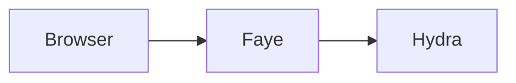

# Write the docs

Faye's docs are plain Markdown files in the `docs/` folder of the repository. GitHub shows them as they are. The Admin UI shows the same files as a docs site at `/docs`, built with [Fumadocs](https://fumadocs.dev), an open source docs framework.

This page is the style guide. Follow it when you add or change a page.

## Who reads the docs

Write for three readers at once:

- **The integrating engineer.** This person deploys Faye next to an authorization server and owns sign in for a product. They want facts, commands and limits.
- **The flow author.** This person builds flows in the Admin UI. They may not be an engineer. They want to know what each control does and why the checker says no.
- **An AI agent.** Agents read the Markdown, often one page at a time. They need each page to make sense on its own.

Many readers do not speak English as a first language. Many use a translation tool. Plain English helps all of them.

## Write plain English

1. Put one idea in each sentence. Aim for 20 words or fewer.
2. Use the active voice and talk to the reader as "you". Write "The checker refuses the flow", not "The flow is refused by the checker".
3. Use the present tense. Write "Faye shows the screen", not "Faye will show the screen".
4. Use one word for one thing, every time. If a page says "flow", it never says "journey" or "pipeline" for the same thing. The [glossary](../reference/glossary.md) lists the words we use.
5. Spell out a short form the first time a page uses it: "intermediate representation (IR)".
6. Keep "that" in clauses: "the rules that the checker applies", not "the rules the checker applies".
7. Do not stack more than two nouns before a noun. Write "the request that publishes a version", not "the version publish request".
8. Make each "it" and "this" point to one clear thing. If in doubt, repeat the noun.
9. Do not use idioms, jokes or cultural references.
10. Do not use words that judge difficulty: simply, just, easy, obviously, of course.
11. Put a condition before the instruction: "If the build fails, run `make clean`."
12. Do not write "above" or "below". Link to the section instead.
13. Write dates as `YYYY-MM-DD`.
14. Do not use a dash to join two sentences. Use two sentences.
15. Never claim what the code does not do. If something is planned, say "planned" and link the record that tracks it.

## What we learned from frontier docs

Before writing these docs, we studied how other developer products write theirs. This table lists what we took from each, and where you see it on this site.

| Source | What they do | What this site does |
|---|---|---|
| [Diátaxis](https://diataxis.fr), used by Canonical, Cloudflare and others | Separate tutorials, how to guides, explanation and reference | Each page is one kind, listed in [Shape each page](#shape-each-page) |
| [Google developer documentation style guide](https://developers.google.com/style/translation) | Write for a global audience: short sentences, one term per idea, no idioms, condition before instruction | The rules in [Write plain English](#write-plain-english) |
| [Anthropic's Claude docs](https://docs.claude.com/llms.txt), [Stripe](https://docs.stripe.com/building-with-llms), [Vercel](https://vercel.com/docs/agent-resources) | An `llms.txt` index, every page as Markdown, and a way to copy a page or open it in an AI assistant | `/llms.txt`, `/llms-full.txt`, `.md` URLs, **Copy Markdown** and the **Open** menu |
| [The llms.txt proposal](https://llmstxt.org) | A Markdown index with a summary, then sections of links, and an "Optional" section | The shape of `/llms.txt`; decision records sit under Optional |
| [OpenAI](https://developers.openai.com/api/docs) and [Claude](https://platform.claude.com/docs/en/intro) docs | Open with what the product is and a recommended path, then a quickstart with steps and next steps | [What is Faye?](../index.md) and the [Quickstart](../start/quickstart.md) |
| [Devin's DeepWiki](https://cognition.ai/blog/deepwiki) | An AI that has read a public repository and answers questions about it | The **Ask Devin** button |
| [Ory's docs](https://github.com/ory/docs) | Mermaid sequence diagrams for OAuth2 login and consent | The sequence diagrams in [Architecture](../understand/architecture.md) and [How the engine works](../understand/engine.md) |

We also chose what not to copy. Many docs sites offer "Open in ChatGPT" with the page's own URL. Faye's docs usually run on your own machine, where an AI assistant cannot read them. So the **Open** menu hands the assistant the page's public copy on GitHub instead.

## Shape each page

Every page has the same parts, in this order:

1. **Front matter** with a one sentence `description`. The docs site shows it under the title, the search uses it, and `/llms.txt` lists it.
2. **One `#` title.** Use sentence case: "Write your first flow", not "Write Your First Flow".
3. **An opening paragraph** that says what the page is for and who it is for.
4. **Sections** with `##` and `###` headings. The docs site builds the "On this page" list from them.
5. **Next steps**, when there is a clear next page for the reader.

Pick one kind of page and stay with it:

| Kind | Answers | Example |
|---|---|---|
| Tutorial | "Teach me, step by step." | [Write your first flow](../flows/first-flow.md) |
| How to guide | "How do I do this one task?" | [Preview a draft](../console/preview.md) |
| Explanation | "Why is it like this?" | [How the engine works](../understand/engine.md) |
| Reference | "What exactly is allowed?" | [Flow DSL reference](../reference/dsl.md) |

## Give each fact one home

Each fact lives on one page. Other pages give a one line summary and link to that page. When a fact changes, you then change one page, and no two pages can disagree.

- Reference tables, such as every key of a flow file, live in the [Flow DSL reference](../reference/dsl.md). Guides link to its sections.
- The meaning of the IR lives in the [Core IR specification](../ir-spec.md). Other pages explain it and link to it.
- Settings and environment variables live in [Configuration](../reference/configuration.md).
- Words live in the [Glossary](../reference/glossary.md).

Keep a guide or an explanation under about 3,000 words. If one grows past that, split it. Reference pages, such as the DSL reference and the IR specification, may be longer: a reader looks things up in them, and one page keeps search and links simple.

## Use these Markdown features

The docs use only Markdown that GitHub also understands. The docs site adds a better look on top.

### Callouts

Use GitHub's alert syntax. The docs site shows each one as a callout box.

```markdown
> [!NOTE]
> Extra facts that are good to know.

> [!TIP]
> A faster or better way to do something.

> [!IMPORTANT]
> Something the reader must do or know to succeed.

> [!WARNING]
> Something that can break or lose data.

> [!CAUTION]
> Something that weakens security.
```

Use at most two callouts in a section. On a page with many boxes, the reader misses the important one.

### Steps

Number the headings of a procedure. The docs site shows them as steps. GitHub shows numbered headings.

```markdown
## Run the stack

### 1. Build the image

Run `make up`.

### 2. Open the demo client

Open http://localhost:3001.
```

### Diagrams

Draw diagrams in [Mermaid](https://mermaid.js.org). Mermaid is text. So you can review a diagram in a diff, a translation tool can translate it, and an agent can read it.

````markdown

````

Rules for diagrams:

- Put a sentence before each diagram that says what it shows.
- Say the important facts in the text too. A reader with a screen reader, or an agent, may not see the picture.
- Keep labels short. Use the same words as the text.
- Prefer `flowchart` for structure and `sequenceDiagram` for requests over time.

### Code

Give each code block a language: `yaml`, `json`, `js`, `bash`, `java`. Copy flows from real files when you can, and name the file.

### Links

Link to other docs with relative paths to the `.md` file: `[Hooks](../flows/hooks.md)`. Link to code with a relative path from the docs folder: `[FlowCompiler](../../src/faye-core/src/main/java/faye/dsl/FlowCompiler.java)`. The docs site opens code links on GitHub.

## Add a page to the sidebar

The sidebar order lives in `docs/nav.yaml`. Add the page's path to the right section. A section with `dir` lists every file in that folder, with its `README.md` first.

## Check your change

- Read the page out loud. If you need to stop for breath in the middle of a sentence, split the sentence.
- Run the admin tests: `cd apps/web && pnpm --filter @faye/admin test`. One test checks that every page in `nav.yaml` exists and that every link between docs works.
- Open the page in the Admin UI at http://localhost:3002/docs and look at it in light and dark mode.

## Features for agents

The docs site gives agents the same text people read:

- Every page has a Markdown version at its URL plus `.md`, for example `/docs/flows/hooks.md`.
- `/llms.txt` lists every page with a one line summary, following [llmstxt.org](https://llmstxt.org).
- `/llms-full.txt` holds every page in one file.
- Each page has **Copy Markdown**, an **Open** menu (GitHub, Markdown, Scira AI, ChatGPT, Claude, Cursor), and **Ask Devin**, which opens [DeepWiki](https://deepwiki.com/jwuxan/faye) for this repository.

Because the Admin UI runs on your own machine, the **Open** menu gives AI assistants the page's public GitHub copy, not the local URL.
