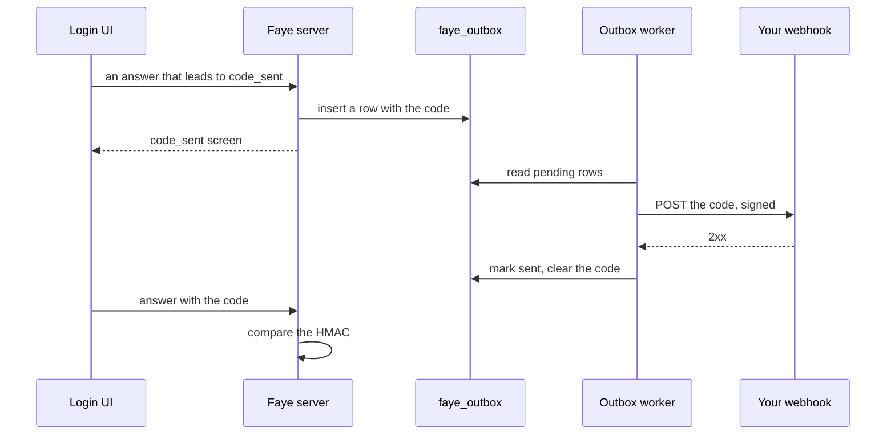

# Send codes by email and text message

Faye can send a six digit code to a person's verified email address or phone, and accept that code as a credential. This page explains the three blocks that use delivered codes, how a code travels from the flow to your mail or text message provider, and how to build the webhook that receives each code. It also lists the limits on codes. This page is for flow authors who add codes to a flow, and for engineers who connect Faye to a provider.

Faye ships no mail client and no text message (SMS) client. Your own endpoint, a webhook, receives each code and hands it to your provider. The design is in [ADR 0032](../adr/0032-delivered-one-time-codes-and-qr-sign-in.md).

## The blocks

Three blocks use delivered codes:

| Block | Handler | Screen | What it does | amr |
|---|---|---|---|---|
| `email-code` | `email_code.verify` | `code_sent` | Sends a code to the account's verified email address, then checks the code. | `email` |
| `sms-code` | `sms_code.verify` | `code_sent` | Sends a code to the account's verified phone, then checks the code. | `sms` |
| `add-phone` | `phone.enroll` | `phone_enroll` | Asks the signed in person for a phone number, texts a code to it, and saves the number once the code matches. | none |

The destination of `email-code` and `sms-code` always comes from the account. It never comes from the answer, the flow or a hook. `add-phone` is the only block that takes a number from the person, because that number is what the person proves.

This is the login section of Acme's flow, from [`acme.yaml`](../../apps/server/faye-app/src/main/resources/flows/acme.yaml). It offers a password, an emailed code or a texted code, and then offers to add a phone:

```yaml
login:
  steps:
    identify:
      block: identifier
      after: risk
    credential:
      alternative:
        password:
          block: password
        email:
          if: user.email_verified
          block: email-code
        phone:
          if: user.has_phone
          block: sms-code
        # Scanned and approved on a phone, which runs the approve steps below
        qr:
          block: qr
    second-factor:
      if: { eq: [vars.risk, high] }
      alternative:
        totp:
          if: user.has_totp
          block: totp
        enroll:
          if: { not: user.has_totp }
          block: enroll-totp
    # Offered to people without phone codes; "Not now" skips it
    add-phone:
      if: { not: user.has_phone }
      block: add-phone
      with: { attempts: 1 }
    # Consent runs once the sign in is accepted, on the authorization server's consent challenge
    grant:
      if: { not: client.first_party }
      block: consent
```

Keep these facts in mind when you use the blocks:

- **Guard each option.** `user.email_verified` is true when the account's email address is verified. `user.has_phone` is true only when the account has a verified phone and the person turned on texted codes.
- **An emailed code is one factor only.** An emailed code alone, or a password and an emailed code, give `faye:1fa`. A texted code counts as possession, so a password and a texted code give `faye:2fa`. See [How amr and acr are computed](../understand/engine.md#how-amr-and-acr-are-computed).
- **`add-phone` needs a signed in person.** Put it after a credential. The person can answer **Not now**, unless the step sets `with: { required: true }` ([ADR 0038](../adr/0038-required-enrollment.md)). Faye saves the number, and turns on texted codes, only when the sign in succeeds.
- **Attempts.** Each block allows three attempts by default. Set `with: { attempts: N }` to change this.

[Sign in screens](../reference/screens.md#the-screens) shows what the person sees on `code_sent` and `phone_enroll`.

## How a code reaches the person

Faye never sends a code while the person waits for a screen. The screen writes the code to an outbox table, and a separate worker delivers it. So a slow provider never slows a sign in.

This diagram shows one emailed code, from the answer that leads to `code_sent` to the check of the code.



These are the steps:

1. **Issue.** When the flow reaches `code_sent`, Faye makes a six digit random code. The flow state keeps only a hash based message authentication code (HMAC SHA-256) of the flow id and the code, under the server key `FAYE_CODE_KEY`. The code is never in the screen, in a condition or in a hook.
2. **Queue.** In the same request, Faye writes the code to the `faye_outbox` table in the SQLite database.
3. **Deliver.** The outbox worker, [`OutboxWorker`](../../apps/server/faye-app/src/main/java/faye/app/OutboxWorker.java), runs once a second on its own thread. Each run hands at most 50 pending rows, oldest first, to their channel.
4. **Clear.** After a delivery succeeds, the worker marks the row `sent` and removes the code from it. Rows older than one day are deleted.
5. **Check.** When the person answers, the handler computes the HMAC of the answer and compares it with the stored HMAC in constant time.

The code stays in the database in plain form only until the worker delivers it or gives up.

## Set up a delivery channel

A tenant has two channels: `email` and `sms`. Faye picks the delivery of each channel in this order:

1. **The tenant's webhook** for that channel, `faye.tenants.<id>.delivery.email` or `.sms`.
2. **The outbox folder**, `FAYE_DEMO_OUTBOX`, when it is not empty. Faye writes each code to a file instead of sending it. The demo uses this folder.
3. **Nothing.** The channel is off.

When a channel is off, the tenant's flows cannot use its blocks. Without `email`, a flow cannot use `email-code`. Without `sms`, a flow cannot use `sms-code` or `add-phone`. The server refuses to publish such a flow, for example with `handler 'sms_code.verify' is not enabled for this tenant`. The flow editor shows these blocks as disabled.

This configuration gives the tenant `bank` a webhook for each channel:

```yaml
faye:
  tenants:
    bank:
      delivery:
        email: { url: https://mail-relay.example/faye, secret: "${FAYE_BANK_EMAIL_SECRET}" }
        sms: { url: https://sms-relay.example/faye, secret: "${FAYE_BANK_SMS_SECRET}", per-hour: 100 }
```

The keys `url`, `secret` and `per-hour` are described in [Configuration](../reference/configuration.md#keys-of-a-tenant). The `url` must be `https`, or `http` to a loopback address. If it is not, the server does not start.

## The webhook request

For each code, the worker sends one request, built in [`CodeDelivery`](../../apps/server/faye-app/src/main/java/faye/app/CodeDelivery.java):

```http
POST /faye HTTP/1.1
Host: mail-relay.example
Content-Type: application/json
Faye-Signature: t=1793548800,v1=5f0c9a...

{"channel":"email","to":"ada@example.com","code":"482913","tenant":"bank"}
```

The JSON body has four fields, in this order:

| Field | Meaning |
|---|---|
| `channel` | `email` or `sms`. |
| `to` | The email address, or the phone number in E.164 format, such as `+15551234567`. |
| `code` | The six digit code, as a string. |
| `tenant` | The tenant id. |

The body has no language field. Faye does not know the person's language when it sends a code.

### What counts as delivered

- **Success.** Any `2xx` status. Faye ignores the response body.
- **Failure.** Any other status, a connection error, or no answer in time. Faye does not follow redirects, so a `3xx` status is a failure.
- **Time limits.** Faye waits at most 5 seconds to connect, and at most 5 seconds for the response.
- **Retries.** Faye tries each code at most 3 times. The worker retries a failed code on its next run, about one second later. After the third failure, Faye marks the row `failed`, removes the code and logs a warning. The log line has the channel and the tenant, never the code or the address.
- **Duplicates.** If several Faye processes share one database, each one drains the outbox. Your endpoint may then receive the same code twice. Faye never loses a code this way.

### Check the signature

The `Faye-Signature` header has the form `t=<timestamp>,v1=<signature>`:

- `t` is the time of the request, in seconds since 1970-01-01 UTC.
- `v1` is the lowercase hex HMAC SHA-256 of the text `<t>.<body>`, keyed with the webhook's `secret`. `<body>` is the raw request body, byte for byte.

Faye signs each attempt again, so a retry has a new `t`. To check a request, compute the HMAC over the raw body before you parse the JSON. Compare it in constant time. Also refuse a `t` that is too old, so that nobody can replay a request that they captured. Faye sets no tolerance. This example uses 5 minutes.

This Node.js endpoint checks each request and answers `204`:

```js
import { createHmac, timingSafeEqual } from "node:crypto";
import { createServer } from "node:http";

const secret = process.env.FAYE_EMAIL_SECRET;

// header: the Faye-Signature header; body: the raw request body as a Buffer
function verify(header, body, toleranceSeconds = 300) {
  const parts = Object.fromEntries(header.split(",").map((part) => part.split("=")));
  const t = Number(parts.t);
  if (!Number.isInteger(t) || typeof parts.v1 !== "string") return false;
  if (Math.abs(Date.now() / 1000 - t) > toleranceSeconds) return false;
  const expected = createHmac("sha256", secret).update(`${t}.`).update(body).digest();
  const given = Buffer.from(parts.v1, "hex");
  return given.length === expected.length && timingSafeEqual(given, expected);
}

createServer((req, res) => {
  const chunks = [];
  req.on("data", (chunk) => chunks.push(chunk));
  req.on("end", () => {
    const body = Buffer.concat(chunks);
    if (req.method !== "POST" || !verify(req.headers["faye-signature"] ?? "", body)) {
      res.writeHead(401).end();
      return;
    }
    const { channel, to, code, tenant } = JSON.parse(body);
    // Hand the code to your mail or SMS provider here. Never log the code.
    res.writeHead(204).end();
  });
}).listen(8090);
```

> [!CAUTION]
> Answer `2xx` only after your provider accepted the code. Faye treats a `2xx` as delivered and does not try again.

## Limits

Faye limits codes in two places. The values are fixed in code, except `per-hour`. They are not tenant settings.

On one `code_sent` screen, [`DeliveredCodes`](../../src/faye-engine/src/main/java/faye/handlers/DeliveredCodes.java) sets these limits:

| Limit | Value |
|---|---|
| Code length | 6 digits |
| How long a code is valid | 5 minutes |
| Wait before **Send a new code** | 30 seconds after the last send |
| Codes for one screen | 3, the first code included |

A wrong code fails with `invalid_code` and spends an attempt. The code that Faye sent stays valid, so the person can type it again. A code past its 5 minutes fails with `code_expired`, and the person can send a new code.

Across all flows, the outbox, [`SqliteCodeOutbox`](../../apps/server/faye-app/src/main/java/faye/app/SqliteCodeOutbox.java), sets these limits:

| Limit | Value |
|---|---|
| Codes to one address or number | 5 in the last hour, and 10 in the last 24 hours |
| Codes for one tenant on one channel | `per-hour` in the last hour, 100 by default |

Every outbox row counts toward these limits: a delivered code, a failed code, and a code that is never delivered. If a limit refuses a code, Faye sends nothing. A **Send a new code** that a limit refuses shows `send_limited`: "Too many codes were sent. Wait a moment, then try again."

## Unknown accounts

The code screen does not show whether an account exists. Suppose that a flow reaches `email-code` or `sms-code` for an address that has no account, or for an account without a verified destination. Faye then behaves as for a real account:

- It shows the same `code_sent` screen, with a masked address.
- It writes an outbox row, so the request costs the same and counts toward the same limits. The row has no code and no destination, and the worker never delivers it.
- It stores an HMAC that no code can match, so every answer fails with `invalid_code`.

For such a row, the limits count what the person typed. So an unknown address reaches a limit like a real one.

> [!NOTE]
> A condition runs before the block. `user.email_verified` and `user.has_phone` are not true for an unknown account. So an option with such a guard, like the ones in [`acme.yaml`](../../apps/server/faye-app/src/main/resources/flows/acme.yaml), is not offered to an unknown account. A step with `block: email-code` and no `if:` shows the code screen to every account that reaches it.

## Read codes in the demo

The demo stack has no webhook. Its tenants use the outbox folder, `/var/lib/faye/outbox` in the image. Faye writes one JSON file for each destination, such as `email-ada@example.com.json`. A new code for the same destination replaces the file. The file holds the same JSON as the webhook body.

To read every code in the outbox folder, run:

```bash
docker exec faye sh -c 'cat /var/lib/faye/outbox/*'
```

Without Docker, `dev.sh` writes the files to `deploy/.data/outbox/`. See [Where state lives](../reference/configuration.md#where-state-lives).

> [!WARNING]
> The outbox folder is for the demo and for tests. Codes in it are plain text and nobody receives them. In production, give each tenant a webhook for every channel that its flows use.

## Next steps

- [Flow recipes](recipes.md#email-or-text-message-code-instead-of-a-password): flows that use emailed and texted codes.
- [Sign in screens](../reference/screens.md#the-screens): the `code_sent` and `phone_enroll` screens.
- [Configuration](../reference/configuration.md#keys-of-a-tenant): the delivery keys of a tenant.
- [ADR 0032](../adr/0032-delivered-one-time-codes-and-qr-sign-in.md): the decision behind delivered codes and QR code sign in.
