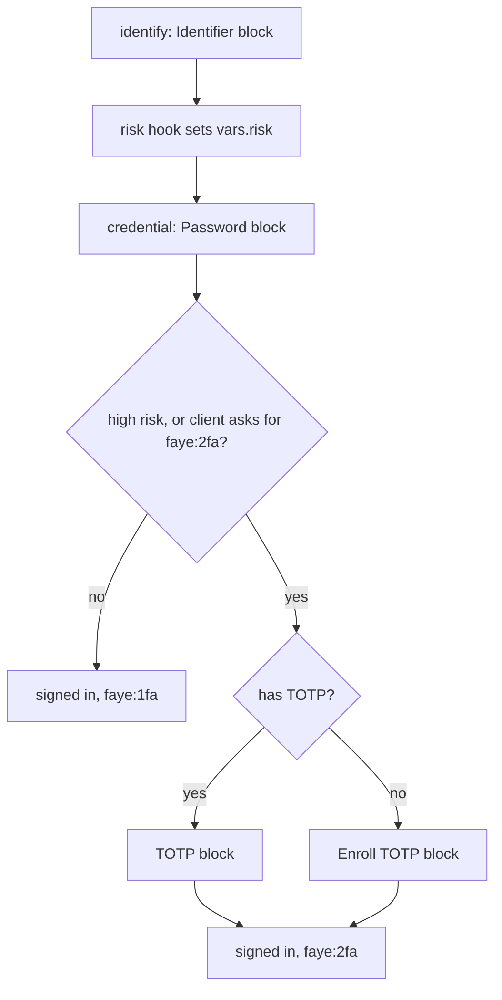

# Write your first flow

This tutorial is for flow authors. You build a sign in flow for the `acme` tenant in the Admin UI, one step at a time. First you build a flow with a password only. Then you watch the checker refuse an unsafe change, and you add a second factor. Last, you try the draft in a preview, publish it, and roll it back.

You write YAML in this tutorial, so you see exactly what the flow says. The Blocks tab edits the same flow without YAML. See [the flow editor](../console/flow-editor.md).

## Before you start

- Run the demo stack and open the Admin UI at http://localhost:3002. The [quickstart](../start/quickstart.md) shows how.
- The demo stack turns on previews (`FAYE_PREVIEW_ENABLED=true`). It also runs a stub, a small test version, of the IP reputation service. The `acme` tenant's risk hook calls this service. If you run Faye another way, the Preview tab says that previews are disabled.

> [!WARNING]
> Publishing changes how every person signs in to the `acme` tenant's applications. Do this tutorial on your own demo stack, not on a shared server. The last step puts the shipped flow back.

## What you build

The finished flow asks for an email address and a password. It asks for a second factor when a hook scores the sign in as high risk, or when the application asks for two factors. The diagram shows the steps in order.



## Build the flow

### 1. Open the Login flow

1. Open http://localhost:3002.
2. On **Choose a tenant**, select **acme**. The console opens the tenant's **Login flow** page.

The page has two halves. On the left are the tabs **Blocks**, **YAML**, **Paths**, **Settings** and **Preview**. On the right is the graph of the flow. The status bar at the bottom shows what the checker found, and how many paths the flow has.

Every change that you make goes into a draft. The draft saves itself, and the header says **Draft saved**. People keep signing in with the live version until you publish.

### 2. Read the shipped flow

Select the **YAML** tab. It shows the flow that the `acme` tenant ships with, from [`acme.yaml`](../../apps/server/faye-app/src/main/resources/flows/acme.yaml). Read it from the top:

- `flow` and `version` name the flow. The version is your own number. Faye identifies each published version by a hash of its content.
- `hooks` declares the `risk` hook. The hook's code is in `risk.js`, next to the flow file.
- `login.steps` lists the steps of a sign in, in the order they run. Each step has an id that you choose, such as `identify` or `credential`.
- Each step names a `block`, such as `identifier` or `password`. A block brings its own screen and the handler that checks the answer.
- `alternative` is a choice between options, such as a password or an emailed code.
- `if` is a condition. The step runs only when the condition is true.
- `approve` is the phone's side of QR code sign in.

Now select the **Paths** tab. The checker lists every path through the flow. Each row shows the path's entry, whether the path succeeds, and the `amr` and `acr` values that the path ends with. The shipped flow has thousands of paths, because it has many choices.

### 3. Start from a password only flow

In the **YAML** tab, select all the text and replace it with this flow:

```yaml
flow: acme
version: 2

login:
  steps:
    identify:
      block: identifier
    credential:
      block: password
```

This flow has two steps:

- `identify` shows the identifier screen and looks up the account. The Identifier block must be the first step, because every credential needs to know whose account it checks. The compiler refuses a flow that starts with any other step.
- `credential` shows the password screen and verifies the password. The Password block allows 3 attempts by default.

You do not write "sign the person in" at the end. The compiler ends every section with success. The engine accepts that success only if a credential verified.

The graph updates as you type. The status bar shows **1 warning**. Select it to open the Problems list:

```text
no path reaches faye:2fa; clients that request it in acr_values are refused
```

A warning does not stop you from publishing. It tells you that no person can reach two factors with this flow. You fix this problem in [step 6](#6-add-a-second-factor).

> [!NOTE]
> This flow has no consent step. Until you add one, Faye accepts every consent request without a screen, for every application, third party ones included. Add a consent step if third party applications must ask the person first. See [consent](flow-syntax.md#add-consent).

### 4. Read the paths

Select the **Paths** tab. The flow has 8 paths, and 3 of them succeed. Each successful path reads `identify › credential › succeed pwd`, with `amr` `pwd` and `acr` `faye:1fa`.

- `amr` lists the methods that verified. `pwd` means a password.
- `acr` is the level of assurance. One kind of factor gives `faye:1fa`. Two kinds of factor give `faye:2fa`.

The engine computes both values from the credentials that verified. You never write them in a flow.

There are 3 successful paths because the password may be right on the first, second or third attempt. The failing paths are the ways a sign in stops, for example three wrong passwords. Select a row to highlight its steps in the graph.

### 5. Make a mistake on purpose

Faye refuses any flow that has a path to success without a verified credential. To see this rule work, add a condition to the password step:

```yaml
flow: acme
version: 2

login:
  steps:
    identify:
      block: identifier
    credential:
      if: user.has_password
      block: password
```

The status bar now shows **1 error** beside the warning. The Problems list shows the message and its line:

```text
a path succeeds without verifying a credential: identify > credential > (condition at 9 false) > succeed with no credential
```

When you publish, the checker cannot know whether `user.has_password` is true. So the checker follows both ways. On the path where the condition is false, the person proves nothing, but the flow still reaches its end. The message names that path, step by step. It also points to line 9, where the condition is.

While the draft has errors, the **Publish** button is disabled. If you remove the `credential` step completely, you get the same error, with the path `identify > succeed with no credential`.

To fix the flow, delete the `if: user.has_password` line. The status bar goes back to **1 warning**.

> [!TIP]
> Select a message in the Problems list to jump to the line in the YAML tab, or to the block in the Blocks tab.

### 6. Add a second factor

Replace the flow with this version:

```yaml
flow: acme
version: 2

hooks:
  risk:
    file: risk.js
    capabilities: { http: [ip-reputation] }
    timeout_ms: 500

login:
  steps:
    identify:
      block: identifier
      after: risk
    credential:
      block: password
    second-factor:
      if:
        or:
          - { eq: [vars.risk, high] }
          - { has: [host.acr_values, "faye:2fa"] }
      alternative:
        totp:
          if: user.has_totp
          block: totp
        enroll:
          if: { not: user.has_totp }
          block: enroll-totp
```

Here is what each new part does:

- `hooks.risk` declares the risk hook. Its code, [`risk.js`](../../apps/server/faye-app/src/main/resources/flows/risk.js), asks the `ip-reputation` service to score the request. `capabilities` lets the hook call that service. The tenant must also grant that service, in its egress settings in `application.yaml` ([Keys of a tenant](../reference/configuration.md#keys-of-a-tenant)). `timeout_ms` gives the hook 500 milliseconds.
- `after: risk` runs the hook after the `identify` step. The hook sets `vars.risk` to `high` or `low`. If the service does not answer, the hook sets `high`. So if the service fails, the person must give a second factor, but the sign in does not fail.
- `second-factor` runs only when its condition is true: the risk is high, or the application asked for `faye:2fa` in `acr_values`.
- `alternative` is a choice. Each option has its own condition. A person who has a time based one time password (TOTP) enters a code from their authenticator app. A person without TOTP enrolls an authenticator app now.

For any account, exactly one of the two options is enabled. So the engine runs that option immediately and shows no method picker. When two or more options are enabled, the person chooses on the method picker screen.

The order of steps matters. A TOTP code is only a second factor. It needs an account that a credential verified earlier in the flow. If you move `second-factor` before `credential`, the checker refuses the flow with `totp.verify needs a subject a credential verified earlier in the flow`.

Open the **Paths** tab again. Successful paths now end with either `pwd` and `faye:1fa`, or `pwd`, `otp` and `faye:2fa`. The warning is gone, because a path reaches `faye:2fa`.

A hook cannot sign anyone in. It can only set values, fail a step, or pick an option. So the checker still sees a password on every successful path, whatever the hook does. See [hooks](hooks.md).

### 7. Preview the draft

A preview runs your draft, not the live version, through the demo client. It works only when the draft has no errors.

1. Select the **Preview** tab.
2. Under **Account**, choose **New user**. Faye creates a preview account and shows its identifier and password. Preview accounts sign in only through preview clients.
3. Under **Request**, turn on **High risk IP**. The request then comes from `203.0.113.7`, which the demo's stub service scores as high risk.
4. Select **Preview**. The demo client opens in a popup or a new tab, with the tenant's preview client.
5. Sign in with the identifier and password that the Preview tab shows.
6. The new account has no TOTP, so the Enroll TOTP screen appears. Add the key to an authenticator app, and enter the code. If you have no app, paste the secret from that screen into **Secret** under **Authenticator**. The Preview tab then shows the current code.

While you sign in, the **Trace** section lists what the engine does, and the graph highlights each block it visits. When the sign in ends, Faye compares it with the paths that the checker found. The result shows **Matches path**, followed by the path.

Run the preview again with **High risk IP** off. The flow skips the second factor and ends with `faye:1fa`. Then choose `faye:2fa` under **acr_values**. The flow asks for the second factor again.

> [!IMPORTANT]
> If the preview says **Matches no enumerated path: the engine and the checker disagree**, you found a bug in Faye. Report it with the flow and the trace.

### 8. Publish

Select **Publish** in the header. The server checks the flow again before it publishes. A message confirms **Published** with the first characters of the new version's hash. The **live** badge shows the same hash.

New sign ins now use your flow. A sign in that started earlier finishes on the version it started with.

Now test the flow as a real person. In the sidebar, open **Applications** and select **Try sign in** on any application. The demo client opens and signs you in through your new flow.

### 9. Roll back

1. In the sidebar, under **Sign in**, select **Versions**. The list shows the newest version first, and the live one has a **Live** badge.
2. Select the version before yours. This version is the shipped flow. The page shows its difference from your draft.
3. Select **Make live**, and confirm.

New sign ins use the shipped flow again. Before the old version goes live, the checker checks it again. The tenant's settings may have changed since that version was published.

A rollback does not change your draft. To bring the draft back to the shipped flow too, select **Load into draft** on that version.

## What you learned

- A flow is a list of steps that run in order. The Identifier block is always first.
- A block brings its screen and its handler. You choose blocks and their order, not how a screen looks.
- `if` makes a step conditional, and `alternative` offers a choice.
- The checker follows every path before anything runs. It refuses a flow where any path succeeds without a verified credential.
- `amr` and `acr` come from the credentials that verified, never from the flow.
- A hook can change which path a flow takes, but it cannot sign anyone in.
- You preview a draft, publish it as a new version, and roll back to an earlier version from **Versions**.

## Next steps

- [Write flows in YAML](flow-syntax.md): every part of the flow file.
- [Flow recipes](recipes.md): passkeys, emailed codes, QR code sign in, consent and more.
- [Hooks](hooks.md): write and test your own hook.
- [Preview a draft](../console/preview.md): every option of the Preview tab.
- [Flow DSL reference](../reference/dsl.md): the complete rules.
