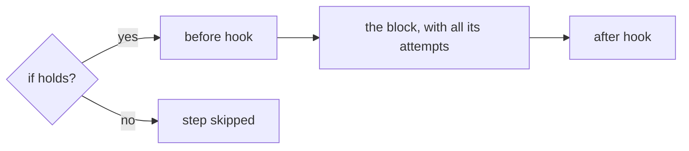
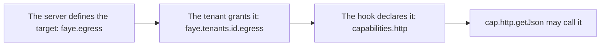

# Hooks

A hook is a small JavaScript function that a tenant's flow calls at a declared point. Hooks add the depth that blocks alone cannot: scoring the risk of a sign in, routing a person to one option, or adding data from another service. This page shows what a hook can return, where it runs, how to write and test one, how to let it call a service, and its limits. It is for flow authors and the engineers who write hooks.

Faye runs each hook in a sandbox: QuickJS compiled to WebAssembly, with a fresh instance, a deadline and a memory cap for every run ([ADR 0009](../adr/0009-m4-javascript-hooks-on-quickjs-wasm.md)).

## What a hook can do

A hook steers a flow inside the shape that the flow declares. It can never sign anyone in. Typical uses:

- **Score risk.** Ask a reputation service about the request, and set `vars.risk`. A later step asks for a second factor when `vars.risk` is `high`.
- **Route.** Pick one option of a **Choose** instead of asking the person.
- **Enrich.** Set values in `vars` that later conditions read.

A hook returns exactly one of these results:

| Result | What the engine does |
|---|---|
| `{}` | Nothing. The flow goes on. |
| `{ set: { name: value, ... } }` | Merges the values into `vars`. A later condition reads them as `vars.name`. |
| `{ fail: "reason" }` | Fails the step with that reason. |
| `{ pick: "option-id" }` | Runs that option of the **Choose**. Only a **Choose**'s picker may return it. |

Anything else is an error, `hook_error`. A hook cannot complete a sign in, skip a step, choose who the person is, write `auth`, `amr` or `acr`, or show a screen. No result says so, so no hook can do it ([charter](../../CHARTER.md), principle 2).

A hook never sees `auth`, the record of which credentials verified. It never sees passwords, codes or other credential material either.

> [!IMPORTANT]
> The checker cannot see inside a hook, so it assumes the worst. For every hook it counts a path where the hook fails, and a path where it sets any value. For a picker, it counts every option the hook could pick. The guarantees that the checker proves, such as "every succeeding path verifies a credential", hold whatever a hook returns.

## Where a hook runs

A flow attaches a hook to a step or an option in one of three ways:

| Key | Where | When it runs |
|---|---|---|
| `before:` | Any step or option | Once, before the rest of the step. |
| `after:` | Any step or option, except a **Fail** | Once, after the block has run. |
| `pick:` | A **Choose** | When the **Choose** decides, with the ids of the enabled options in `ctx.options`. |

The diagram shows the order in which a step runs its parts.



A step's condition (`if`) covers its hooks too: when the condition does not hold, no hook of that step runs. A block's attempts wrap only its screen and its handler. So a hook runs once, however many times the person retries the password or the code. A `before` hook on the **Identifier** runs before the account is known, so it sees no `user` values yet.

In the Admin UI, you attach a hook in the block inspector. Use **Before** and **After** in the **Hooks** group. For a **Choose**, set **Picked by** to **Hook** and choose the hook in **Picker**. See [Edit and publish a flow](../console/flow-editor.md#hooks).

## Declare a hook in YAML

A flow declares its hooks under `hooks:`, then names them in its steps. This is the shipped flow `apps/server/faye-app/src/main/resources/flows/acme.yaml`, shortened:

```yaml
flow: acme
version: 1

hooks:
  risk:
    file: risk.js
    capabilities: { http: [ip-reputation] }
    timeout_ms: 500

login:
  steps:
    identify:
      block: identifier
      after: risk
    credential:
      alternative:
        password:
          block: password
        email:
          if: user.email_verified
          block: email-code
    second-factor:
      if: { eq: [vars.risk, high] }
      alternative:
        totp:
          if: user.has_totp
          block: totp
        enroll:
          if: { not: user.has_totp }
          block: enroll-totp
```

A hook takes these keys:

| Key | Required | What it is |
|---|---|---|
| `file` | `file` or `source` | A JavaScript file next to the flow file, such as `risk.js`. The name matches `[a-z0-9][a-z0-9_-]*\.js`. |
| `source` | `file` or `source` | The JavaScript, inline. |
| `capabilities` | no | `{ http: [target, ...] }`: the egress targets the hook may call. See [Egress](#egress). |
| `timeout_ms` | no | The hook's deadline in milliseconds, from 1 to 2000. The default is 200. |

A hook id starts with a lowercase letter and uses `a` to `z`, `0` to `9`, `-` and `_`.

The hook's code exports one function as its default export. The function may be `async`. It receives `ctx` and `cap`, and returns one of the results in [What a hook can do](#what-a-hook-can-do). This example routes a sign in with a picker. The `route` hook is new; `risk` is the shipped one:

```yaml
hooks:
  risk:
    file: risk.js
    capabilities: { http: [ip-reputation] }
    timeout_ms: 500
  route:
    source: |
      // High risk: ask for the password, not an emailed code. Otherwise the person picks.
      export default async function (ctx) {
        if (ctx.vars.risk === 'high' && ctx.options.includes('password')) return { pick: 'password' }
        return {}
      }

login:
  steps:
    identify:
      block: identifier
      after: risk
    credential:
      pick: route
      alternative:
        password:
          block: password
        email:
          if: user.email_verified
          block: email-code
```

When the picker returns `{}`, the **Choose** goes on as if it had no picker: it runs the only enabled option, or asks the person.

> [!NOTE]
> Write `export default` at the start of a line. Faye finds the hook's function by that line.

A hook is part of its flow. Publishing the flow stores the hook, and the published version pins it by a hash of its definition. A change to a hook's source is a change to the flow, so it takes effect only when you publish.

## The ctx object

`ctx` is a deep frozen copy of what the flow knows, except `auth`. Its fields:

| Field | What it holds |
|---|---|
| `ctx.request` | The browser's request: `ip`, `user_agent`. |
| `ctx.client` | The OAuth client: `client_id`, `client_name`, `first_party`, and `metadata`, the operator's own data about the client. |
| `ctx.host` | The login request as the authorization server relays it: `acr_values`, `requested_scope`, `requested_access_token_audience`, `login_hint`, `ui_locales`, `skip`, `subject`, and `context`. |
| `ctx.tenant` | Tenant settings: `mfa_required`, `name`, and `remember_me` when it is on. |
| `ctx.user` | What the **Identifier** found out about the account: `exists`, `identified_by`, `identifier`, `has_password`, `has_passkey`, `has_totp`, `has_phone`, `mfa_required`, and for a known account `email`, `email_verified` and `name`. Empty before the **Identifier** runs. |
| `ctx.vars` | The values that `set` blocks and earlier hooks wrote. |
| `ctx.options` | For a picker only: the ids of the enabled options, as a list. |

A field that has no value is absent. Read it with `??`, as `risk.js` does.

## The cap object

`cap` holds the only two things a hook can do besides compute. The sandbox has no other network, file, timer or process access.

### cap.http.getJson(target, query)

Calls an egress target with an HTTP `GET` and returns a promise of its JSON response.

- `target` is the name of an egress target, such as `'ip-reputation'`. A hook names a target, never a URL.
- `query` is an object whose values are strings, numbers or booleans. Faye sends them as URL query parameters.

The call throws an error, which the hook can catch, when:

- The hook does not declare the target, or the tenant does not grant it.
- The server has no URL for the target.
- The target answers with a status other than 2xx, or with a body that is not JSON, or with more than 64 KiB.
- The hook's deadline runs out. The call gets what is left of the deadline, and at most 2 seconds to connect.
- The hook already made 4 calls in this run.

Faye does not follow redirects, so a target cannot send the hook somewhere else.

### cap.log.info(...args)

Writes one line: the arguments, as strings, joined by spaces. The line goes to the server log, and to the result of a test run in the Admin UI. A run keeps its first 20 lines, each up to 500 characters. Faye replaces control characters with spaces, so a hook cannot forge other log entries.

## A walk through risk.js

The `acme` tenant's risk hook is `apps/server/faye-app/src/main/resources/flows/risk.js`:

```js
// Scores a sign in with the ip-reputation service: above 50 is high risk.
//
// If the service fails or does not answer in time, the sign in counts as high risk. Failing closed
// costs the person a second factor, never the sign in.
export default async function (ctx, cap) {
  try {
    const reputation = await cap.http.getJson('ip-reputation', {
      ip: ctx.request.ip ?? '',
      user_agent: ctx.request.user_agent ?? '',
    })
    return { set: { risk: reputation.score > 50 ? 'high' : 'low' } }
  } catch (e) {
    cap.log.info('ip-reputation unavailable, scoring high:', e.message)
    return { set: { risk: 'high' } }
  }
}
```

Step by step:

1. The hook calls the `ip-reputation` target with the browser's IP address and user agent. `??` sends an empty string when a value is absent.
2. A score above 50 sets `vars.risk` to `high`. Any other score sets it to `low`.
3. If the call throws, the hook logs why and sets `vars.risk` to `high`. The hook never throws itself. An uncaught error would be a `hook_error`, which fails the sign in.

In `acme.yaml`, the hook runs `after` the **Identifier**. The `second-factor` step then runs only `if: { eq: [vars.risk, high] }`. The flow declares the target under `capabilities`, and gives the hook 500 ms instead of the default 200 ms, because the hook makes a network call.

In the local stack, the target is a stub, `deploy/ip-reputation.mjs`. It scores 90 for an IP address in `203.0.113.0/24` or a user agent that contains "suspicious", and 10 otherwise. The **High risk IP** switch of a preview uses `203.0.113.7`. See [Preview a draft](../console/preview.md).

## Write and test a hook in the Admin UI

Open a tenant, then select **Hooks** in the sidebar. The page has three parts: the list of the flow's hooks on the left, the source in the middle, and two tabs on the right, **Test run** and **Capabilities**. The status bar at the bottom shows the draft's problems.

> [!NOTE]
> This section writes keyboard shortcuts with `⌘`. On Windows and Linux, press `Ctrl` instead.

### 1. Create a hook

Select **New hook** (the plus button above the list). Type an **ID**, then select **Create hook**. The hook starts from a template:

```js
// Return { set: { name: value } }, { fail: "reason" }, { pick: "option" } (in a choose), or {}.
export default async function (ctx, cap) {
  return {}
}
```

### 2. Write the source

Edit the source in the middle. Type `ctx.` or `cap.` to see the fields you can use. The console saves the hook in the draft's `hooks.<id>.source`, like any other edit of the draft.

A hook loaded from a file, such as `risk.js`, is read only here. Select **Edit inline** to copy its code into the draft as `source`, and edit it there.

### 3. Attach it to a block

On the **Login flow** page, select a block, then choose the hook under **Before** or **After**. For a **Choose**, set **Picked by** to **Hook** and choose it under **Picker**. In the list on the **Hooks** page, each hook says which steps use it, or **Unused**.

### 4. Run a test

Open the **Test run** tab:

1. Edit the **ctx** field: the JSON that the hook receives as `ctx`. It starts with a sample.
2. To test a picker, turn on **Test as a Choose picker** and type the enabled option ids in **Picks from**, separated by commas. For a hook that a **Choose** already uses, both are filled in.
3. Select **Run**, or press `⌘↵` while the **ctx** field has focus.

The test runs on the server, in the same sandbox and with the same limits as a published hook. It uses the egress targets that the hook declares and the tenant grants, so it makes real calls. It stores nothing.

The result shows:

- What the engine would do with the result: `nothing`, `set vars.risk = high`, `fail the step: reason`, `pick password`, or `hook_error` and why.
- How long the run took, in milliseconds.
- The error, if the hook did not return.
- The returned JSON and the logged lines, or **No output**.

### 5. Set its capabilities

Open the **Capabilities** tab:

- **HTTP egress** has one switch for each target the server knows. Turn a switch on to let this hook call that target. A target that the tenant does not grant is off and says **Not granted to this tenant**.
- **Deadline** sets **Timeout**, in milliseconds, from 1 to 2000. The default is 200.

These controls write `capabilities` and `timeout_ms` in the draft.

### 6. Publish

Hooks are part of the draft. Select **Publish** in the header to publish them with the flow. See [Publish](../console/flow-editor.md#publish).

To delete a hook, select **Delete hook** above the source, then **Delete**. If steps still use the hook, the console warns that they fail the check until you change them. Press `⌘Z` to undo.

## Egress

Egress is a hook's access to an outside HTTP service. A call needs three things to be true:



1. **The server defines the target.** The operator gives each target a name and a base URL under `faye.egress` in the server's `application.yaml`.
2. **The tenant grants it.** The operator lists the targets a tenant's hooks may call under `faye.tenants.<id>.egress`.
3. **The hook declares it.** The hook lists the targets it calls under `capabilities: { http: [...] }`.

The shipped `apps/server/faye-app/src/main/resources/application.yaml` grants `acme` one target:

```yaml
faye:
  tenants:
    acme:
      name: Acme
      flow: classpath:flows/acme.yaml
      # Hooks of this tenant may call these named targets, and no others
      egress: [ip-reputation]
  # Named HTTP targets for hooks. Unset, the risk hook cannot reach its service and scores high.
  egress:
    ip-reputation: ${FAYE_IP_REPUTATION_URL:}
```

Only the operator can grant egress. The Admin UI shows the tenant's grants read only, on the **General** page and in the hook's **Capabilities** tab.

The checker refuses to publish a flow whose hook declares a target that the tenant does not grant. The engine checks the same rule again on every call. If the operator later removes a grant, published hooks can no longer call that target: the call throws.

## Limits

Every limit is fixed. A flow cannot raise one ([ADR 0037](../adr/0037-hard-limits-on-flows-and-hooks.md)).

### Limits of one hook run

| Limit | Value | Past the limit |
|---|---|---|
| Deadline (`timeout_ms`) | 200 ms by default, from 1 to 2,000 ms | `hook_error` |
| Memory | 16 MiB | `hook_error` |
| Source size | 64 KiB | The flow does not compile. |
| Compiling a hook | 2,000 ms, the first time the server runs it | `hook_error` |
| Egress calls | 4 per run | The call throws. |
| Egress response | 64 KiB, no redirects, 2 s to connect | The call throws. |
| Log lines | 20 per run, each up to 500 characters | Further lines are dropped. |
| Error message | 200 characters | Cut to 200 characters. |
| Hooks running at once | 8 per server, and 8 more waiting | `hook_error` |

### Limits of a result

| Limit | Value | Past the limit |
|---|---|---|
| Names in one `set` | 1 to 16, each matching `[a-z][a-z0-9_]*` | `hook_error` |
| Values in `set` | A string of up to 1,024 characters, an integer, or a boolean | `hook_error` |
| Names in `vars` | 64 in all | `hook_error`, and nothing is set |
| `fail` reason | An id (`[a-z][a-z0-9_-]*`) of up to 64 characters | `hook_error` |

### Limits of a flow, at check time

The checker applies these when you validate, preview or publish. For each entry, it adds up the entry's hook attachments. An attachment inside retries counts once for each attempt the retries allow. Hook time weights each attachment by its hook's deadline.

| Limit | Value |
|---|---|
| Hook attachments in a flow | 16 |
| Distinct hooks in a flow | 8 |
| Hook runs per entry | 32 |
| Hook time per entry, the sum of the deadlines | 5,000 ms |

### Limits of one request, at run time

A request runs the flow from one answer of the person to the next screen. The engine stops calling hooks in that request once it reaches either limit, and the next hook fails with `hook_error`.

| Limit | Value |
|---|---|
| Hook runs per request | 32 |
| Measured hook time per request | 10,000 ms |

## Errors

A hook that returns `{ fail: "reason" }` fails its step with that reason. Every other problem fails the step with `hook_error`:

- The hook threw, or a promise it returned was rejected.
- The code has no default export function.
- The run passed its deadline or its memory cap.
- The result is not `{}`, `{ set }`, `{ fail }` or `{ pick }`, or breaks a limit of a result.
- A hook that is not a picker returned `{ pick }`.
- A picker returned `{ set }`, or picked an option that is not enabled.
- The request's hook budget is spent, or too many hooks are running on the server.

In the IR, a hook failure is retryable: a retry around the hook runs it again ([Core IR specification](../ir-spec.md#failures)). In a flow written in YAML, though, a block's attempts wrap only its screen and handler, never a hook. So in practice a failing hook ends the entry with that failure.

To keep a slow or broken service from failing sign ins, catch the errors of `cap.http.getJson` and choose a safe result, as `risk.js` does. A picker that cannot decide can return `{}` and let the person choose.

To find out why a hook failed:

- Run it in the **Test run** tab with the same `ctx`.
- Preview the draft. The trace shows a `hook` event with `ok` or the failure reason. See [Preview a draft](../console/preview.md#read-the-trace).
- Read the server log. Faye logs a hook that throws or passes a limit, with the tenant and the hook id.

## Next steps

- [Preview a draft](../console/preview.md): try a hook in a real sign in, with the **High risk IP** switch.
- [Edit and publish a flow](../console/flow-editor.md): attach hooks to blocks.
- [Flow DSL reference](../reference/dsl.md): every key of a flow, hooks included.
