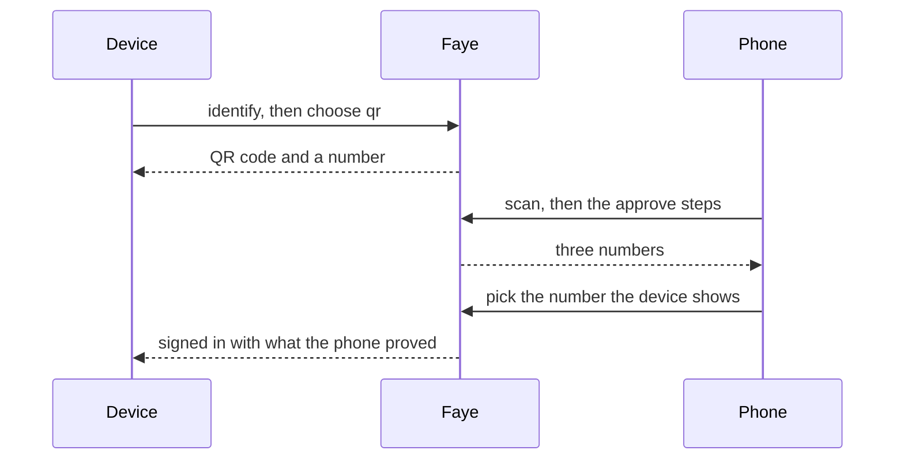

# Flow recipes

This page collects flows for common goals. Each recipe gives the goal, the YAML, what the checker proves about the flow's paths, and notes. Copy a recipe into the **YAML** tab of a tenant's **Login flow**, then change it to fit. Every recipe passes the compiler and the checker as shown, for a tenant set up as `acme` is in the demo stack.

Many recipes come from the flows that ship with the prototype, in [`apps/server/faye-app/src/main/resources/flows/`](../../apps/server/faye-app/src/main/resources/flows/). Each recipe names its file. For the syntax, see [Write flows in YAML](flow-syntax.md).

"What the checker proves" lists the `amr` and `acr` of the paths that succeed, as the **Paths** tab shows them. The engine computes these values from the credentials that verified. A flow never sets them.

> [!NOTE]
> A recipe without a consent step has no consent screen: the authorization server grants consent without one. To ask third party applications, add the step from [Consent for third party applications only](#consent-for-third-party-applications-only).

## Password only

**Goal:** sign in with an email address and a password.

From [`password-only.yaml`](../../apps/server/faye-app/src/main/resources/flows/password-only.yaml):

```yaml
# Password only: identity first, then a password with three attempts.
flow: password-only
version: 1

login:
  steps:
    identify:
      block: identifier
    credential:
      block: password
```

**What the checker proves:** every successful path ends with `pwd` and `faye:1fa`.

**Notes:**

- The checker warns `no path reaches faye:2fa`. An application that asks for `faye:2fa` in `acr_values` cannot sign in with this flow.
- An unknown email address goes to the same password screen as a known one. The flow does not reveal which accounts exist.

## Identifier and password on one screen

**Goal:** ask for the email address and the password on the same screen.

```yaml
flow: one-screen
version: 1

login:
  steps:
    sign-in:
      block: identifier
      with: { password: true }
```

**What the checker proves:** every successful path ends with `pwd` and `faye:1fa`.

**Notes:**

- The Identifier block verifies the password itself, with 3 attempts by default. Set `attempts` on the same block to change that.
- No `password` block may follow. The compiler refuses one with `the identifier already asks for the password`.
- This screen cannot also offer passkey autofill. `with: { password: true, passkey: true }` is refused.

## Passkey first, with a password fallback

**Goal:** sign in with a passkey from autofill, or with a password when the person types an email address.

From the `credential` step of [`passkey-totp.yaml`](../../apps/server/faye-app/src/main/resources/flows/passkey-totp.yaml):

```yaml
flow: passkey-first
version: 1

login:
  steps:
    identify:
      block: identifier
      with: { passkey: true }
    credential:
      alternative:
        passkey:
          if: { eq: [user.identified_by, passkey] }
          block: passkey
        password:
          if: { eq: [user.identified_by, identifier] }
          block: password
```

**What the checker proves:** a passkey path ends with `hwk` `user` and `faye:2fa`. A password path ends with `pwd` and `faye:1fa`. The checker also lists passkey paths that prove only `hwk` or only `user`, with `faye:1fa`, because it counts every part of what a passkey can prove.

**Notes:**

- `with: { passkey: true }` offers passkey autofill on the identifier screen. A passkey chosen there also answers the `passkey` screen, so the person sees no second screen.
- `user.identified_by` says how the person identified: `passkey` or `identifier`. Exactly one option is enabled, so no method picker shows.
- Offering passkeys only through autofill keeps the flow from revealing which accounts have one.

## Second factor for everyone

**Goal:** every sign in proves two factors.

```yaml
flow: two-factor
version: 1

login:
  steps:
    identify:
      block: identifier
    credential:
      block: password
    second-factor:
      alternative:
        totp:
          if: user.has_totp
          block: totp
        enroll:
          if: { not: user.has_totp }
          block: enroll-totp
```

**What the checker proves:** every successful path ends with `pwd` `otp` and `faye:2fa`.

**Notes:**

- A person with TOTP proves it. A person without TOTP sets it up now. See [Enroll TOTP when the account has none](#enroll-totp-when-the-account-has-none).
- The flow makes everyone use two factors. The tenant setting **Require MFA** makes it a rule. Turn it on in **General settings**, or set `faye.tenants.<id>.mfa-required: true` in the server configuration.
- With **Require MFA** on, the checker refuses any flow that has a path ending with `faye:1fa`, with `the tenant requires MFA, but a path succeeds with faye:1fa`. The engine checks it again when each sign in ends. The console refuses to save the setting while the live version would fail it.

## Second factor only when risk is high

**Goal:** ask for a second factor only when a hook scores the sign in as high risk.

From [`risk-totp.yaml`](../../apps/server/faye-app/src/main/resources/flows/risk-totp.yaml):

```yaml
flow: risk-totp
version: 1

hooks:
  risk:
    file: risk.js
    capabilities: { http: [ip-reputation] }
    timeout_ms: 500

login:
  steps:
    identify:
      block: identifier
      after: risk
    credential:
      block: password
    second-factor:
      if: { eq: [vars.risk, high] }
      alternative:
        totp:
          if: user.has_totp
          block: totp
        enroll:
          if: { not: user.has_totp }
          block: enroll-totp
```

**What the checker proves:** low risk paths end with `pwd` and `faye:1fa`. High risk paths end with `pwd` `otp` and `faye:2fa`. A password verifies on every successful path, whatever the hook returns.

**Notes:**

- The hook [`risk.js`](../../apps/server/faye-app/src/main/resources/flows/risk.js) asks the `ip-reputation` service for a score, and sets `vars.risk` to `high` above 50, else `low`.
- If the service fails or is too slow, the hook sets `high`. A failure then costs the person a second factor, never the sign in.
- The hook calls a named egress target. The tenant must grant it (`faye.tenants.<id>.egress: [ip-reputation]`), and the server must give its URL (`faye.egress.ip-reputation`). The `acme` tenant has both in the demo stack. See [Hooks](hooks.md).

## Step up when the application asks for two factors

**Goal:** ask for a second factor only when the application requests `faye:2fa` in `acr_values`.

```yaml
flow: step-up
version: 1

login:
  steps:
    identify:
      block: identifier
    credential:
      block: password
    second-factor:
      if: { has: [host.acr_values, "faye:2fa"] }
      alternative:
        totp:
          if: user.has_totp
          block: totp
        enroll:
          if: { not: user.has_totp }
          block: enroll-totp
```

**What the checker proves:** paths without the request end with `pwd` and `faye:1fa`. Paths with the request end with `pwd` `otp` and `faye:2fa`.

**Notes:**

- The engine enforces `acr_values` itself. If a sign in ends below the level that the application asked for, it fails with `acr_not_satisfied`. The condition makes the flow reach that level.
- The authorization server may remember a person who signed in earlier. A remembered sign in counts as one factor. If the application asks for `faye:2fa`, the engine runs the flow for that same person. The identifier must name the same account, else the step fails with `wrong_account`.
- [`passkey-totp.yaml`](../../apps/server/faye-app/src/main/resources/flows/passkey-totp.yaml) also skips the second factor when the person already has `faye:2fa`, with `{ ne: [auth.acr, "faye:2fa"] }`. A passkey sign in already has it.

## Enroll TOTP when the account has none

**Goal:** ask for a second factor, and set up an authenticator app for a person who has no second factor yet.

From the `second-factor` step of [`passkey-totp.yaml`](../../apps/server/faye-app/src/main/resources/flows/passkey-totp.yaml), simplified:

```yaml
flow: second-factor
version: 1

login:
  steps:
    identify:
      block: identifier
    credential:
      block: password
    second-factor:
      alternative:
        totp:
          if: user.has_totp
          block: totp
        passkey:
          if: user.has_passkey
          block: passkey
        enroll:
          if: { not: { or: [user.has_totp, user.has_passkey] } }
          block: enroll-totp
```

**What the checker proves:** every successful path ends with `faye:2fa`: `pwd` `otp` for TOTP or a new authenticator app, and `pwd` with `hwk` or `user` for a passkey.

**Notes:**

- `enroll-totp` shows a QR code and a key for an authenticator app, then checks the first code. It proves `otp`, so it counts as the second factor.
- `enroll-totp` is a credential, so the person cannot skip it. Enrollment blocks that may be skipped are [`add-phone` and `add-passkey`](#offer-to-add-a-phone-or-a-passkey).
- `enroll-totp` and `totp` need an account that a credential verified earlier in the flow. Put them after the password.
- A person with both TOTP and a passkey has two enabled options, and chooses on the method picker screen.

## Email or text message code instead of a password

**Goal:** let a person sign in with a code sent to their verified email address or phone, instead of a password.

From the `credential` step of [`acme.yaml`](../../apps/server/faye-app/src/main/resources/flows/acme.yaml):

```yaml
flow: codes
version: 1

login:
  steps:
    identify:
      block: identifier
    credential:
      alternative:
        password:
          block: password
        email:
          if: user.email_verified
          block: email-code
        phone:
          if: user.has_phone
          block: sms-code
```

**What the checker proves:** each option ends with `faye:1fa`: `pwd`, `email` or `sms`.

**Notes:**

- The tenant needs delivery for each channel. Configure a webhook per channel under `faye.tenants.<id>.delivery`, which Faye calls with each code:

  ```yaml
  faye:
    tenants:
      bank:
        delivery:
          email: { url: https://mail-relay.example/faye, secret: "${FAYE_BANK_EMAIL_SECRET}" }
          sms: { url: https://sms-relay.example/faye, secret: "${FAYE_BANK_SMS_SECRET}", per-hour: 100 }
  ```

- A channel without a webhook uses the demo outbox (`FAYE_DEMO_OUTBOX`) when it is set. Faye then writes each code to a file there instead of sending it. In the demo stack, read the codes with `docker exec faye ls /var/lib/faye/outbox`.
- With neither, the channel is off. The console offers its block disabled, and the server refuses to publish a flow that uses it, with `handler 'sms_code.verify' is not enabled for this tenant`.
- `user.has_phone` is true only when the account has a verified phone and the person turned on texted codes.
- An unknown email address gets the same screen and timing, but no code ever matches.
- An emailed code never counts as a second factor. A password and an emailed code give `faye:1fa`. A texted code after a password gives `faye:2fa`.
- [ADR 0032](../adr/0032-delivered-one-time-codes-and-qr-sign-in.md) has the code length, lifetime and sending limits.

## Offer to add a phone or a passkey

**Goal:** after the sign in, ask a person to add a phone for texted codes, or a passkey.

```yaml
flow: offer-enrollment
version: 1

login:
  steps:
    identify:
      block: identifier
    credential:
      block: password
    add-phone:
      if: { not: user.has_phone }
      block: add-phone
      with: { attempts: 1 }
    add-passkey:
      if: { not: user.has_passkey }
      block: add-passkey
```

The `add-phone` step comes from [`acme.yaml`](../../apps/server/faye-app/src/main/resources/flows/acme.yaml). [`passkey-totp.yaml`](../../apps/server/faye-app/src/main/resources/flows/passkey-totp.yaml) offers a passkey only after two factors, with `if: { and: [{ not: user.has_passkey }, { eq: [auth.acr, "faye:2fa"] }] }`.

**What the checker proves:** every successful path ends with `pwd` and `faye:1fa`. Adding a phone or a passkey proves nothing for this sign in, so it does not change `amr` or `acr`.

**Notes:**

- By default, each screen has **Not now**, and the person may skip it.
- To require the enrollment, set `required`. The screen then has no **Not now**, and the server refuses a skip. If the person runs out of attempts, the sign in fails ([ADR 0038](../adr/0038-required-enrollment.md)).

  ```yaml
  add-phone:
    if: { not: user.has_phone }
    block: add-phone
    with: { required: true }
  ```

- Both blocks act for the signed in person. Put them after a credential, and before a consent step. Elsewhere the checker refuses them, for example with `screen 'passkey' acts for the signed in subject, which needs a subject a credential verified earlier in the flow`.
- `add-phone` takes `attempts`, 3 by default. `add-passkey` takes only `required`.
- The **General settings** page does not offer `required` as a tenant default yet. Set it in the flow.

## QR code sign in

**Goal:** sign in on a device with no credential, such as a shared computer, by approving it on a phone.

The `login` side is part of the `credential` step of [`acme.yaml`](../../apps/server/faye-app/src/main/resources/flows/acme.yaml). The `approve` side is the same as that file's:

```yaml
flow: qr-sign-in
version: 1

login:
  steps:
    identify:
      block: identifier
    credential:
      alternative:
        password:
          block: password
        qr:
          block: qr

approve:
  steps:
    who:
      block: identifier
    prove:
      alternative:
        passkey:
          if: user.has_passkey
          block: passkey
        password:
          block: password
    confirm:
      block: qr-approve
```

The sign in runs on two devices. The diagram shows the order.



**What the checker proves:** in `approve`, a password path ends with `pwd` and `faye:1fa`, and a passkey path with `hwk` `user` and `faye:2fa`. In `login`, the `qr` option lists many `amr` sets, because at publish time the checker cannot know what the phone proves later.

**Notes:**

- At run time, the waiting device gets exactly the `amr` that the phone proved. A password on the phone gives `pwd` and `faye:1fa`, never more.
- The phone must sign in as the account that the waiting device identified. Another account fails with `wrong_account`.
- A QR code expires after 2 minutes. The `qr` block's 3 attempts show a fresh code each time.
- A flow with a `qr` block needs an `approve` section. Without one, the checker refuses it.
- QR code sign in can be relayed: an attacker can show a person the QR code of the attacker's own device. The matching number and the short lifetime raise the cost, but QR code sign in is never phishing resistant. Where that matters, use passkeys.

## Consent for third party applications only

**Goal:** ask for consent in applications from other companies, and skip it in your own.

From [`partner-consent.yaml`](../../apps/server/faye-app/src/main/resources/flows/partner-consent.yaml):

```yaml
# Password sign in, and a consent screen for third party clients. First party clients
# (registered with metadata.first_party = true) are not asked.
flow: partner-consent
version: 1

login:
  steps:
    identify:
      block: identifier
    credential:
      block: password
    # Consent runs once the sign in is accepted, on the authorization server's consent challenge
    grant:
      if: { not: client.first_party }
      block: consent
```

**What the checker proves:** the sign in ends with `pwd` and `faye:1fa`. The consent part verifies no credential, and it succeeds with or without the screen.

**Notes:**

- `client.first_party` is true for an application registered with `metadata.first_party = true`.
- The consent step and every step after it run on the authorization server's consent challenge, after it accepted the sign in. Keep consent the last step.
- Consent is a top level step. It cannot be an option of a choice or part of a group.

## Next steps

- [Write flows in YAML](flow-syntax.md): every key a recipe uses.
- [Hooks](hooks.md): write your own risk score or picker.
- [Preview a draft](../console/preview.md): try a recipe before you publish it.
- [Flow DSL reference](../reference/dsl.md): the full rules for every key and block.
