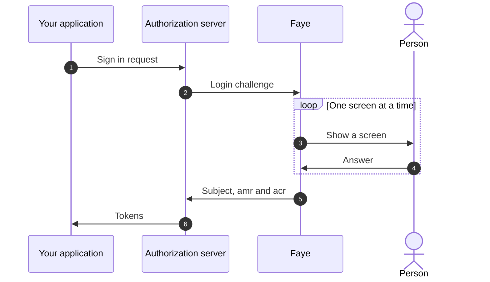

# What is Faye?

Faye is a sign in flow engine. It sits between the browser and an OAuth2 / OpenID Connect authorization server, such as [Ory Hydra](https://www.ory.sh/hydra/). The authorization server keeps the protocol. Faye owns every screen a person sees, and every decision about how that person proves who they are.

You describe a sign in as a short YAML file. Faye checks the file before it runs anywhere, then runs it one screen at a time.

> [!NOTE]
> Faye is a working prototype. It runs end to end with Hydra, two demo tenants and ten demo applications. Production hardening, such as high availability and rate limiting at scale, is designed for but not built yet. See [Vision and north star](understand/vision.md#where-faye-is-today).

## The problem Faye solves

Every product needs sign in. Authorization servers such as Hydra handle OAuth2 and OpenID Connect very well, but on purpose they ship no login screens. Each team must build its own login app.

A login app looks small, but it is hard to get right:

- It needs many screens: password, passkey, one time codes, second factor, consent.
- It needs safe rules. One wrong branch can let a person in without a password. A careless error message can tell an attacker which accounts exist.
- It changes often. Security asks for a second factor on risky sign ins. A partner app needs a consent screen. Each change means new code and a new deploy.

Faye replaces that app. You change a flow as data, the checker proves it is still safe, and you try it before you publish it.

## How it works

The diagram shows one sign in. The application sends the person to the authorization server, which hands the login to Faye. Faye runs the tenant's flow and shows each screen in its Login UI. When the flow succeeds, Faye tells the authorization server who signed in and how. The authorization server then issues the tokens.



Three ideas carry the design:

1. **Flows are data.** A flow is a YAML file of steps, such as "ask who you are", then "ask for a password". You can read it, diff it and review it like code.
2. **Flows are checked before they run.** The checker lists every path through a flow. It refuses a flow if any path can succeed without verifying a credential.
3. **Assurance is computed, not configured.** Faye records which credentials really verified. From that it computes the `amr` and `acr` claims that go into the tokens. No setting and no script can raise them.

## A flow in one look

This is the `bank` tenant's flow, from [`passkey-totp.yaml`](../apps/server/faye-app/src/main/resources/flows/passkey-totp.yaml), shortened. A person signs in with a passkey, or with a password plus a code from an authenticator app.

```yaml
flow: passkey-totp
version: 1

login:
  steps:
    identify:
      block: identifier
      with: { passkey: true }
    credential:
      alternative:
        passkey:
          if: { eq: [user.identified_by, passkey] }
          block: passkey
        password:
          if: { eq: [user.identified_by, identifier] }
          block: password
    second-factor:
      if:
        and:
          - { ne: [auth.acr, "faye:2fa"] }
          - or: [user.has_totp, user.mfa_required, { has: [host.acr_values, "faye:2fa"] }]
      alternative:
        totp:
          if: user.has_totp
          block: totp
        enroll:
          if: { not: user.has_totp }
          block: enroll-totp
```

Each `block` brings its own screen and its own verification code. The flow decides only the order and the conditions. The [Flow DSL reference](reference/dsl.md) lists every key.

## What you get

| Feature | What it means for you |
|---|---|
| Flows as YAML | Sign in logic that people can read and review, kept in version control. |
| A checker | Every path is listed and checked before a flow is published or previewed. |
| Built in screens | Identifier, password, passkey, one time codes, QR code sign in and consent, accessible and branded per tenant. |
| Sandboxed hooks | Small JavaScript functions that score risk or route a sign in, but can never sign anyone in. |
| An Admin UI | Edit a flow as blocks or YAML beside a live graph, preview a draft with a real application, publish and roll back. |
| Host neutral engine | The engine knows no authorization server. Hydra is the first host, behind one adapter. |

## What Faye is not

Faye has a narrow job on purpose. The [charter](../CHARTER.md) lists what it does not do.

| Faye is not | Instead |
|---|---|
| An OAuth2 or OpenID Connect provider | The authorization server serves the protocol, registers clients and talks to applications. |
| A token service | The authorization server issues and signs tokens and owns sessions. Faye reports the result of a flow. |
| A general UI platform | Faye shows only the screens that sign people in, sign them up and ask for consent. Account settings belong elsewhere. |
| A programming language | The flow language is closed and every flow ends. Hooks make decisions inside a flow; they cannot replace it. |

## Where to go next

Pick the path that matches what you want to do.

- **Try it.** Run the demo stack and sign in, in about ten minutes: [Quickstart](start/quickstart.md).
- **Learn the words.** Tenants, flows, blocks, screens and hooks: [Core concepts](start/concepts.md).
- **Write a flow.** Build and publish a flow step by step: [Write your first flow](flows/first-flow.md).
- **Run the Admin UI.** Every page and control: [Admin UI overview](console/overview.md).
- **Understand the design.** Why it is built this way: [Architecture](understand/architecture.md) and [How the engine works](understand/engine.md).
- **Contribute.** Build from source and find your way around: [Build and run from source](develop/build-from-source.md).

> [!TIP]
> AI agents can read every page as Markdown. Add `.md` to a page's URL, or start from `/llms.txt`. Each page also has **Copy Markdown** and **Ask Devin** buttons.
