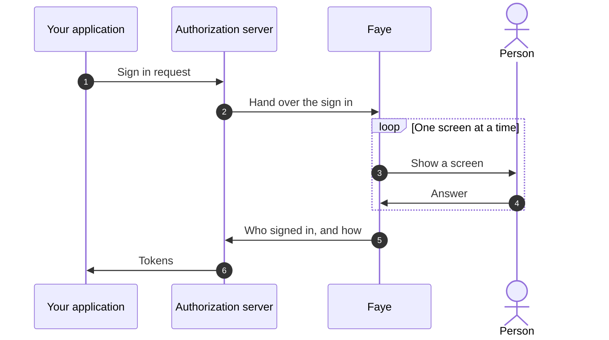

# What is Faye?

Faye is an embeddable, configurable flow runtime built only for sign in and sign up. A **flow** is the steps that a person goes through to get into an account. You configure the flow, and Faye runs it.

- **Embeddable.** Faye's engine is a Java library. You embed it in a server, and connect it to your authorization server and your user store through a few Java interfaces ([the host SPI](understand/host-spi.md)). The prototype runs the engine in a server in front of Ory Hydra.
- **Configurable.** Each tenant writes its own flow as data, not as code.
- **Built only for sign in and sign up.** The flow language knows about credentials, screens and assurance, and about nothing else. It cannot run other kinds of work.

Faye sits between the browser and an OAuth2 / OpenID Connect authorization server, such as [Ory Hydra](https://www.ory.sh/hydra/). The authorization server handles the protocol. Faye owns every screen that a person sees. Faye also owns every decision about how that person proves who they are.

You describe a sign in as a short YAML file. Faye checks the flow before the flow runs anywhere. Then Faye runs the flow one screen at a time.

> [!NOTE]
> Faye is a working prototype. It runs end to end with Hydra, two demo tenants (customers, each with its own setup) and ten demo applications. Production features, such as high availability and rate limiting at scale, are planned and not built yet. Sign up is not built yet either. The Admin UI has no sign in, so it must run only on your own machine. See [Vision and north star](understand/vision.md#where-faye-is-today).

## The problem Faye solves

Every product needs sign in. Authorization servers such as Hydra handle OAuth2 and OpenID Connect very well. But they ship no sign in screens, on purpose. Each team must build its own login app.

A login app looks small. But it is hard to build correctly:

- It needs many screens: password, passkey, one time codes, second factor, consent.
- It needs safe rules. One wrong branch can let a person in without a password. A careless error message can tell an attacker which accounts exist.
- It changes often. The security team asks for a second factor on risky sign ins. A partner app needs a consent screen. Each change means new code and a new deploy.

Faye replaces that app. You change a flow as data. Faye refuses the change if any path through the flow could sign a person in without checking a credential. You try the flow before you publish it.

## How it works

Four words appear on this page:

- An **application** is the program a person signs in to, such as your web app.
- A **tenant** is one customer or product line in Faye, with its own flow, applications and users. Each application belongs to one tenant.
- A **credential** is what the person gives to prove who they are: a password, a passkey or a one time code.
- **Consent** is the screen where a person allows another company's application to read their account data.

The diagram shows one sign in. The application sends the person to the authorization server. The authorization server hands the sign in to Faye. Faye runs the flow of the application's tenant and shows each screen in its Login UI. When the flow succeeds, Faye tells the authorization server who signed in and how. The authorization server then issues the tokens.



The design rests on three ideas:

1. **Flows are data.** A flow is a YAML file of steps, such as "ask who you are", then "ask for a password". You can read it, diff it and review it like code.
2. **Flows are checked before they run.** The checker lists every path through a flow. It refuses a flow if any path can succeed without verifying a credential.
3. **Assurance is computed, not configured.** Faye records which credentials really verified. From those credentials, Faye computes two claims that go into the tokens: the authentication methods references (`amr`) and the authentication context class reference (`acr`). No setting and no script can raise these claims.

## A flow in one look

This is the `bank` tenant's flow, from [`passkey-totp.yaml`](../apps/server/faye-app/src/main/resources/flows/passkey-totp.yaml), shortened. A person signs in with a passkey, or with a password. If the person used a password and the account has an authenticator app, the person also enters a code from that app.

```yaml
flow: passkey-totp
version: 1

login:
  steps:
    identify:
      block: identifier
      with: { passkey: true }
    credential:
      alternative:
        passkey:
          if: { eq: [user.identified_by, passkey] }
          block: passkey
        password:
          if: { eq: [user.identified_by, identifier] }
          block: password
    second-factor:
      if:
        and:
          - { ne: [auth.acr, "faye:2fa"] }
          - or: [user.has_totp, user.mfa_required, { has: [host.acr_values, "faye:2fa"] }]
      alternative:
        totp:
          if: user.has_totp
          block: totp
        enroll:
          if: { not: user.has_totp }
          block: enroll-totp
```

Each `block` brings its own screen and its own verification code. The flow decides only the order and the conditions. The [Flow DSL reference](reference/dsl.md) lists every key.

## What you get

| Feature | What it means for you |
|---|---|
| Flows as YAML | Sign in logic that people can read and review, kept in version control. |
| A checker | The checker lists and checks every path before you publish or preview a flow. |
| Built in screens | Identifier, password, passkey, one time codes, QR code sign in and consent, branded per tenant. One set of screens serves every tenant. |
| Sandboxed hooks | Small JavaScript functions that score risk or route a sign in, but can never sign anyone in. |
| An Admin UI | Edit a flow as blocks or YAML beside a live graph, preview a draft with a real application, publish and roll back. |
| Host neutral engine | The engine knows no authorization server. Hydra is the first host, behind one adapter. |

## What Faye is not

Faye has a narrow job on purpose. The [charter](../CHARTER.md), the project's founding document, lists what Faye does not do.

| Faye is not | Instead |
|---|---|
| An OAuth2 or OpenID Connect provider | The authorization server serves the protocol, registers clients and talks to applications. |
| A token service | The authorization server issues and signs tokens and owns sessions. Faye reports the result of a flow. |
| A general UI platform | Faye shows only the screens that sign people in and ask for consent, and later the screens that sign people up. Account settings belong elsewhere. |
| A general purpose workflow engine | Faye runs only sign in, sign up and consent flows. Other processes, such as orders or approvals at work, belong in other tools. |
| A programming language | The flow language is closed and every flow ends. Hooks make decisions inside a flow. They cannot replace the flow. |

## Where to go next

Pick the path that matches what you want to do.

- **Try it.** Run the demo stack and sign in, in about ten minutes: [Quickstart](start/quickstart.md).
- **Learn the words.** Tenants, flows, blocks, screens and hooks: [Core concepts](start/concepts.md).
- **Write a flow.** Build and publish a flow step by step: [Write your first flow](flows/first-flow.md).
- **Run the Admin UI.** Every page and control: [Admin UI overview](console/overview.md).
- **Decide whether Faye fits.** The goals, the limits and the alternatives: [Vision and north star](understand/vision.md) and [How Faye compares](understand/compare.md).
- **Understand the design.** Why it is built this way: [Architecture](understand/architecture.md) and [How the engine works](understand/engine.md).
- **Connect Faye to your systems.** Run it as a container next to Hydra, or embed its two Java libraries in your own server: [Embed Faye: the host SPI](understand/host-spi.md).
- **Contribute.** Build from source and find your way around: [Build and run from source](develop/build-from-source.md).

> [!TIP]
> AI agents can read every page as Markdown. Add `.md` to a page's URL, or start from `/llms.txt`. Each page also has a **Copy Markdown** button, an **Open** menu that hands the page to ChatGPT, Claude or Cursor, and an **Ask Devin** button. Ask Devin opens [DeepWiki](https://deepwiki.com/jwuxan/faye), an AI assistant that has read Faye's code and answers questions about it.
