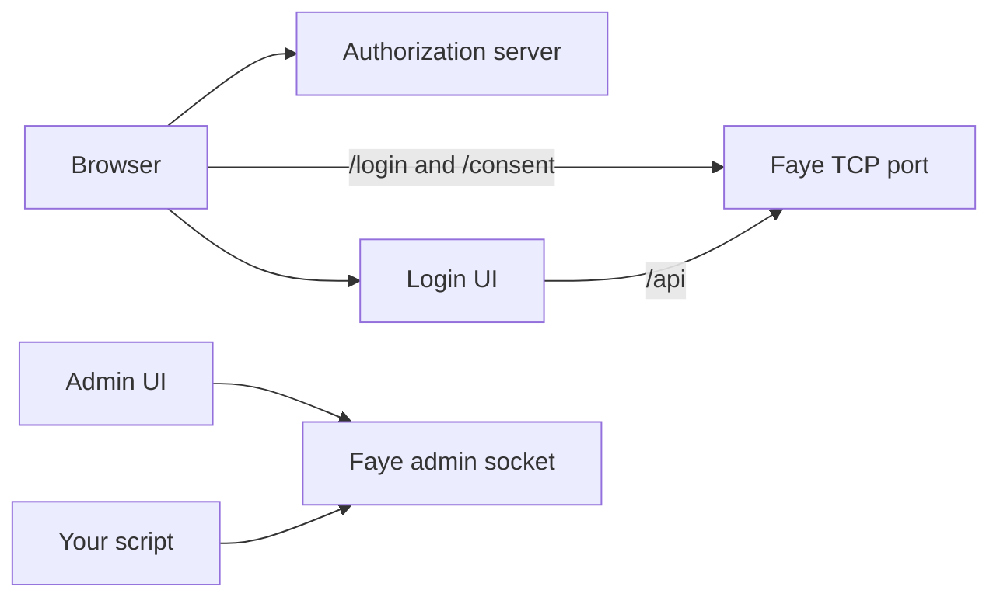

# HTTP API

This page lists every HTTP route that the Faye server serves. It covers the browser routes that the authorization server sends people to, the screen API that the Login UI calls, and the admin API that the Admin UI and your scripts call. This page is for engineers who deploy Faye, build their own screen renderer, or publish flows from continuous integration (CI).

The routes live in three classes: [`FlowController`](../../apps/server/faye-app/src/main/java/faye/app/FlowController.java), [`AdminController`](../../apps/server/faye-app/src/main/java/faye/app/AdminController.java) and [`PreviewController`](../../apps/server/faye-app/src/main/java/faye/app/PreviewController.java). The exact shapes of screens, answers and responses are in [`src/schema/screen.schema.json`](../../src/schema/screen.schema.json), screen protocol v1.

## Two listeners

The Faye server listens in two places. Each path is served on one of them only.

| Listener | Paths | Who calls it |
|---|---|---|
| The TCP port, 8080 by default | `/login`, `/consent` and `/api/...` | Browsers, through the authorization server's redirects, and the Login UI and demo client |
| The Unix domain socket `FAYE_ADMIN_SOCKET` | `/admin` and every path under it | The Admin UI, and scripts on the same machine |

A request for an admin path on the TCP port gets 404 with no body. A request for any other path on the socket also gets 404. If `FAYE_ADMIN_SOCKET` is empty, the server serves no admin API at all ([ADR 0028](../adr/0028-admin-api-on-a-unix-domain-socket.md)). [`AdminSocket`](../../apps/server/faye-app/src/main/java/faye/app/AdminSocket.java) makes this split before any route runs.

This diagram shows who calls which listener.



## Browser routes

The authorization server sends the browser to these two routes. In the image, Hydra's `URLS_LOGIN` and `URLS_CONSENT` point to them.

| Route | What it does |
|---|---|
| `GET /login?login_challenge={challenge}` | Starts the tenant's `login:` entry for this login challenge. |
| `GET /consent?consent_challenge={challenge}` | Starts the `consent:` entry of the flow version that the login ran. |

Both routes answer with `302 Found`. The `Location` is one of these:

- **The first screen.** The Login UI's URL, the screen's path and `?flow={flowId}`, for example `http://localhost:3000/login?flow=f_...` ([ADR 0029](../adr/0029-screen-paths.md)).
- **The error page.** `{Login UI}/error?reason=failed`, when the sign in failed before its first screen ([ADR 0031](../adr/0031-failed-sign-in-stays-on-faye.md)).
- **The authorization server's redirect.** When the entry ended at once without a screen. For example, a consent entry ends at once when its only step is skipped for a first party application.

If the authorization server's redirect is not a URL that a browser may safely follow, the route answers `502` with `host_error` instead.

### The flow cookie

When a flow shows its first screen, the response sets a cookie named `faye_flow_{flowId}`. The cookie holds the flow's binder: a random secret that ties the flow to this browser. Every request to the screen API must carry the cookie. Without the right value, the server answers as if the flow does not exist.

The cookie has these attributes:

- `HttpOnly` and `SameSite=Lax`, so scripts and cross site posts never carry it.
- `Path=/` and no `Domain`. The Login UI and the Faye server must use the same host name. Their ports may differ.
- `Secure` when `FAYE_LOGIN_UI_URL` starts with `https://`.
- `Max-Age` equal to `faye.flow-ttl`, 30 minutes by default.

Each flow has its own cookie, so a person can sign in from several tabs at once. When a flow ends, the final response expires its cookie.

## Screen API

The Login UI calls the screen API from its own server and forwards the browser's flow cookie. If you build your own screen renderer, call the same routes.

### Read a screen

`GET /api/flows/{flowId}` returns the screen that the flow waits on.

| Field | Meaning |
|---|---|
| `flowId` | The flow: `f_` and random characters. |
| `nonce` | `n_` and random characters. Send it back with the next answer. It is used once, so an old page cannot answer. |
| `step` | The id of the innermost step around the screen. Absent when there is none. |
| `path` | The URL path where the Login UI shows the screen, such as `/challenge/credential`. |
| `screen` | The screen: its `type` and its own fields. After a failed answer, it also has `errors` and `attemptsLeft`. |
| `branding` | The tenant's branding. Absent when the tenant set none. Its fields are `name`, `logoUrl`, `primaryColor`, `radius`, `showPassword` and `signUp`. |

This is a `code_sent` screen after the person typed `ada@example.com`:

```json
{
  "flowId": "f_Xq3...",
  "nonce": "n_Lr8...",
  "step": "credential",
  "path": "/challenge/credential",
  "screen": {
    "type": "code_sent",
    "identifier": "ada@example.com",
    "channel": "email",
    "to": "a•••@example.com",
    "resendIn": 30,
    "expiresIn": 300
  },
  "branding": { "name": "Acme" }
}
```

[Sign in screens](screens.md) describes every screen type, its answers and its actions.

### Answer a screen

`POST /api/flows/{flowId}/submit` takes a JSON body with three fields:

| Field | Meaning |
|---|---|
| `nonce` | The nonce of the screen that the person answers. |
| `action` | `submit` for an answer. Any other value is a screen action. |
| `payload` | The answer or the action's input, as an object. |

```json
{ "nonce": "n_Lr8...", "action": "submit", "payload": { "code": "482913" } }
```

A screen action does not answer the screen. Three screens take one: `resend` on `code_sent`, `send` on `phone_enroll` and `poll` on `qr`. No handler runs and no attempt is spent. The response is the same screen with the same nonce. If a limit refuses a code, the screen comes back with `errors: [{ "code": "send_limited" }]`.

The response is `200 OK` with one of three bodies:

| Body | When |
|---|---|
| A screen, with the fields of [Read a screen](#read-a-screen) | The flow waits on a screen: the next one, or the same one after a failed answer or an action. |
| `{ "redirectTo": "https://...", "failed": true }` | The flow ended and the host redirects the browser. `failed` is present, and `true`, only when the sign in failed. The Login UI then shows `/error?reason=failed` instead of following `redirectTo`. |
| `{ "result": { ... } }` | The flow ended and the host hands its result to a page instead of redirecting ([ADR 0025](../adr/0025-host-neutral-boundaries-for-embedding.md)). The approve entry of QR code sign in ends this way. |

`redirectTo` is always an absolute `http` or `https` URL. If the authorization server answers with any other redirect, the server refuses it with `502` and `host_error`.

### Body limit

A body sent to `/api/flows/...` may be at most 64 KiB. A request that declares a larger `Content-Length` gets `413` with `{ "error": "invalid_submission" }`. A larger body without a declared length stops being read at 64 KiB, and the request fails. The largest real answer, a passkey assertion, is a few KiB. A JSON body that repeats a key gets `400`.

### Refusals

When the engine refuses a request, the stored flow does not change. The body is `{ "error": "<code>" }`, and the status depends on the code:

| Code | Status | Meaning |
|---|---|---|
| `flow_not_found` | 404 | No such flow, a wrong or missing cookie, or a state that does not fit its version. |
| `flow_finished` | 410 | The flow already ended. |
| `flow_expired` | 410 | The flow passed a time limit ([ADR 0035](../adr/0035-flow-settings-per-entry-kind.md)). |
| `stale_nonce` | 409 | The nonce is not the one that the flow waits with. |
| `conflict` | 409 | Another answer to the same screen saved first. |
| `invalid_submission` | 400 | The screen does not take this answer, or the body lacks `nonce`, `action` or `payload`. 413 when the body is too large. |
| `unknown_action` | 400 | The screen does not take this action, or not with this input. |
| `host_error` | 502 | The authorization server answered with a redirect that a browser must not follow. |

[How the engine works](../understand/engine.md#resume-on-submit) explains the checks behind each code.

### Start a QR code approval

`POST /api/approve/{token}` starts the phone's side of a QR code sign in ([ADR 0032](../adr/0032-delivered-one-time-codes-and-qr-sign-in.md)). The Login UI calls it from its `/approve/{token}` page, which the QR code opens.

- If the token belongs to a QR code that waits and has not expired, the server starts the tenant's `approve:` entry. The response is `200` with `{ "location": "{path}?flow={flowId}" }` and the flow cookie.
- If the token is unknown, used or expired, the response is `404` with `flow_not_found`. A tenant without an `approve:` entry gets the same answer.

### Read a preview run

`GET /api/preview/flows/{flowId}` returns what a preview run did and what the checker predicted for it. The demo client shows it after a sign in through a preview client. The route checks no token or cookie. Only someone who knows the flow id can read the run, and nobody can guess a flow id. The route answers `404` when previews are off (`FAYE_PREVIEW_ENABLED` is not `true`) or when the flow has no trace. See [Preview a draft](../console/preview.md).

## Admin API

The admin API manages a tenant's flow: drafts, checks, publishing, rollback, hook test runs and settings. The Admin UI uses it, and you can call it from a script on the same machine.

### Reach the admin API

The admin API needs two settings ([Configuration](configuration.md#server)):

- `FAYE_ADMIN_SOCKET`: the path of the Unix domain socket. Only the socket's owner and group may connect (`rw-rw----`). The folder that holds the socket can narrow this further.
- `FAYE_ADMIN_TOKEN`: the token that every request sends as `Authorization: Bearer {token}`.

[`AdminAuth`](../../apps/server/faye-app/src/main/java/faye/app/AdminAuth.java) checks every request:

| Situation | Status |
|---|---|
| `FAYE_ADMIN_TOKEN` is empty | 404. The admin API does not exist. |
| The token is missing or wrong | 401 |
| The tenant in the path is not configured | 404 |

In the image, the socket is `/run/faye/admin.sock` and the token is in `/var/lib/faye/secrets/admin-token`. See [Where state lives](configuration.md#where-state-lives).

### Routes

Every path is on the socket. `{tenant}` is a tenant id such as `acme`. The **Writes** column marks the routes that change stored state.

| Method and path | Writes | What it does |
|---|---|---|
| `GET /admin/catalog` | no | The handlers with their amr, the screen types, and the named egress targets. |
| `GET /admin/tenants` | no | Every tenant id with the hash of its current version. |
| `GET /admin/tenants/{tenant}/clients` | no | The tenant's applications, read from the authorization server. `502` if it cannot list them. |
| `GET /admin/tenants/{tenant}/users` | no | The accounts that the tenant's flows can sign in, without their secrets. Preview accounts are left out. |
| `GET /admin/tenants/{tenant}/draft` | no | The saved draft. Without one, the YAML of the current version, else the configured flow file. `origin` says which. |
| `PUT /admin/tenants/{tenant}/draft` | yes | Saves a draft. Body: `{ "yaml": "..." }`. At most 256 KiB, else `413`. |
| `POST /admin/tenants/{tenant}/validate` | no | Compiles and checks a flow. Body: the flow's YAML. Query: `offset`, `limit` and `succeeds` page the paths. |
| `POST /admin/tenants/{tenant}/publish` | yes | Compiles, checks and publishes a flow. Body: the flow's YAML. |
| `GET /admin/tenants/{tenant}/versions` | no | The current version's hash, every published hash, and when each was published. |
| `GET /admin/tenants/{tenant}/versions/{hash}` | no | One version: its YAML, its intermediate representation (IR) and whether it is current. |
| `POST /admin/tenants/{tenant}/current` | yes | Rolls back, or forward, to a version that the tenant published before. Body: `{ "versionHash": "sha256:..." }`. |
| `POST /admin/tenants/{tenant}/hooks/test` | no | Runs a hook once in the same sandbox as published hooks. Body: `source`, `http`, `timeoutMs`, `ctx`, `options`. Stores nothing. |
| `GET /admin/tenants/{tenant}/settings` | no | The settings in effect, the configured ones, the egress grants, the flow time limits and the handlers whose codes cannot be delivered. |
| `PUT /admin/tenants/{tenant}/settings` | yes | Saves settings over the configuration. `400` for an unknown value. `422` if the current version would fail the checker under the new settings. |
| `GET /admin/tenants/{tenant}/preview` | no | Whether previews are on, and the tenant's preview scenario. |
| `PUT /admin/tenants/{tenant}/preview/scenario` | yes | Saves the scenario that the tenant's next preview runs see in `request.*`. |
| `POST /admin/tenants/{tenant}/preview/users` | yes | Creates a preview account. Body: `{ "totp": true }` to enroll TOTP. Returns `201` with the identifier, the password and the TOTP secret. |
| `GET /admin/tenants/{tenant}/preview/events` | no | The tenant's preview trace events as server sent events. Send `Last-Event-ID` to resume. |
| `GET /admin/tenants/{tenant}/preview/flows/{flowId}` | no | One preview run of this tenant, as in [Read a preview run](#read-a-preview-run). |

The preview routes answer `404` while previews are off. `GET /admin/tenants/{tenant}/preview` is the exception.

### Validate and publish responses

`validate` answers `200` when the YAML compiles, whether or not the checker finds errors. It answers `422` when the YAML does not compile. Both bodies have these fields:

| Field | Meaning |
|---|---|
| `ok` | `true` when the checker found no errors. |
| `errors`, `warnings` | Each one has `source` (`file:line:column`), `line`, `column` and `message`. |
| `summary` | Paths and assurance for each authenticate entry, for example `login: 6 success paths, 3 failure paths; assurance ...`. |
| `paths` | The enumerated paths, or the page of them that the query asked for. |
| `pathCount`, `succeeding` | How many paths there are, and how many succeed, over all pages. |
| `pathBudget` | The most paths that one entry may have. |
| `entries` | The number of paths for each entry. |

`publish` answers `201` with `{ "versionHash": "sha256:...", "summary": "...", "warnings": [...] }`. If the YAML does not compile or the checker finds errors, `publish` answers `422` with the body that `validate` returns, and publishes nothing.

A hook in the YAML can carry its code inline as `source:`. If a hook names a `file:` instead, the server reads that file from the folder of the tenant's configured flow file, not from your machine.

### The Admin UI proxy

The Admin UI serves the admin API to the browser at `/api/admin/...` on its own port, 3002. This proxy forwards each request to the socket with the server's token ([`route.ts`](../../apps/web/apps/admin/app/api/admin/[...path]/route.ts)). The proxy has no sign in. See [Keep the Admin UI on your own machine](../console/overview.md#keep-the-admin-ui-on-your-own-machine).

The proxy answers `403` to a request other than `GET` that does not carry the header `x-faye-admin: 1`. A cross site form cannot send this header. This header belongs only to the proxy. The admin API on the socket does not ask for it.

## Publish from CI

This procedure checks a flow file and publishes it from a script. The script uses `curl` and `jq`. Run it where the admin socket is, as a user that may open the socket.

> [!NOTE]
> In the container image, the socket is inside the container, and the image has no `curl` or `jq`. From the host, call the Admin UI's proxy instead, as `deploy/smoke.sh` does. Use the same paths under `http://localhost:3002/api/admin/`, with the header `x-faye-admin: 1` and no token. For example: `curl -H 'x-faye-admin: 1' -H 'Content-Type: application/yaml' --data-binary @flows/acme.yaml http://localhost:3002/api/admin/tenants/acme/validate`.

### 1. Set the socket and the token

With `deploy/dev.sh`, the socket and the default token are:

```bash
export FAYE_ADMIN_SOCKET=deploy/.data/run/admin.sock
export FAYE_ADMIN_TOKEN=dev-admin-token
```

For your own deployment, use the values you gave the server. [Where state lives](configuration.md#where-state-lives) lists the paths.

### 2. Check the flow

The body is the YAML file as it is. Send it with `--data-binary`, so that `curl` keeps the line breaks. The host name in the URL is not used, because the socket decides where the request goes.

```bash
curl --silent --show-error --fail-with-body \
  --unix-socket "$FAYE_ADMIN_SOCKET" \
  -H "Authorization: Bearer $FAYE_ADMIN_TOKEN" \
  -H "Content-Type: application/yaml" \
  --data-binary @flows/acme.yaml \
  http://faye/admin/tenants/acme/validate | jq -e '.ok' > /dev/null
```

`jq -e` exits with an error when `ok` is `false`. `--fail-with-body` makes `curl` fail on `422`.

### 3. Publish the flow

```bash
curl --silent --show-error --fail-with-body \
  --unix-socket "$FAYE_ADMIN_SOCKET" \
  -H "Authorization: Bearer $FAYE_ADMIN_TOKEN" \
  -H "Content-Type: application/yaml" \
  --data-binary @flows/acme.yaml \
  http://faye/admin/tenants/acme/publish
```

The new version is live at once for new sign ins. Sign ins that already started stay on the version that they started with.

### 4. Roll back if you need to

Find the hash of the earlier version with `GET /admin/tenants/acme/versions`. Then make that version current:

```bash
curl --silent --show-error --fail-with-body \
  --unix-socket "$FAYE_ADMIN_SOCKET" \
  -H "Authorization: Bearer $FAYE_ADMIN_TOKEN" \
  -H "Content-Type: application/json" \
  -d '{"versionHash": "sha256:..."}' \
  http://faye/admin/tenants/acme/current
```

The server checks the version again before it makes the version current. If the tenant's settings changed since the version was published, the rollback can fail with `422`.

## Next steps

- [Sign in screens](screens.md): every screen, its answers and its actions.
- [How the engine works](../understand/engine.md): what happens on each answer.
- [Configuration](configuration.md): the settings that turn on the admin API and previews.
- [Send codes by email and text message](../flows/codes.md): the webhook that delivers one time codes.
