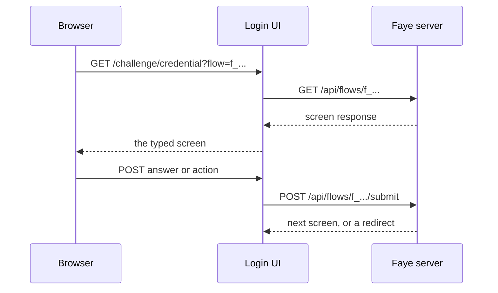

# Sign in screens

This page lists every screen that a person can see during a sign in, a consent or a QR code approval. For each screen it gives the block that shows it, what the person sees, the answers and actions it takes, and the URL path it appears at. It is for flow authors who want to know what their flow looks like, and for engineers who build against the screen protocol.

The source of truth is [`src/schema/screen.schema.json`](../../src/schema/screen.schema.json), screen protocol v1. The Login UI renders each screen in [`flow-screen.tsx`](../../apps/web/apps/login/app/flow-screen.tsx). The texts on this page are the texts in that file and in [`messages.ts`](../../apps/web/apps/login/lib/messages.ts).

## Why screens are typed

Faye shows only screens from a fixed set of typed templates. A flow says which screen comes next. It never says how the screen looks.

- [Charter](../../CHARTER.md) principle 6 says that tenants configure what happens and in what order, not how screens are built. Appearance is limited to branding.
- Founding decision D6 in [ADR 0036](../adr/0036-retire-the-roadmap.md) chose typed screens over free form forms. One renderer serves every tenant, so accessibility and security are reviewed once.

A tenant changes the look only through branding: a name, a logo, a primary color, a corner radius, a show password button and a sign up button ([ADR 0033](../adr/0033-login-page-customization-and-keep-me-signed-in.md)). See [Customize the login page](../console/login-page.md).

To show something new, a contributor adds a screen type to the protocol, schema first. See [the rules every change follows](../develop/codebase.md#the-rules-every-change-follows).

## How a screen reaches the browser

The Faye server answers each step with a screen response. The Login UI renders it and posts the person's answer back.

A screen response has these fields:

| Field | Meaning |
|---|---|
| `flowId` | The flow, `f_` and random characters. |
| `nonce` | Single use. The next answer must echo it, so a stale page cannot answer. |
| `step` | The id of the innermost step around the screen, when there is one. |
| `path` | The URL path to show the screen at. |
| `screen` | The screen: its `type` and its own fields. |
| `branding` | The tenant's branding, when it set any. |

The flow is bound to the browser that started it. Faye sets a cookie named `faye_flow_{flowId}` when the flow starts, and answers only requests that carry it.

## Screens at a glance

| Screen | Shown by | Default path | Heading |
|---|---|---|---|
| [`identifier`](#identifier) | `identifier` block | `/login` | Sign in (for screen readers only) |
| [`password`](#password) | `password` block | `/challenge/{step}` | Enter your password |
| [`method_picker`](#method_picker) | a choice (`alternative:`) | `/challenge/{step}` | Choose how to continue |
| [`passkey`](#passkey) | `passkey` and `add-passkey` blocks | `/challenge/{step}` | Use your passkey, or Create a passkey |
| [`otp`](#otp) | `totp` block | `/challenge/{step}` | Enter your code |
| [`otp_enroll`](#otp_enroll) | `enroll-totp` block | `/challenge/{step}` | Set up an authenticator app |
| [`code_sent`](#code_sent) | `email-code` and `sms-code` blocks | `/challenge/{step}` | Check your email, or Check your phone |
| [`phone_enroll`](#phone_enroll) | `add-phone` block | `/challenge/{step}` | Add a phone number |
| [`qr`](#qr) | `qr` block | `/challenge/{step}` | Scan with your phone |
| [`qr_approve`](#qr_approve) | `qr-approve` block | `/challenge/{step}` | Sign in to {app}?, or Approve this sign in? |
| [`consent`](#consent) | `consent` block | `/consent` | {app} wants to access your account |
| [`error`](#error) | no block | `/error` | Can't sign in |

Every screen after `identifier` shows the identifier being signed in, as a chip under the heading, when the server sends it.

## The screens

### identifier

The first screen of every sign in. The `identifier` block always runs first in `login:` and in `approve:`.

- **What the person sees:** the tenant's name or logo, a field labeled **Email** and a **Continue** button. The field is prefilled from `login_hint` when the application sends one.
- **With `with: { password: true }`:** the screen asks for the email and the password together, with a **Sign in** button. It then never offers a passkey.
- **With `with: { passkey: true }`:** the browser offers passkeys in the field's autofill, and a **Sign in with a passkey** button appears under a rule. Every account sees both, so they reveal nothing about which accounts have a passkey.
- **When the tenant turns them on:** a **Keep me signed in** checkbox, and a **Sign up** button. Sign up is not built yet: the button opens a dialog that says "Sign up isn't available yet" ([ADR 0033](../adr/0033-login-page-customization-and-keep-me-signed-in.md)).
- **Answers:** `{identifier}`, `{identifier, password}` or `{passkey}`. Each may carry `remember` when the screen offers it.

### password

Shown by the `password` block.

- **What the person sees:** **Enter your password**, a **Password** field and a **Sign in** button.
- **When the tenant turns it on:** a button in the field that shows or hides what the person typed.
- **Answer:** `{password}`.

### method_picker

No block names this screen. The engine shows it for a choice (`alternative:`) when more than one option is enabled and no hook picks one. If only one option is enabled, the engine takes it without asking. If none is enabled, the step fails with `no_method`.

- **What the person sees:** **Choose how to continue** and one button per enabled option, in flow order.
- **Button labels by option id:** `password` is **Password**; `passkey` is **Passkey**; `totp`, `otp` and `app` are **Authenticator app**; `phone` and `sms` are **Text message**; `email` is **Email**; `qr` is **QR code**; `enroll` is **Set up an authenticator app**. Any other id shows as written in the flow.
- **Answer:** `{method}`, the option id.
- **Path:** always the default path. A `path:` setting does not apply to it.

### passkey

Shown by two blocks. The `passkey` block uses a passkey. The `add-passkey` block creates one for the signed in person.

- **Using a passkey:** **Use your passkey** and a **Use passkey** button, which opens the browser's passkey dialog.
- **Creating a passkey:** **Create a passkey**, the text "Next time, sign in with your fingerprint, face or device PIN instead of a password.", a **Create a passkey** button and a **Not now** button. With `with: { required: true }`, **Not now** is gone and the person must create one ([ADR 0038](../adr/0038-required-enrollment.md)).
- **If the person closes the browser dialog:** "The passkey request was cancelled. Try again."
- **Answers:** `{passkey}`, the browser's credential as JSON, or `{skip: true}` for **Not now**.

### otp

Shown by the `totp` block.

- **What the person sees:** **Enter your code**, six boxes labeled **6 digit code**, and a **Verify** button. A complete code submits itself, also when pasted.
- **Answer:** `{code}`, six digits.

### otp_enroll

Shown by the `enroll-totp` block.

- **What the person sees:** **Set up an authenticator app**, the text "Scan this code with your authenticator app, then enter the 6 digit code it shows.", a QR code, the secret under **Or enter this key:** with a **Copy key** button, and the six code boxes with **Verify**.
- **On a retry:** the screen keeps the same secret, so the person does not scan a new QR code.
- **Answer:** `{code}`.

### code_sent

Shown by the `email-code` block (channel `email`) and the `sms-code` block (channel `sms`) ([ADR 0032](../adr/0032-delivered-one-time-codes-and-qr-sign-in.md)).

- **What the person sees:** **Check your email** or **Check your phone**, then "We sent a 6 digit code to {address}. It expires in {N} minutes." The address is masked. Then the six code boxes with **Verify**.
- **Resend:** a button counts down, "Send a new code in {N}s", then reads **Send a new code**. When no more codes may be sent, the screen says "No more codes can be sent for this sign in."
- **Answer:** `{code}`.
- **Action:** `resend`, with an empty payload. It sends another code, spends no attempt and keeps the same screen.

A tenant may use these blocks only when it has a delivery channel for them: a webhook or the outbox folder. Without one, Faye refuses to publish a flow that uses them. See [Configuration](configuration.md#keys-of-a-tenant).

### phone_enroll

Shown by the `add-phone` block, for the signed in person.

- **First, the number:** **Add a phone number**, the text "We'll text a code to this number. Include the country code.", a field labeled **Phone number, e.g. +1 555 123 4567**, a **Text me a code** button and a **Not now** button. With `with: { required: true }`, **Not now** is gone ([ADR 0038](../adr/0038-required-enrollment.md)).
- **Then, the code:** "We texted a 6 digit code to {number}.", the six code boxes with **Verify**, the resend countdown, and **Use a different number**.
- **Answers:** `{code}`, or `{skip: true}` for **Not now**.
- **Action:** `send`, with `{phone}` in the international E.164 format, such as `+15551234567`. It texts a code and keeps the same screen. The Login UI checks the format before it sends. A wrong format shows "Enter the number with its country code, starting with +."

### qr

Shown by the `qr` block, on the device that signs in. The flow must also have an `approve:` section, which runs on the phone.

- **What the person sees:** **Scan with your phone**, the text "Scan this code with your phone's camera and sign in there. When asked, pick the number shown here.", a QR code, and **Your number** with a two digit number. Under it, "Waiting for your phone", and the warning "Only approve a code you scanned yourself, on a screen in front of you."
- **Action:** `poll`, with an empty payload, every 2 seconds. Each poll reads whether the phone approved.
- **Answer:** an empty payload, sent once a poll reads a decision: `approved`, `refused` or `expired`.

The QR code encodes the Login UI's `/approve/{token}` URL.

### qr_approve

Shown by the `qr-approve` block, on the phone. It belongs only in the `approve:` section, after the identifier and a credential.

- **How the phone gets here:** the camera opens `/approve/{token}` in the Login UI. That route starts the approve flow on the server and goes to its first screen. An unknown, used or expired token shows `/error`.
- **What the person sees:** **Sign in to {app}?** (or **Approve this sign in?** when the app has no name), "A sign in is waiting on {device}." when the device is known, "Pick the number that device shows. If you did not start it, pick none and close this page.", and three number buttons.
- **Answer:** `{number}`. A wrong number refuses the sign in on the other device.
- **After the answer:** **Approved** with "Return to your other device to continue.", or **Not approved** with "Nothing was signed in. Start again on your other device."

### consent

Shown by the `consent` block. It must be a top level step of `login:`. It runs after the sign in is accepted, on the authorization server's consent challenge ([ADR 0026](../adr/0026-consent-as-a-step.md)).

- **What the person sees:** **{app} wants to access your account**, the app's initial beside a person icon, and the identifier chip. Then "This will allow {app} to:" and one row per requested scope. The footer shows **Client ID** and the client id.
- **Scope labels:** `openid` is **Know who you are**; `profile` is **See your name**; `email` is **See your email address**; `offline_access` is **Stay connected**. Each has a short detail line. Other scopes show as written.
- **Buttons:** **Cancel** and **Allow**, under the text "Only allow this if you trust {app}. It will receive the information listed above."
- **Answer:** `{decision: "allow"}` or `{decision: "deny"}`.

### error

No block of the flow DSL shows this screen today. It exists in the protocol for flows written directly in the intermediate representation (IR), as `["screen", "error", {"code": "blocked"}]`.

- **What the person sees:** **Can't sign in**, a message for the code, and a **Back to the app** button. The code `blocked` shows "Sign in is not available for this account." Any other code shows "We couldn't sign you in."
- **Answer:** an empty payload.

The Login UI also has its own `/error` page, which is not a screen of a flow. It appears when a flow cannot be loaded, and after a failed sign in, at `/error?reason=failed` ([ADR 0031](../adr/0031-failed-sign-in-stays-on-faye.md)). When `DEMO_SIGN_IN_URL` is set, that page shows **Start now** and starts a new sign in after 5 seconds.

## URL paths

Each screen appears at a URL path, with the flow in the query: `/challenge/credential?flow=f_...` ([ADR 0029](../adr/0029-screen-paths.md)). The path is a label. It never selects the screen: the flow alone decides which screen it waits on.

| Default path | Screens |
|---|---|
| `/login` | `identifier` |
| `/challenge/{step}` | Every other screen. `{step}` is the id of the innermost step around the screen, or nothing when there is none. |
| `/consent` | `consent` |
| `/error` | `error` |

A step's `path:` setting replaces the default. It must keep the first segment of the default and add at most three lowercase segments, such as `/login/both` or `/challenge/second/totp`. The checker refuses any other path. The method picker always uses its default.

The Login UI moves the address bar to each new screen's path, and replaces the history entry instead of adding one. An answered screen's nonce is spent, so the browser's back button cannot return to it.

Other paths of the Login UI:

- `/` goes to `/login`.
- `/login` with no flow goes to `DEMO_SIGN_IN_URL` when it is set, and otherwise to `/error`.
- `/approve/{token}` starts the phone's side of a QR code sign in.

## Error messages

When an answer fails, the flow returns to the same screen with an error code. The Login UI shows the message under the fields. If the step has attempts left, the message ends with "{N} attempts left." or "1 attempt left."

| Code | Message |
|---|---|
| `invalid_credentials` | That didn't work. Check what you entered and try again. |
| `invalid_code` on `code_sent` or `phone_enroll` | That code didn't work. Enter the latest code we sent. |
| `invalid_code` on other screens | That code didn't work. Enter the current code from your authenticator app. |
| `code_expired` | That code has expired. Send a new code. |
| `send_limited` | Too many codes were sent. Wait a moment, then try again. |
| `qr_expired` | That QR code expired. Scan this new one. |
| `qr_not_approved` | That QR code was not approved. Scan this new one, or sign in another way. |
| `wrong_number` | That was not the number on your other device. |
| `wrong_account` | That isn't the account you're signed in with. Enter your own email address. |
| any other code | Something went wrong. Try again. |

When the server refuses a request itself, the Login UI shows one of these messages:

| Error | Message |
|---|---|
| `flow_not_found`, `flow_finished` | This sign in has expired. Go back to the app and try again. |
| `flow_expired` | This sign in timed out. Go back to the app and start again. |
| `stale_nonce`, `conflict` | This page is out of date. Reload to continue. |
| `invalid_submission` | Please fill in the field. |
| `unknown_action` | That isn't possible on this page. Reload to continue. |
| `host_error` | We couldn't finish signing you in. Go back to the app and try again. |

## Accessibility

These properties are true of the Login UI's code today:

- **Labels.** Every field has a label for assistive technology, and the same text as its placeholder. The code boxes have the visible label **6 digit code**. Groups of buttons have names: **Methods** for the method picker and **Numbers** for the QR approval.
- **Autocomplete.** The email field uses `autocomplete="username"`, or `username webauthn` when passkey autofill is offered. Password fields use `current-password`. The phone field uses `tel`.
- **Focus.** Each new screen starts empty. A screen with a field moves focus to it. The method picker moves focus to its first button, and the passkey and consent screens to their main button. The QR code screens and the error screen do not move focus.
- **Errors.** The error message sits in an element with `role="alert"` and `aria-live="assertive"`. A field with an error has `aria-invalid` and points to the message with `aria-describedby`.
- **Busy state.** A submit button has `aria-busy` while the server answers.
- **Show password.** The button is named **Show password** or **Hide password**, and uses `aria-pressed` and `aria-controls`.
- **QR codes.** Each QR code is an image with a text label. The number beside it is announced politely when it changes.
- **Language and theme.** The page declares `lang="en"`. The sign in screens use a light theme only.

The Login UI also refuses to be framed by another site. It sends `Content-Security-Policy: frame-ancestors 'none'` and `X-Frame-Options: DENY`.

## Next steps

- [Flow DSL reference](dsl.md): the blocks that show these screens, and their settings.
- [Customize the login page](../console/login-page.md): branding and the optional controls.
- [Configuration](configuration.md): the Login UI's environment variables.
- [Core IR specification](../ir-spec.md): how the engine waits on a screen.
