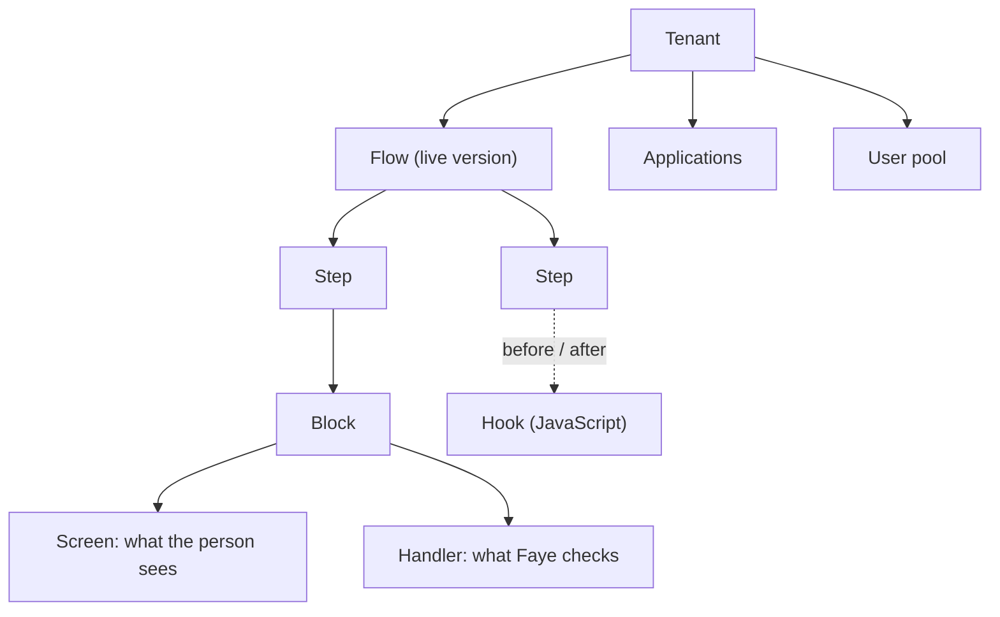

# Core concepts

This page explains the main ideas in Faye and how they fit together. Read it once before you write a flow. Each idea links to the page that covers it in depth. For short definitions, see the [Glossary](../reference/glossary.md).

## The big picture

The diagram shows how the ideas relate. A tenant has one live flow. A flow has steps. Each step uses a block, and each block shows a screen and runs a handler. Hooks can attach to steps.



## Tenant

A **tenant** is one customer or one product line that shares a sign in. Each tenant has its own flow, its own applications, its own user pool, its own branding and its own policy, such as "every sign in needs two factors".

The demo stack has two tenants: `acme` and `bank`. The authorization server decides which tenant a sign in belongs to, from the application's registration (`metadata.tenant`).

## Flow

A **flow** is the recipe for a sign in. You write it as a YAML file, the **flow file**. A flow lists **steps** that run in order, from top to bottom.

```yaml
flow: password-only
version: 1

login:
  steps:
    identify:
      block: identifier
    credential:
      block: password
```

A flow file can have up to two sections that a person goes through:

- `login` is the sign in itself. If it contains a consent step, the steps from that point on run later, when the authorization server asks for consent.
- `approve` is the phone's side of a QR code sign in.

Faye compiles each section to an **entry** of the flow. Learn the syntax in [Write flows in YAML](../build/flow-syntax.md).

## Step and block

A **step** is one stage of a flow, with a name you choose, such as `identify` or `second-factor`. Most steps use a **block**.

A block is a built in piece of sign in. It always shows the same screen and always runs the same verification code. For example, the `password` block shows the password screen and checks the password. You cannot change what a block does, only where it runs and a few settings, such as how many attempts a person gets.

A step can also be:

- a **choice** (`alternative:`): several options, of which the person or a hook picks one;
- a **group** (`steps:`): steps that run together under one condition;
- a **set** (`set:`): writes a value the flow can test later;
- a **fail** (`fail:`): ends the sign in with a reason.

Any step can have a **condition** (`if:`). A step whose condition is false is skipped.

## Screen and handler

A **screen** is one page of the sign in, such as "Enter your password". Screens are typed templates: Faye has a fixed list of screen types, and the Login UI knows how to draw each one. A tenant can brand them but not redesign them. See [Sign in screens](../reference/screens.md).

A **handler** is the code that checks what the person entered. Only built in handlers exist. A handler that verifies something about the person, such as a password, is a **credential**.

## Hook

A **hook** is a small JavaScript function that a tenant writes. A hook can score the risk of a sign in, pick an option of a choice, or add a value for later steps. A hook runs in a sandbox with a time limit and no network, except for the targets the tenant grants.

A hook can do only three things: set values, fail the step, or pick an option. It can never sign a person in. See [Hooks](../build/hooks.md).

## Assurance: amr and acr

When a flow succeeds, Faye tells the authorization server two things about how the person signed in:

- **`amr`** (authentication methods references) lists the methods that verified, such as `pwd` for a password and `otp` for a one time code.
- **`acr`** (authentication context class reference) is the overall level: `faye:1fa` for one factor or `faye:2fa` for two factors of different kinds.

The engine computes both from the credentials that really verified. No flow, setting or hook can write them. An application can ask for a level with the OpenID Connect `acr_values` parameter, and Faye refuses a sign in that does not reach it.

## Checker and path

The **checker** reads a flow before it runs and lists every **path** through it. A path is one way a sign in can go, such as "identify, password, success with `pwd`".

The checker refuses a flow if any path can succeed without a credential. It also refuses a flow with a path that ends with one factor when the tenant requires two. There are a few more rules. Because flows are small and always end, the checker can list every path. See [How the IR is designed](../understand/ir-design.md).

## Draft, version and publish

You edit a **draft** of a tenant's flow. When you **publish** the draft, the checker runs and the draft becomes a new **version**. The newest published version is **live**: new sign ins use it.

A sign in that already started keeps its version to the end, so publishing never breaks a person in the middle of signing in. You can **roll back** to an earlier version at any time.

A **preview** runs a draft with a real application before you publish it. See [Preview a draft](../console/preview.md).

## Engine and host

The **engine** runs flows. It shows a screen, waits for the answer, checks it, and moves on. Between two screens, the whole state of a sign in is plain data in the database, so a server restart loses nothing. See [How the engine works](../understand/engine.md).

The engine knows no authorization server. A **host** adapter connects it to one. Faye ships a host for Ory Hydra. Supporting another authorization server means writing another host, not changing the engine or the flows.

## IR

Faye compiles each flow file to an **intermediate representation (IR)**: a small JSON form with eleven kinds of node. The checker and the engine read the IR, not the YAML. You never need to read or write the IR to build a flow. It exists so that each part of Faye can change on its own. See [How the IR is designed](../understand/ir-design.md).

## Next steps

- Run the demo and see these ideas in action: [Quickstart](quickstart.md).
- Write a flow: [Write your first flow](../build/first-flow.md).
