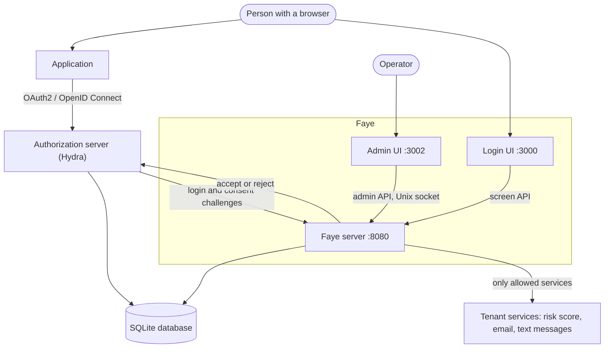
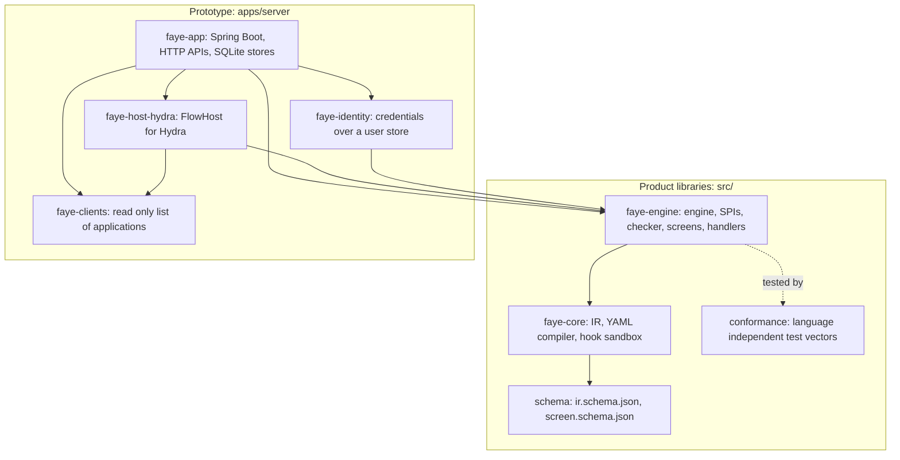
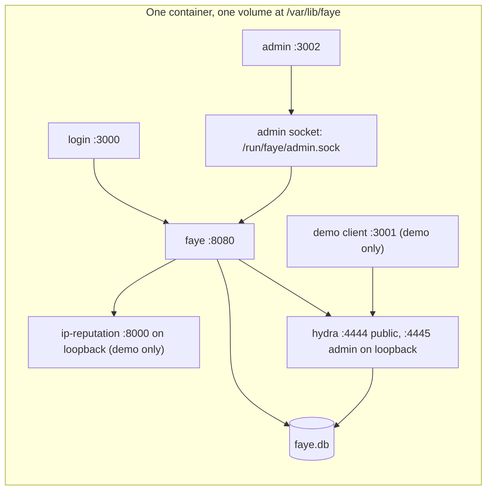

# Architecture

This page shows the parts of Faye and how a sign in moves through them. It is for engineers who deploy Faye, review it, or change it. To learn how the engine works inside, see [How the engine works](engine.md).

## Faye in its surroundings

The diagram shows Faye and the systems around it. The application never talks to Faye. The application talks to the authorization server. The authorization server hands the login and consent pages to Faye.



Who does what:

| Part | Its job | It does not |
|---|---|---|
| **Authorization server** (Hydra) | Speaks OAuth2 and OpenID Connect, registers applications, issues tokens, keeps login sessions. | Show any screen. It sends the browser to Faye for login and consent. |
| **Faye server** | Runs flows with the engine, checks every answer, tells the authorization server the result. Serves the screen API, and the admin API on a Unix socket. | Issue tokens or talk to applications. |
| **Login UI** | Draws each typed screen and posts the person's answer to the server. | Make any security decision. It has no database access. |
| **Admin UI** | Lets an operator edit, check, preview, publish and roll back flows, and read applications and users. | Run on a network. It has no sign in, so it must run only on your own machine. |
| **Database** | One SQLite file holds Faye's state. In the container image, the same file also holds Hydra's state. | Hold state in memory. Faye keeps nothing between requests outside the database. |

## A sign in, end to end

The diagram shows a sign in with a password and a consent screen. The browser goes back and forth between the parts. The parts never share a browser session.

```mermaid
sequenceDiagram
  autonumber
  participant B as Browser
  participant App as Application
  participant H as Hydra
  participant F as Faye server
  participant UI as Login UI
  B->>App: Click "Sign in"
  App->>B: Redirect to Hydra (authorize)
  B->>H: GET /oauth2/auth
  H->>B: Redirect to Faye with a login challenge
  B->>F: GET /login?login_challenge=...
  F->>F: Load the request, start the tenant's flow
  F->>B: Set the flow cookie, redirect to the first screen
  B->>UI: GET /login?flow=f_...
  UI->>F: GET /api/flows/{id}
  F-->>UI: Screen: identifier
  B->>UI: Submit email, then password
  UI->>F: POST /api/flows/{id}/submit
  F->>H: Accept login (subject, amr, acr)
  F-->>UI: Redirect back to Hydra
  H->>B: Redirect to Faye with a consent challenge
  B->>F: GET /consent?consent_challenge=...
  F->>H: Accept consent (scopes, claims)
  H->>B: Redirect to the application with a code
  B->>App: Callback; the application gets tokens from Hydra
```

Two words in the diagram need a definition. A *login challenge* is an opaque id that Hydra creates for one login request. Faye uses it to read that request and to answer it. The *flow cookie* holds a random secret that ties the sign in to this browser, so no other browser can continue it.

The flow decides which screens appear. For example, the shipped flows skip the consent screen for first party applications. A remembered session may skip the login screens. [How the engine works](engine.md#the-life-of-one-sign-in) shows the same sign in from inside the engine.

## Inside the Faye server

Faye is two shippable libraries and a prototype application that uses them ([ADR 0034](../adr/0034-two-shippable-modules-under-src.md)).

The diagram shows the modules and which module depends on which. Arrows point from a module to what it uses.



- **`faye-core`** holds the intermediate representation (IR) types and their JSON codec, the YAML to IR compiler, and the JavaScript hook runtime (QuickJS compiled to WebAssembly).
- **`faye-engine`** holds the engine and the service provider interfaces (SPIs) that a host implements, in `faye.engine.spi`. It also holds the checker and `Publisher`, the screen catalog, and the built in handlers and blocks. It knows no authorization server.
- **`faye-app`** is the Spring Boot application. It wires the engine to SQLite stores, serves the HTTP APIs, and runs the code outbox for emailed and texted codes.
- **`faye-host-hydra`** implements `FlowHost` for Hydra's admin API, and the read only list of applications.
- **`faye-identity`** implements the credential interfaces (passwords with Argon2, authenticator app codes, passkeys) over each tenant's user pool.
- **`faye-clients`** reads the applications registered in the authorization server, for the Admin UI.

[Read the codebase](../develop/codebase.md) gives a guided tour of each module.

## Boundaries and contracts

Faye's parts meet at a few written contracts. You can replace the part on one side of a contract without a change to the part on the other side.

| Boundary | Contract | Why it matters |
|---|---|---|
| Engine and authorization server | `FlowHost`, with the closed fields of `HostParams` | A second authorization server needs only a new host. Flows read `host.*` fields that every host must fill. |
| Engine and user directory | `UserDirectory`, `PasswordAuthenticator`, `OtpVerifier`, `PasskeyAuthenticator` and the other credential interfaces | You can connect an existing user store without changing handlers. |
| Server and Login UI | The screen protocol, [`screen.schema.json`](../../src/schema/screen.schema.json) | One renderer for every tenant. The TypeScript types are generated from the schema. |
| Author tools and engine | The IR, [`ir.schema.json`](../../src/schema/ir.schema.json) and the [Core IR specification](../ir-spec.md) | The domain specific language (DSL), the checker, the editor and the engine change on their own. Another engine can use the conformance vectors to prove that it behaves the same. |
| Admin UI and server | The admin API, served only on a Unix domain socket with a token ([ADR 0028](../adr/0028-admin-api-on-a-unix-domain-socket.md)) | Nothing on the network can publish a flow. |

## Where state lives

All of Faye's state is in one SQLite file. In the container, the file is `/var/lib/faye/faye.db`, on one volume ([ADR 0017](../adr/0017-one-sqlite-database.md)). Schema changes run as Flyway migrations at startup ([ADR 0020](../adr/0020-versioned-schema-migrations-with-flyway.md)).

| Table | Holds |
|---|---|
| `faye_flow` | Each sign in in progress: where the flow is and what it knows (its *continuation*), as JSON, with a revision number. |
| `faye_version`, `faye_version_source` | Every flow version by its hash, and the YAML it came from. Published versions are never deleted. |
| `faye_history`, `faye_tenant` | Which version each tenant published when, which one is live, and each tenant's draft, settings and preview scenario. |
| `faye_hook` | Hook code by its hash. |
| `faye_user` | Each tenant's user pool: password hashes, authenticator app secrets, passkeys. |
| `faye_outbox`, `faye_key` | Codes waiting to be emailed or texted, and the server key for the message authentication code (MAC) of each code. |
| `faye_qr_grant` | QR codes waiting to be approved from a phone. |
| `faye_trace` | Preview trace events. |

Between two screens, a sign in is only a row in `faye_flow`. No part of the sign in stays in the server's memory. So a restart of the server loses nothing.

## Tenants

A tenant is chosen per application, not per request. Each application registered in the authorization server carries `metadata.tenant`. The host reads `metadata.tenant` when a sign in starts, and the engine runs that tenant's live flow.

Each tenant has its own flow, user pool, branding, policy, allowed handlers and screens, and egress grants for hooks. An example of a policy is "require two factors". The prototype sets tenants in `faye.tenants` in [`application.yaml`](../../apps/server/faye-app/src/main/resources/application.yaml). See [Configuration](../reference/configuration.md).

## Deployment

Faye ships as one container image that runs every process under the s6 supervisor ([ADR 0023](../adr/0023-one-container-many-processes.md)). The diagram shows the processes in the image and the ports they listen on.



- `FAYE_SERVICES` picks which processes run. The default is `hydra,faye,login,admin`.
- `FAYE_DEMO=true` adds the demo client, the IP reputation stub, and two one time jobs that register demo applications and seed demo users.
- The compose file publishes the Admin UI on `127.0.0.1` only. See [Keep the Admin UI on your own machine](../console/overview.md#keep-the-admin-ui-on-your-own-machine).

The single container is how the prototype ships and how the demo runs. It is not a production setup: high availability, several regions and rate limiting at scale are not built yet. See [Vision and north star](vision.md#where-faye-is-today).

## Next steps

- Follow a sign in through the engine: [How the engine works](engine.md).
- See the guarantees and where they are enforced: [Security model](security.md).
- Run it: [Quickstart](../start/quickstart.md).
