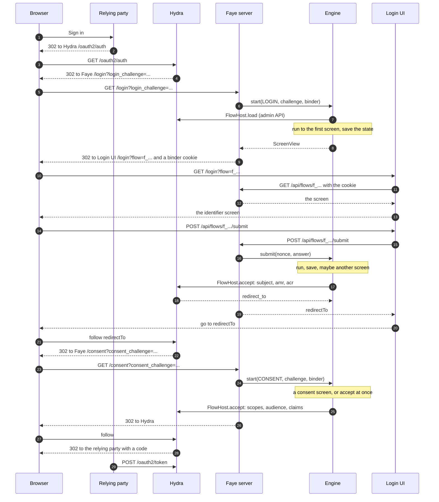
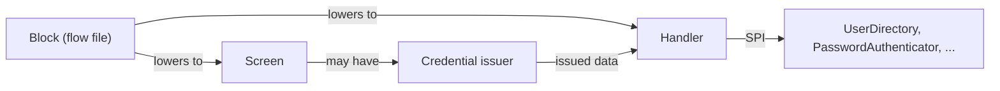

# How the engine works

This page explains the runtime that runs every flow. This page is for engineers who want to know what happens between the authorization server's redirect and its accept. It shows how a flow waits on a screen, resumes, fails, and computes the authentication methods references (`amr`) and the authentication context class reference (`acr`). For the exact rules, read the [Core IR specification](../ir-spec.md). This page gives the model behind those rules.

## What the engine is

The engine is a Java library in [`src/faye-engine`](../../src/faye-engine), package `faye.engine`. It runs the intermediate representation (IR) that the compiler makes from a flow file. Its main class is [`Engine`](../../src/faye-engine/src/main/java/faye/engine/Engine.java).

The engine is not a server, and it renders nothing. It does not know which authorization server it serves. It talks to the authorization server only through one interface, [`FlowHost`](../../src/faye-engine/src/main/java/faye/engine/spi/FlowHost.java). Through this interface, the engine can load a request, accept it, or reject it. The prototype's host is [`HydraFlowHost`](../../apps/server/faye-host-hydra/src/main/java/faye/host/hydra/HydraFlowHost.java). [`BoundaryTest`](../../src/faye-engine/src/test/java/faye/engine/BoundaryTest.java) fails the build if the engine names a host.

An embedder builds an engine with `Engine.builder()`. The embedder gives the engine every part that it uses:

| Part | What it does |
|---|---|
| `FlowVersions` | Reads published versions by hash, and each tenant's current version. |
| `FlowStore` | Keeps suspended flows. Its `replace` is a compare and set on the revision. |
| `FlowHost` | Loads, accepts and rejects the authorization server's requests. |
| `HandlerRegistry` | The handlers that flows may call. |
| `ScreenRegistry` | The screen types that flows may show, with their credential issuers. |
| `TenantPolicies` | Each tenant's settings: whether multi factor authentication (MFA) is required, allowlists, egress grants, flow settings. |
| `HookRunner` | Runs hooks. The default fails every hook. |
| `Previews` | The draft that preview clients run, and where their traces go. |
| `Clock` | The time that flow settings are measured on. |

The engine discovers nothing. It runs exactly the handlers, screens and issuers that it is given.

## The life of one sign in

The diagram shows one sign in with the demo stack. The parts are an application, Hydra, the Faye server on port 8080, the engine inside the server, and the Login UI on port 3000. The diagram calls the application the relying party, its OpenID Connect name.



In words:

1. The relying party sends the browser to Hydra. Hydra sends the browser to `GET /login?login_challenge=...` on the Faye server. That endpoint is [`FlowController`](../../apps/server/faye-app/src/main/java/faye/app/FlowController.java).
2. The server makes a binder: 32 random bytes. It calls `Engine.start` with the challenge and the binder.
3. The engine asks the host for the request. The host returns the client, the tenant, the preview flag, and the request's parameters (`acr_values`, `login_hint`, `ui_locales`, scope, audience, `skip`, `subject`).
   Hydra's host reads the tenant from the client's `metadata.tenant`, and the preview flag from `metadata.preview`.
4. The engine picks the version. This is the tenant's current version, or the tenant's draft for a preview client. If there is no version to run, the host rejects the request.
5. The engine runs the flow until it reaches a screen, saves the flow state, and returns the screen.
6. The server sets the cookie `faye_flow_<flowId>` to the binder. Then the server redirects to the Login UI at the screen's path, for example `/login?flow=f_...`. If the flow fails before its first screen, the server redirects to `/error?reason=failed` instead.
7. The Login UI's server reads the screen with `GET /api/flows/{flowId}`. It forwards only that flow's cookie.
8. The person answers. The Login UI posts the answer to its own route. That route forwards the answer to `POST /api/flows/{flowId}/submit` as `{nonce, action, payload}`.
9. The engine resumes the flow. It returns either the next screen or the host's completion.
10. When the login succeeds, the host accepts it with the subject, `amr`, `acr` and a context of `{flowId, versionHash}`. Hydra answers with a redirect, and the Login UI sends the browser there.
11. Hydra then sends the browser to `GET /consent?consent_challenge=...`. The engine runs the consent entry of the same version, and the host accepts the consent.

## How a flow runs

### The IR that the engine runs

The engine runs IR, never YAML. This is [`password-only.yaml`](../../apps/server/faye-app/src/main/resources/flows/password-only.yaml), a flow that ships with the server:

```yaml
flow: password-only
version: 1

login:
  steps:
    identify:
      block: identifier
    credential:
      block: password
```

The flow compiles to this IR, which is the file [`src/conformance/flows/password-only.json`](../../src/conformance/flows/password-only.json). `FlowApiTest.tenantFlowsAreConformanceFlows` checks that both have the same hash.

```json
["flow", 1, "password-only", 1,
  ["entry", "login", "authenticate",
    ["seq",
      ["step", "identify", ["seq", ["screen", "identifier"], ["call", "identity.resolve"]]],
      ["step", "credential", ["retry", 3, ["seq", ["screen", "password"], ["call", "password.verify"]]]],
      ["succeed"]]]]
```

### Frames and child index paths

The engine is a small step interpreter: it runs one small step at a time, over an explicit continuation. The continuation is a stack of frames. Each frame names a node of the entry body by its child index path. A child index path is the list of child positions from the body down to the node.

In the example, `[]` is the top `seq`. `[1]` is the step `credential`, `[1, 0]` is its `retry`, and `[1, 0, 0, 0]` is the `password` screen.

There are five kinds of frame, defined in [`Frame`](../../src/faye-engine/src/main/java/faye/engine/Frame.java):

| Frame | Meaning |
|---|---|
| `Eval(path)` | Evaluate the node at `path`. |
| `SeqNext(path, next)` | Continue the `seq` at `path` with child `next`. |
| `StepExit(path, id)` | Leave step `id`. While this frame is on the stack, it marks the innermost step. |
| `RetryExit(path, attempt)` | Leave the `retry` at `path` during attempt `attempt`. A failure unwinds the stack to this frame. |
| `Pick(path)` | The `choose` at `path` waits on the method picker. |

A run pops one frame at a time and pushes the frames that come next. It stops when the flow waits on a screen or the entry ends. Frames hold only paths into the pinned IR. So the whole continuation is small, plain data.

### Suspend on a screen

When a run reaches a `screen` node, the flow suspends. This is what happens:

1. The engine prepares the screen's data. The data is what the screen spec adds, plus what the screen's credential issuer issues. An issuer issues, for example, a WebAuthn challenge, a time based one time password (TOTP) secret, or a message authentication code (MAC) of a sent code.
2. The engine makes a fresh nonce: `n_` followed by 16 random bytes.
3. The engine records what the flow waits on: the path, the screen type, the innermost step, the nonce, the data, and any error and attempts left.
4. The engine saves the flow state with the rest of the stack.

When the person in the example sees the password screen, the stack holds four frames, from the bottom: `SeqNext([], 2)`, `StepExit([1], "credential")`, `RetryExit([1, 0], 1)` and `SeqNext([1, 0, 0], 1)`. The answer resumes the run at `SeqNext([1, 0, 0], 1)`. That frame evaluates the `call` to `password.verify`.

A run can reach a choice with more than one enabled option. If no hook pick and no earlier answer decides the choice, the flow suspends on the engine's own `method_picker` screen with a `Pick` frame.

### What the saved state holds

The saved state is a [`FlowState`](../../src/faye-engine/src/main/java/faye/engine/FlowState.java) record. Nothing about a flow stays in the engine between requests. So a new engine instance can resume any flow (`EngineTest.progressSurvivesANewEngineInstance`).

| Field | What it holds |
|---|---|
| `flowId` | `f_` and 16 random bytes. |
| `tenantId` | The tenant the host chose. |
| `versionHash` | The pinned version. It never changes. |
| `kind`, `entry` | The host challenge (login, consent, approve) and the entry it runs. |
| `hostRef` | The host's id for the request, such as Hydra's challenge. |
| `binder` | The hex SHA-256 of the binder. The browser holds the binder itself. |
| `stack` | The continuation. |
| `env` | What the flow can read: `request`, `client`, `tenant`, `host`, `user`, `vars`, and `auth` (the subject and each verified credential with its amr). |
| `awaiting` | The screen the flow waits on, with its nonce and data. Null after the flow finished. |
| `pending` | The writes that the entry staged. They apply only if the entry succeeds. |
| `revision` | Raised on every save, for the compare and set. |
| `preview`, `proven`, `remember`, `expiry` | The preview flag, what a consent may hand over, "keep me signed in", and the flow's time limits. |

[`FlowStateCodec`](../../src/faye-engine/src/main/java/faye/engine/FlowStateCodec.java) writes the state as JSON with sorted map keys and a `stateFormat` of 1. The prototype keeps the state in the SQLite table `faye_flow`, with the columns `id`, `rev`, `state` and `expires_at` ([`SqliteFlowStore`](../../apps/server/faye-app/src/main/java/faye/app/SqliteFlowStore.java)). A state that cannot be read, or that does not fit its pinned version, reads as absent. Its flow ends, and the person starts again.

> [!NOTE]
> Credential material that an issuer returns stays in `awaiting.data`. This material reaches only the handlers that check the answer. The issuer decides which public part the screen shows. The material is never in `env`, so conditions and hooks cannot read it.

## Resume on submit

`Engine.submit` takes the flow id, the binder, the nonce and the answer. It runs these checks in order. Each refusal leaves the stored state unchanged.

1. **Load.** The flow must exist. Its stored binder hash must match the hash of the binder that the browser sent, in a constant time compare. The flow must not be finished or past its time limits. The state must fit its pinned version, and that version must still run with this engine's catalogs.
2. **Nonce.** The nonce must be the one that the flow waits with. A replayed or old nonce is `stale_nonce`.
3. **Keep me signed in.** On a screen that offers it, the engine takes a boolean `remember` from the answer and records it.
4. **Accepts.** The screen spec must accept the answer. If it does not, the result is `invalid_submission`.
5. **Run.** The engine resumes the run with the answer, and with the screen's issued data as the answer's context.
6. **Save.** The store replaces the state only if the stored revision is the one the run started from. In SQLite this is `UPDATE ... WHERE rev = ?`.
7. **Commit.** If the entry succeeded, the engine applies its staged writes (see [Effects](#effects)).
8. **Answer.** The engine returns the next screen, or tells the host the result.

Two submits of the same screen can race: they arrive at the same time, for example after a double click. Only one save wins. The losing submit applies nothing that it staged. It gets the screen that the winning answer led to, as if it had won. If the winning submit finished the flow, the losing submit gets `flow_finished`. Only the winning submit carries the host's redirect. If the stored revision did not change, the losing submit gets `conflict`.

The server maps each refusal to an HTTP status:

| Code | Status | Meaning |
|---|---|---|
| `flow_not_found` | 404 | No such flow, a wrong or missing binder, or a state that does not fit its version. |
| `flow_finished` | 410 | The flow already ended. |
| `flow_expired` | 410 | The flow passed a time limit. |
| `stale_nonce`, `conflict` | 409 | An old nonce, or a lost race. |
| `invalid_submission`, `unknown_action` | 400 | An answer or action that the screen does not take. |

Some screens also take actions: `resend` on `code_sent`, `send` on `phone_enroll`, `poll` on `qr`. The screen's issuer answers an action. No handler runs, no attempt is spent, and the flow stays on the same screen. The engine saves the result under the same compare and set as an answer.

## Failures and retry

A failure is either retryable or terminal. The [Failures](../ir-spec.md#failures) section of the IR specification lists every failure.

| Kind | Examples | What the engine does |
|---|---|---|
| Retryable | A handler's code (`invalid_credentials`, `invalid_code`), a hook's reason or `hook_error`, `no_method`, `issuer_error`, `wrong_account` | Unwind to the innermost `retry` with attempts left and run its body again. If no retry has attempts left, the entry fails. |
| Terminal | `subject_mismatch`, a `fail` reason, a write's commit code, `unauthenticated`, `mfa_required`, `acr_not_satisfied`, `incomplete`, `limit_exceeded` | End the entry. |

To unwind, the engine pops frames until it finds a `RetryExit` whose attempt is less than the retry's limit. It pushes a `RetryExit` for the next attempt and evaluates the retry's body again. The next screen that the flow waits on shows the failure's code in `errors` and the count in `attemptsLeft`.

In the example, a wrong password fails `password.verify` with `invalid_credentials`. The engine unwinds to `RetryExit([1, 0], 1)`, starts attempt 2, and shows the password screen again with `attemptsLeft: 2`.

The engine reports a failed entry to the host as a rejection, with the failure as its reason. For a login, the Login UI then shows `/error?reason=failed` ([ADR 0031](../adr/0031-failed-sign-in-stays-on-faye.md)).

## Handlers, issuers, screens and blocks

Four parts do the work of a step. The diagram shows how they relate.



- A **block** is what a flow author writes: `block: password`. The compiler lowers it to a screen and a call to a handler, usually inside a `retry`. The file [`src/conformance/blocks.yaml`](../../src/conformance/blocks.yaml) lists the blocks ([ADR 0030](../adr/0030-blocks-with-fixed-screens-and-handlers.md)).
- A **screen** is a typed template that the Login UI renders. Its spec says which answers it accepts. The built in screens are `identifier`, `password`, `passkey`, `otp`, `otp_enroll`, `code_sent`, `phone_enroll`, `qr`, `qr_approve`, `consent` and `error`, plus the engine's `method_picker`.
- A **credential issuer** makes the server side material for one screen type, such as a WebAuthn challenge. It is registered with the handlers that check the answer.
- A **handler** does the work after the answer. It reads accounts and credentials only through the service provider interfaces (SPIs) in `faye.engine.spi`. Each handler declares what it may prove, in [`src/conformance/handlers.yaml`](../../src/conformance/handlers.yaml).

| Handler | Block | amr it may prove | Effect |
|---|---|---|---|
| `identity.resolve` | `identifier` | none | `none` |
| `password.verify` | `password` | `pwd` | `none` |
| `webauthn.assert` | `passkey` | `hwk`, `user` | `guard` |
| `webauthn.register` | `add-passkey` | none | `write` |
| `totp.verify` | `totp` | `otp` | `guard` |
| `totp.enroll` | `enroll-totp` | `otp` | `write` |
| `email_code.verify` | `email-code` | `email` | `none` |
| `sms_code.verify` | `sms-code` | `sms` | `none` |
| `phone.enroll` | `add-phone` | none | `write` |
| `qr.redeem` | `qr` | what the approving phone proved | `guard` |
| `qr.approve` | `qr-approve` | none | `write` |
| `consent.record` | `consent` | none | `none` |

A handler returns `Ok` or `Fail`. On `Ok`, an identifying handler (`identity.resolve`) replaces `user.*`. A credential handler records what it proved in `auth`. A handler may prove less than it declares, but never more. The engine refuses an amr value outside the declaration.

## How amr and acr are computed

Only the engine writes `auth`. The engine writes `auth` only from credential handlers that verified. No flow, hook or setting can set `amr` or `acr` ([ADR 0006](../adr/0006-assurance-amr-acr.md)).

`amr` is the list of values that verified credentials proved, in the order they were first proven. [`Acr`](../../src/faye-engine/src/main/java/faye/engine/Acr.java) maps each value to a factor class:

| amr | Proved by | Factor class |
|---|---|---|
| `pwd` | A password | Knowledge |
| `otp` | An authenticator app code | Possession |
| `sms` | A texted code | Possession |
| `hwk` | A passkey | Possession |
| `user` | A passkey with user verification | Inherence |
| `email` | An emailed code | Counts alone, but never as a second factor |

`acr` is `faye:2fa` when the amr covers two or more distinct factor classes. Otherwise it is `faye:1fa`. If nothing verified, there is no `acr`. For example:

- A password alone is `faye:1fa`.
- A password and an authenticator app code are `faye:2fa`.
- A passkey with user verification proves `hwk` and `user`, so it is `faye:2fa` by itself.
- A password and an emailed code are `faye:1fa` ([ADR 0032](../adr/0032-delivered-one-time-codes-and-qr-sign-in.md)).

When a run reaches `succeed`, the engine checks three things before the entry succeeds. A login fails with the first check that does not hold:

| Failure | When |
|---|---|
| `unauthenticated` | No subject is bound, or no credential proved any amr. |
| `mfa_required` | The tenant requires MFA and the `acr` is not `faye:2fa`. |
| `acr_not_satisfied` | The client's `acr_values` ask for more than the `acr` reached. |

The engine reads `acr_values` as a list or as a space separated string. It ignores values that it does not know, and it takes the weakest value that it knows. An approve entry gets the first two checks. A consent entry gets none, because it verifies nothing.

A remembered session is a special case. The host may say to skip the login and name a subject. Then the engine accepts at once with `faye:1fa` and an empty amr. But the engine does this only when that result meets `acr_values` and the tenant's MFA setting. Otherwise, the engine runs the flow as a step up, bound to that subject.

## Effects

Each handler declares one of three effect kinds:

- `none`: it only reads.
- `guard`: it checks and marks in one atomic action, inline, as part of verifying. A TOTP code is used once. A passkey's sign count only rises.
- `write`: it makes a lasting change, such as enrolling a TOTP secret or adding a phone. It returns the change as data, and the entry stages it.

Staged writes stay in the flow state across screens. The engine applies them only when the entry succeeds. Only the request whose save ended the entry applies them. It applies them in order, before the engine tells the host. A write that fails ends the entry with its code, so the host rejects the request. A failed or abandoned entry drops its writes. Loading a flow never applies anything.

## Version pinning

A version is addressed by its content: `sha256:` and the hex SHA-256 of the canonical IR. When the prototype's store reads a version, it checks that the stored bytes hash to that address.

A flow pins the version that it started on and keeps that version to the end. On every request, the engine reads the pinned version again. It checks that the version still runs. Publishing a new version changes only which version new flows start on. A sign in in progress finishes on its own version (`EngineTest.flowStaysPinnedToItsVersion`, vector `publish-mid-flow`). Published versions are never deleted.

## Time limits and hard limits

A tenant can limit how long its flows run, per entry kind ([ADR 0035](../adr/0035-flow-settings-per-entry-kind.md)). A time limit counts from the entry's start. An idle timeout counts from the last answer that the engine took. The engine reads the settings when the entry starts and keeps them on the state. A read or answer after a limit gets `flow_expired`, and the engine does not tell the host. The deployment setting `faye.flow-ttl` is 30 minutes. It sets how long the store keeps a flow, and it is the maximum for both settings.

Every flow also stays under fixed hard limits ([ADR 0037](../adr/0037-hard-limits-on-flows-and-hooks.md)). [`FlowLimits`](../../src/faye-engine/src/main/java/faye/engine/FlowLimits.java) defines them. Examples are 1,000 IR nodes, 64 steps and 8 options in a choice. At run time, one run of the engine stops running hooks after 32 hook runs or 10,000 ms. A flow whose saved state would pass 256 KiB ends with `limit_exceeded`.

## Consent

Consent is a separate request from the authorization server, so the engine starts a new flow for it. The host returns the context that the login accept set, `{flowId, versionHash}`. The engine finds that login by its flow id. It uses the login only if the login finished and has the same tenant, the same preview flag and the same subject.

The consent then runs the consent entry of the login's version, with the login's `user` and `auth`. If the host says to skip, or the version has no consent entry, the engine accepts the consent at once. The accept grants the requested scopes and audience. The host turns what the login learned about the person into claims, for each scope.

## The checker and paths

Before a version becomes current, the checker proves rules about every path through it. [`Publisher`](../../src/faye-engine/src/main/java/faye/check/Publisher.java) is the only way to publish. It runs the checker on publish and on rollback. The server also checks every current version at startup, and every draft before a preview runs it.

The checker enumerates every path through each entry. This is possible because the IR has no loops other than a bounded `retry`. For example, the checker refuses a flow with a path that succeeds without verifying a credential. [The IR design](ir-design.md) explains why the IR makes this possible. The [Checks](../ir-spec.md#checks) section lists every rule.

## Preview and trace events

A preview client runs the tenant's draft instead of the current version. For preview flows only, the engine emits trace events: `start`, `step`, `option`, `screen`, `call`, `hook`, `retry`, `commit` and `end`. Events carry ids and codes, never what the person typed. The engine emits each event after it saves the state that the event led to. The server compares the run to the paths that the checker predicted. The Admin UI shows both. See [Preview a draft](../console/preview.md).

## Next steps

- [Security model](security.md): the guarantees that this design keeps, and where each one is tested.
- [The IR design](ir-design.md): why flows compile to a closed IR.
- [Core IR specification](../ir-spec.md): the normative rules for every form.
- [Hooks](../flows/hooks.md): what tenant code can and cannot do inside a flow.
