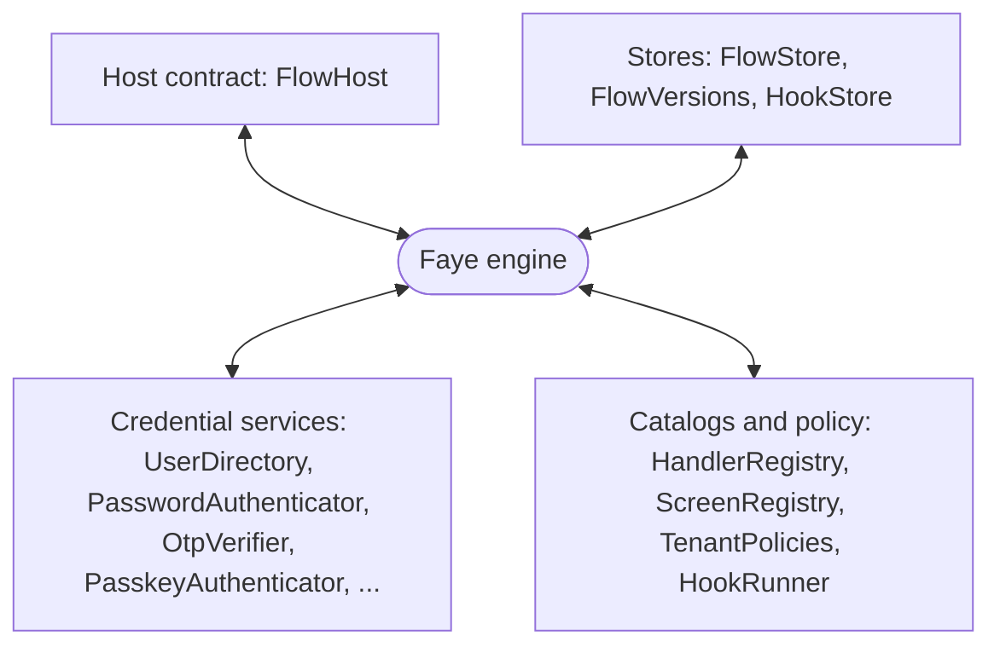

# Embed Faye: the host SPI

Faye's engine does not know which authorization server it serves. It talks to the outside world only through a small set of Java interfaces, its service provider interface (SPI). This page explains that SPI. It covers what a **host** must provide, what the engine guarantees in return, and how to run Faye as middleware in front of an authorization server or inside your own application.

This page is for engineers who want to connect Faye to a new authorization server, connect an existing user store, or embed the engine. For the runtime behind the SPI, read [How the engine works](engine.md).

## Faye as middleware

Faye sits between the person's browser and the system that needs the person signed in. That system is the **host**. The engine asks the host for the request, runs the tenant's flow, and gives the host the result.

There are two kinds of host:

- **A redirecting host** is an authorization server that hands its login and consent pages to an outside app, and gets the result back through an API. Ory Hydra works this way, and Faye's Hydra adapter is a redirecting host.
- **An embedding host** is your own application. It starts a flow itself and receives the result as data, not as a browser redirect ([ADR 0025](../adr/0025-host-neutral-boundaries-for-embedding.md)).

The diagram shows the engine in the middle and the four groups of interfaces around it. The engine receives everything that it uses through one of these groups.



The interfaces live in the package [`faye.engine.spi`](../../src/faye-engine/src/main/java/faye/engine/spi/) of the `faye-engine` library. The catalog interfaces live in `faye.engine`. `faye-engine` and `faye-core` are the product. They are the two libraries that a host embeds ([ADR 0034](../adr/0034-two-shippable-modules-under-src.md)). The server in `apps/server` is one host built on them.

## What Faye needs from an authorization server

To put Faye in front of an authorization server, the server must offer the capabilities in this table. The last column shows the Hydra admin API call that the Hydra adapter uses for each one.

| # | Capability | Why Faye needs it | Required | Hydra |
|---|---|---|---|---|
| 1 | Hand the login page to an outside app, with an opaque challenge | Faye must own the screens | Yes | Redirect to Faye's `/login?login_challenge=...` |
| 2 | Read the login request on the server side | The flow reads the client, the scopes and the OpenID Connect parameters | Yes | `getOAuth2LoginRequest` |
| 3 | Accept the login with a subject, the authentication methods references (`amr`) and the authentication context class reference (`acr`), and return a redirect | Faye reports who signed in and how | Yes | `acceptOAuth2LoginRequest` |
| 4 | Reject the login with an error | A failed flow must fail the request | Yes | `rejectOAuth2LoginRequest` |
| 5 | Keep metadata on each client | Faye reads the tenant from it, and whether the client is a preview client or first party | Yes, for tenants | `metadata.tenant`, `metadata.preview`, `metadata.first_party` |
| 6 | Hand the consent page to an outside app, read it, accept and reject it | Needed only for flows with a consent step | For consent | `getOAuth2ConsentRequest`, `acceptOAuth2ConsentRequest`, `rejectOAuth2ConsentRequest` |
| 7 | Carry data from the login accept to the consent request | Faye links a consent to the login it follows | For consent | The login accept's `context` |
| 8 | Remember a session and say so on the next login | Lets a remembered person skip the screens when one factor is enough | No | `skip` and `subject` on the login request |
| 9 | Hand the logout page to an outside app | Not used yet. Logout is planned ([ADR 0036](../adr/0036-retire-the-roadmap.md#open-gaps), R2) | No | The adapter can load one with `getOAuth2LogoutRequest`, but no route uses it |

An authorization server that offers capabilities 1 to 5 can run Faye's sign in flows. An authorization server that also offers 6 and 7 can run consent steps.

> [!NOTE]
> Hydra is the only real host today. A second real host is planned, such as an adapter for Keycloak or a generic redirect based host. It would prove that a flow runs unchanged on another authorization server ([ADR 0036](../adr/0036-retire-the-roadmap.md#open-gaps), R1). Tests already drive flows through other hosts: `EmbeddingTest`, `HandoffApiTest` and `MockFlowHost`.

## The host contract: FlowHost

[`FlowHost`](../../src/faye-engine/src/main/java/faye/engine/spi/FlowHost.java) is the only way the engine talks to the system it runs flows for. It has four methods:

```java
public interface FlowHost {
    HostRequest load(HostKind kind, String ref);
    Completion accept(HostRequest request, Authenticated outcome);
    Completion accept(HostRequest request, Consented outcome);
    Completion reject(HostRequest request, String error, String description);
}
```

- **`load`** returns the request behind a reference, such as Hydra's login challenge. The engine calls it when a flow starts, and again when the flow ends. So a host must be able to load the same request for as long as the flow lives.
- **`accept`** reports a successful sign in (`Authenticated`) or a granted consent (`Consented`).
- **`reject`** reports a failure. The engine always passes `access_denied` as the error, and a Faye code as the description, such as `mfa_required` or `flow_unavailable`.

Each method that ends a request returns a `Completion`. A `Completion` has two forms. A host always returns the same form:

| Completion | Fields | Used by |
|---|---|---|
| `Redirect` | `url`, `failed` | A redirecting host. The browser goes to `url`. The engine sets `failed` for a failed login, so the Login UI can keep the person on Faye's error page ([ADR 0031](../adr/0031-failed-sign-in-stays-on-faye.md)). |
| `Handoff` | `result`, a JSON object | An embedding host. The result goes back to your application, for example as a one time code that it exchanges server to server. |

### HostKind and HostRequest

`HostKind` names what the host asks for: `LOGIN`, `CONSENT`, `APPROVE` (the phone's side of a QR code sign in) or `LOGOUT`. The engine runs the flow's entry of the matching kind: `authenticate`, `consent` or `approve`. The engine runs nothing for `LOGOUT` yet.

`load` returns a [`HostRequest`](../../src/faye-engine/src/main/java/faye/engine/spi/HostRequest.java):

| Field | Meaning |
|---|---|
| `kind`, `ref` | What was asked, and the host's own id for the request |
| `tenant` | The tenant whose flow runs. The host decides the tenant, and never uses anything that the browser sent to decide it. |
| `preview` | Whether to run the tenant's draft instead of its live version. The host decides this too. |
| `client` | Display data about the client: `client_id`, `client_name`, `first_party` and the operator's `metadata`. Flows read it as `client.*`. |
| `params` | The request's parameters, as `HostParams` |

### HostParams: a closed contract

[`HostParams`](../../src/faye-engine/src/main/java/faye/engine/spi/HostParams.java) is everything that a flow may read about the request, as `host.*`. The set of fields is closed. A host maps its protocol into these fields and cannot add a field. So a flow written for one host runs on any other host.

| Field | Type | Meaning |
|---|---|---|
| `subject` | string or absent | Who the host already knows: a remembered session, a step up, or the subject of a consent |
| `skip` | boolean | For a login, the host remembers this subject. For a consent, it remembers this grant. |
| `acr_values` | list | The assurance the client asked for, most preferred first |
| `requested_scope` | list | The scopes the client asks for |
| `requested_access_token_audience` | list | The audiences the client asks for |
| `login_hint` | string or absent | Who the client expects to sign in |
| `ui_locales` | list | The person's preferred languages |
| `context` | object | The host's own data, carried from one request to the next |

The checker refuses a flow that reads any other `host.*` path. A new field needs a decision record. The [Core IR specification](../ir-spec.md#host-contract) gives the exact rules, such as how lists are split on spaces.

### What the engine reports

When a login succeeds, the engine calls `accept` with an [`Authenticated`](../../src/faye-engine/src/main/java/faye/engine/spi/Authenticated.java):

```java
record Authenticated(String subject, List<String> amr, String acr, Map<String, Object> context, boolean remember)
```

- The engine computes `amr` and `acr` from the credentials that verified. A host must pass them on unchanged.
- `context` holds `flowId` and `versionHash`. A redirecting host must return this context on the consent request that follows, as `host.context.flowId`. The engine uses this context to run the consent on the same flow version, with what the login learned.
- `remember` is the person's "keep me signed in" choice ([ADR 0033](../adr/0033-login-page-customization-and-keep-me-signed-in.md)).

When a consent succeeds, the engine calls `accept` with a [`Consented`](../../src/faye-engine/src/main/java/faye/engine/spi/Consented.java). It holds the subject, the scopes and audiences to grant, and the `user` fields that the login learned. The host decides which of those fields become token claims. The Hydra host maps `email` and `email_verified` for the `email` scope, and `name` for the `profile` scope.

## Stores

The engine keeps no state in memory between requests. It keeps everything through three store interfaces:

| Interface | What it keeps | The rule an implementation must follow |
|---|---|---|
| [`FlowStore`](../../src/faye-engine/src/main/java/faye/engine/spi/FlowStore.java) | Each sign in in progress | `replace` saves a state only if the stored revision is still the one before it. This check is a compare and set. It makes a double submit safe. |
| [`FlowVersions`](../../src/faye-engine/src/main/java/faye/engine/spi/FlowVersions.java) | Every flow version, and each tenant's current one | Once stored, a version never changes and is never lost. So a flow pinned to it can always finish. |
| [`HookStore`](../../src/faye-engine/src/main/java/faye/engine/spi/HookStore.java) | Hook code by its hash | Read by the hook runner and by the publisher. |

Only [`Publisher`](../../src/faye-engine/src/main/java/faye/check/Publisher.java) makes a version current. It runs the checker first. So no unchecked flow ever goes live, whatever way the host stores versions.

`faye-engine` ships in memory versions of all three: `InMemoryFlowStore`, `InMemoryFlowVersions` and `InMemoryHookStore`. The prototype server stores them in SQLite.

## Credential services

The built in handlers verify credentials only through these interfaces. A host implements the interfaces that its flows need, over its own user store. The prototype implements them in `faye-identity`, over each tenant's user pool.

| Interface | Used by | What an implementation must guarantee |
|---|---|---|
| [`UserDirectory`](../../src/faye-engine/src/main/java/faye/engine/spi/UserDirectory.java) | Every block that names a person | Look up an account by identifier and by subject. An account can belong to one tenant, or be visible only to preview flows. |
| [`PasswordAuthenticator`](../../src/faye-engine/src/main/java/faye/engine/spi/PasswordAuthenticator.java) | `password` | An unknown identifier must cost the same as a known one, so timing does not reveal which accounts exist. |
| [`OtpIssuer`](../../src/faye-engine/src/main/java/faye/engine/spi/OtpIssuer.java), [`OtpVerifier`](../../src/faye-engine/src/main/java/faye/engine/spi/OtpVerifier.java) | `totp`, `enroll-totp` | Verifying a code marks its time step used, atomically. The same flow may use the code again, in a double submit. No other flow can. |
| [`PasskeyAuthenticator`](../../src/faye-engine/src/main/java/faye/engine/spi/PasskeyAuthenticator.java) | `passkey`, `add-passkey` | A passkey's sign count only rises. Registering is idempotent. |
| [`CodeOutbox`](../../src/faye-engine/src/main/java/faye/engine/spi/CodeOutbox.java) | `email-code`, `sms-code`, and `add-phone` to text a code | Only record the code to send. A separate worker delivers it. For an unknown account, record a row that is never delivered, so the call costs the same. |
| [`PhoneDirectory`](../../src/faye-engine/src/main/java/faye/engine/spi/PhoneDirectory.java) | `add-phone` | Enrolling a phone is one idempotent write. |
| [`QrGrants`](../../src/faye-engine/src/main/java/faye/engine/spi/QrGrants.java) | `qr`, `qr-approve` | A QR code is consumed once, atomically. |

You do not have to trust your own reading of these rules. `faye-engine` publishes contract test kits as test fixtures: `PasswordAuthenticatorContract`, `OtpVerifierContract` and `PasskeyAuthenticatorContract`. Extend one in your tests to check your implementation, as the prototype's [`LocalCredentialsContractTest`](../../apps/server/faye-identity/src/test/java/faye/identity/LocalCredentialsContractTest.java) does.

## Catalogs, policy and hooks

The engine discovers nothing. It runs exactly the handlers, screens and policies that it is given:

| Interface | What it gives the engine | Default |
|---|---|---|
| `HandlerRegistry` | The handlers that flows may call. `BuiltinHandlers.create(...)` makes the built in ones. | Required |
| `ScreenRegistry` | The screen types that flows may show, with the issuers that make their server side data. `BuiltinScreen.registry(...)` makes the built in ones. | Required |
| `TenantPolicies` | Each tenant's settings: whether it requires multi factor authentication (MFA), its allowed handlers and screens, its egress grants, its flow time limits | Every tenant gets the default policy |
| `HookRunner` | Runs hooks. The prototype uses `SandboxedHooks` over the QuickJS sandbox. | No hooks. A flow that runs a hook fails |
| `Previews` | The draft that preview clients run, and where their trace goes | Previews are off |
| `Clock` | The time that time limits use | The system clock |

## Assemble an engine

This sketch shows the shape of an embedding. It builds an engine with the in memory stores, the built in handlers and screens, and your own host and credential services. For complete assemblies that compile, see [`EmbeddingTest`](../../src/faye-engine/src/test/java/faye/engine/EmbeddingTest.java) and the prototype's [`EngineConfiguration`](../../apps/server/faye-app/src/main/java/faye/app/EngineConfiguration.java).

```java
FlowVersions versions = new InMemoryFlowVersions();
HandlerRegistry handlers = new HandlerRegistry(
        BuiltinHandlers.create(users, passwords, otpVerifier, passkeys));
ScreenRegistry screens = BuiltinScreen.registry(
        BuiltinIssuers.create(otpIssuer, passkeys));

Engine engine = Engine.builder()
        .versions(versions)
        .store(new InMemoryFlowStore())
        .handlers(handlers)
        .screens(screens)
        .host(new MyHost())          // your FlowHost
        .tenants(myTenantPolicies)   // optional
        .build();
```

To publish a flow, compile its YAML with `FlowCompiler` and give the result to a `Publisher`. Before the flow becomes current, the publisher checks it against the same catalogs and the tenant's policy.

Then serve four calls from your HTTP layer:

| Call | When |
|---|---|
| `engine.start(kind, ref, request, binder)` | A sign in starts. `request` holds the IP address and user agent. `binder` comes from `Engine.newBinder()`. Give it to the browser in an HttpOnly cookie. |
| `engine.view(flowId, binder)` | The Login UI reads the screen that the flow waits on. |
| `engine.submit(flowId, binder, nonce, submission)` | The person answers. The result is the next screen or the host's `Completion`. |
| `engine.act(flowId, binder, nonce, action, input)` | The person uses a screen action, such as "send a new code". |

`start` and `submit` return either a `ScreenView`, the next screen to show, or the host's `Completion`. A refused call throws a `FlowException` with a code. Your HTTP layer maps the code to a status, for example `flow_not_found` to 404 and `stale_nonce` to 409. [How the engine works](engine.md#resume-on-submit) lists every code.

### Embedding in your own application

An embedding host creates its own `ref` and returns `Handoff` from `accept` and `reject`. It starts flows through its own route, or by calling `Engine.start` directly. The prototype server then answers the last submit with `{result}` instead of a redirect.

The Login UI supports this in a popup. If `FAYE_EMBED_ORIGIN` names exactly one origin, the Login UI posts the result with `postMessage` to the window that opened it. It posts only to that origin. The Login UI refuses to be shown in a frame. [`HandoffApiTest`](../../apps/server/faye-app/src/test/java/faye/app/HandoffApiTest.java) tests the server side of this path. It checks that the screen API answers the last submit with `{result}`. No automated test covers the popup yet.

## What the engine promises a host

| Promise | How |
|---|---|
| A request is completed at most once | Only the run whose save wins the compare and set calls `accept` or `reject`. A losing double submit never calls the host. |
| Writes come before the result | Staged writes, such as a new TOTP secret, are applied before the host learns of success. A write that fails turns the result into a rejection. |
| A success is proven | The engine accepts a login only if all of these hold: there is a subject, a credential verified, the tenant's MFA policy is met, and the client's `acr_values` are met. |
| The tenant is the host's choice | The engine reads the tenant and the preview flag only from `HostRequest`, never from the browser. |
| Flows stay host neutral | Flows may read only the closed `host.*` and `client.*` fields. The checker refuses anything else. |
| An expired flow does not call the host | The engine refuses a flow past its time limit with `flow_expired`, and does not call the host. The host's own challenge expires on its own. |

[`BoundaryTest`](../../src/faye-engine/src/test/java/faye/engine/BoundaryTest.java) enforces the boundary. It fails the build if the engine names Hydra, a token claim, a built in screen or handler outside their packages, or a host parameter outside `HostParams`. It also fails if the product's build files depend on Hydra, Spring, SQLite or the prototype.

## Next steps

- See the whole system around the SPI: [Architecture](architecture.md).
- Read the exact host contract: [Core IR specification](../ir-spec.md#host-contract).
- See every setting of the prototype host: [Configuration](../reference/configuration.md).
- Find the code: [Read the codebase](../develop/codebase.md).
