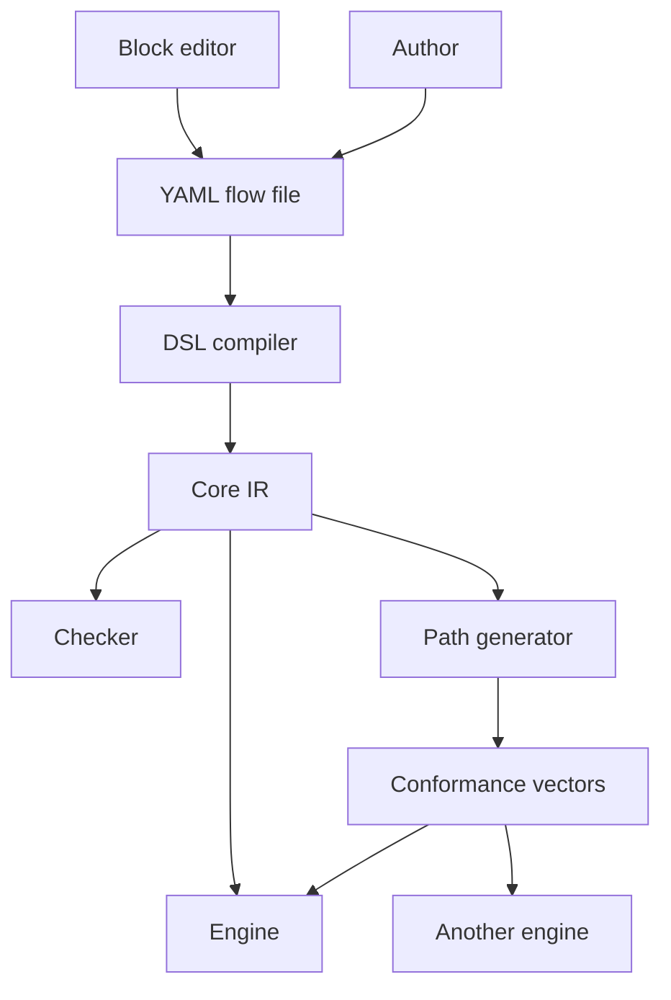

# How the IR is designed

Faye compiles every flow file to an intermediate representation (IR) before anything checks or runs it. This page explains why the IR exists, the choices behind its shape, and what those choices make possible. It is for engineers who change the compiler, the checker or the engine, or who want to build another engine. Flow authors never need the IR: the [Flow DSL reference](../reference/dsl.md) is for them.

The [Core IR specification](../ir-spec.md) is the normative definition. This page explains it; where the two differ, the specification wins.

## Why there is an IR

The charter gives the IR one job: interop and modularity. In its words, the IR "lets the DSL, the checker, the editor and the engine evolve separately, and lets another engine implementation prove it behaves the same".

In practice, that means four things:

- **Parts change alone.** The YAML surface can gain blocks and settings, and the Admin UI can change how it edits flows, while the checker and engine stay the same. [ADR 0030](../adr/0030-blocks-with-fixed-screens-and-handlers.md) replaced the whole YAML step syntax with blocks and did not change a single IR form.
- **One target for every check.** The checker reads the IR, not YAML. Every safety rule is written once, keyed by entry kind, and holds for any frontend.
- **Another engine can prove itself.** The conformance suite in [`src/conformance/`](../../src/conformance/README.md) is a set of IR documents and scripted scenarios. An engine that passes every vector behaves like the reference engine.
- **Authors never see it.** People write YAML or use the block editor. The charter calls the IR "important but optional for authors", and asks for the simpler path when the IR adds cost without serving interop or modularity.

## A narrow waist

The IR sits at the narrow point between the ways to write a flow and the tools that use one. The diagram shows the two authoring paths at the top, the IR in the middle, and the parts that read the IR at the bottom.



The Admin UI's block editor writes YAML, the same text an author can edit by hand ([ADR 0010](../adr/0010-m5-admin-ui.md)). The DSL compiler, [`FlowCompiler`](../../src/faye-core/src/main/java/faye/dsl/FlowCompiler.java), lowers that YAML to the IR. Everything under the IR depends only on the IR and on the catalogs of handlers and screens ([ADR 0024](../adr/0024-core-ir-as-a-narrow-waist.md)).

Each fact about the IR has exactly one source:

| Fact | Source |
|---|---|
| Grammar: forms, arity, patterns, format numbers | [`src/schema/ir.schema.json`](../../src/schema/ir.schema.json) |
| Meaning: what each form does, what the checker requires | [Core IR specification](../ir-spec.md) |
| Executable pins of that meaning | [`src/conformance/`](../../src/conformance/README.md) vectors, hand written and generated |
| Handler contract | [`src/conformance/handlers.yaml`](../../src/conformance/handlers.yaml) |

The Admin UI does not keep its own copy of the grammar either. `pnpm generate` writes the id, key and path patterns, the namespaces and the operators into `apps/web/packages/contract/src/ir.ts` from the schema, and CI fails when that file is stale.

## The design choices

### JSON arrays as S expressions

Founding decision D2 in [ADR 0036](../adr/0036-retire-the-roadmap.md#founding-decisions) chose a YAML surface over an S expression IR stored as JSON. The S expression is the abstract syntax. JSON arrays are its only serialization: the head of each array names the form, and the rest are its arguments.

```json
["retry", 3, ["seq", ["screen", "password"], ["call", "password.verify"]]]
```

Docs and tests print the same tree in a Lisp style display, `(retry 3 (seq (screen password) (call password.verify)))`. Nothing parses that display. It is a view of the JSON, position for position (`IrCodec.display`).

This needs no Lisp runtime and no second parser. Any language with a JSON library can read the IR, and a standard JSON Schema validator checks its shape ([ADR 0001](../adr/0001-validate-ir-with-json-schema.md)).

Every node follows one arity rule: `[head, required arguments..., options?]`. Optional parameters live in one trailing options object, such as `{"guard": ...}` on an option or `{"path": ...}` on a screen. A form's positional arity never changes within a format, so a reader always knows what each position holds.

### A closed language that always terminates

Founding decision D3 made the language closed. It has no loops except `retry`, whose attempts are fixed at 1 to 10, and no recursion or calls between flows. Every flow ends.

Because every flow ends, the checker can list every path through an entry. That is the basis of every static guarantee in [What the checker can prove](#what-the-checker-can-prove).

New capability arrives as a handler, a screen, a block or a predicate operator, not as a new form. A form is added only when control flow, suspension or termination change, and that needs an ADR and a new format number ([ADR 0024](../adr/0024-core-ir-as-a-narrow-waist.md)).

### Eleven forms

The IR has eleven control forms, plus three structural ones: `flow`, `entry` and `opt`.

| Form | Shape | What it does |
|---|---|---|
| `seq` | `(seq node...)` | Runs its children in order. |
| `step` | `(step id body)` | Names a boundary. Traces, audit and screen paths use the step id. |
| `screen` | `(screen type options?)` | Waits for the person to answer a typed screen. |
| `call` | `(call handler args?)` | Runs a built in handler. Only a handler can verify a credential. |
| `hook` | `(hook id hash)` | Runs tenant JavaScript, which may only set `vars` or fail. |
| `choose` | `(choose (opt...) {:pick hook}?)` | Offers the enabled options and runs the chosen one. |
| `when` | `(when predicate body)` | Runs its body if the predicate holds. |
| `retry` | `(retry attempts body)` | Runs its body again after a failure, up to `attempts` times in total (1 to 10). |
| `set` | `(set key literal)` | Writes `vars.key`. |
| `succeed` | `(succeed)` | Ends the entry. It succeeds only if the entry kind's conditions hold. |
| `fail` | `(fail reason)` | Ends the entry with a reason. It is never retried. |

No form marks a person as signed in. Only `succeed` ends an entry well, and the engine checks at that point that a credential verified the subject.

### Entries and entry kinds

A flow holds one or more entries: `(entry id kind body)`. The kind is a typing context. It decides what `succeed` means, which rules the checker applies, and what the body sees when it starts.

| Kind | Started by | `succeed` means |
|---|---|---|
| `authenticate` | the authorization server's login challenge | the subject is signed in, with the `amr` and `acr` its credentials proved |
| `consent` | the consent challenge, after the sign in was accepted | the access the client asked for is granted |
| `approve` | a QR code scanned on a second device | the waiting sign in is approved for this subject |

The engine picks an entry by kind, not by name. The checker refuses a flow with no `authenticate` entry, or with two entries of one kind. Rules are keyed by kind: a `consent` entry may not verify a credential, and an `approve` entry must end with exactly one approval.

The YAML surface hides the split. The steps of `login:` lower to the `authenticate` entry, up to the first step that asks for consent. That step and every step after it lower to the `consent` entry ([ADR 0026](../adr/0026-consent-as-a-step.md)).

### Predicates are data

A condition is not a string of code. It is a bare path, such as `"user.has_totp"`, or an object with exactly one operator:

```json
{"and": [{"ne": ["auth.acr", "faye:2fa"]}, {"has": ["host.acr_values", "faye:2fa"]}]}
```

The grammar limits paths to seven namespaces: `request`, `client`, `host`, `tenant`, `user`, `vars` and `auth`. Because a predicate is data, tools can read it:

- The checker decides a predicate when it reads only what is known before the flow runs, such as `tenant.mfa_required`. Otherwise it follows both outcomes.
- The checker refuses a `host.*` or `client.*` path that is not part of the closed host and client contracts ([ADR 0025](../adr/0025-host-neutral-boundaries-for-embedding.md)). So a flow cannot come to depend on one authorization server.
- The Admin UI's condition builder edits predicates as structures, and checks them as you type.

A new operator extends the IR without a new form. It still needs a new format number, because an older reader would refuse it.

### Hooks pinned by hash

A `hook` node names its hook by id and by the SHA-256 of the hook's definition: its source, its egress targets and its timeout, as canonical JSON. Changing any of the three makes a different hook with a different hash.

The hash is part of the flow's own bytes. So a published version always runs exactly the hook code that was checked with it, and editing a hook means publishing a new version.

### Canonical JSON and the version address

The canonical form of a flow is its JSON in UTF-8, with no extra whitespace, object keys sorted, and empty options objects left out. A version's address is `sha256:` followed by the hex SHA-256 of those bytes.

Canonicalization is only syntax. The compiler never simplifies a predicate or rewrites meaning, because that would change hashes and node paths. Two YAML files that lower to the same IR are the same version: reformatting the YAML or adding a comment does not create a new one.

A store checks a version against the bytes it kept, never against a fresh serialization.

### Format numbers

The IR format number is the second element of every flow: `["flow", 1, ...]`. It is inside the canonical bytes, so it is part of the hash.

| Format | What it is |
|---|---|
| 1 | The first versioned format: eleven forms, `authenticate` and `consent` entries |
| 2 | Format 1 plus the `approve` entry kind ([ADR 0032](../adr/0032-delivered-one-time-codes-and-qr-sign-in.md)) |

The compiler writes format 2 only for a flow with an `approve` entry, and format 1 for any other. So adding format 2 changed no existing version or hash. A format 1 document that names the `approve` kind is refused.

The rule for a new format: a change to what a form means, a new form, a new predicate operator or a new options key needs a format bump and an ADR. A reader refuses any format it does not know before it reads anything else. It never guesses. A reader upgrades an older format in memory when it reads a stored version, keeps its hash, and must keep every node at the same position.

### State format

A flow in progress is saved as a continuation: a stack of frames, each naming its IR node by a path of child indexes from the entry body. The meaning of those frames is versioned on its own, as the state format (currently 1).

A new optional field needs no bump; a changed meaning does. The engine reads the current and the previous state format. A state in any other format, or one that does not fit the version it pinned, reads as absent. The person then starts the sign in again: the engine fails closed rather than guess.

This is why an IR upgrade must keep node positions. If it cannot, the state format changes too.

### Source references

The compiler gives every IR node a source reference: the file, line and column of the YAML that produced it. Every compile error and checker finding points there, such as `tenant.yaml:8:11`.

Grammar errors work the same way. The compiler keeps no copy of the grammar. It builds the JSON, validates it against the schema, and maps each error's JSON pointer back to the YAML that produced the node. The compiler test fixture `grammar.yaml` pins this, for example `13:14: variable name: does not match the regex pattern ^[a-z][a-z0-9_]*$`.

Source references are not part of the JSON, so they never change a hash. A stored version is read back without them. A source map per version, so that run time errors can point at YAML lines too, is planned and not built yet ([ADR 0027](../adr/0027-source-lines-at-run-time.md)).

## Worked example: a password only flow

This is the shipped flow `apps/server/faye-app/src/main/resources/flows/password-only.yaml`:

```yaml
# Password only: identity first, then a password with three attempts.
flow: password-only
version: 1

login:
  steps:
    identify:
      block: identifier
    credential:
      block: password
```

The compiler lowers it to this IR, shown in the display notation. The golden file `src/faye-core/src/test/resources/golden/password-only.ir` pins it.

```lisp
(flow 1 password-only 1
  (entry login authenticate
    (seq
      (step identify (seq (screen identifier) (call identity.resolve)))
      (step credential (retry 3 (seq (screen password) (call password.verify))))
      (succeed))))
```

Each line of YAML became something concrete:

- `login:` became the entry `login` of kind `authenticate`. There is no consent step, so there is no consent entry.
- `block: identifier` became the identifier screen and the `identity.resolve` handler. The identifier alone never fails, so it gets no `retry`.
- `block: password` became the password screen and `password.verify`, inside `(retry 3 ...)`. Three attempts is the Password block's default.
- The compiler added `(succeed)` at the end of the entry.

The canonical JSON is the only form that is stored and hashed:

```json
["flow",1,"password-only",1,["entry","login","authenticate",["seq",["step","identify",["seq",["screen","identifier"],["call","identity.resolve"]]],["step","credential",["retry",3,["seq",["screen","password"],["call","password.verify"]]]],["succeed"]]]]
```

Its address is `sha256:129be1ff8b8c89f74745e796de0186aa71b15144df6941887b3521eb865fbb8d`. The conformance suite holds the same document as `src/conformance/flows/password-only.json`.

## A richer lowering

The shipped flow `acme.yaml` uses a hook, choices with conditions, a condition on a whole step and a changed attempts count. This slice is lines 14 to 51:

```yaml
hooks:
  risk:
    file: risk.js
    capabilities: { http: [ip-reputation] }
    timeout_ms: 500

login:
  steps:
    identify:
      block: identifier
      after: risk
    credential:
      alternative:
        password:
          block: password
        email:
          if: user.email_verified
          block: email-code
        phone:
          if: user.has_phone
          block: sms-code
        # Scanned and approved on a phone, which runs the approve steps below
        qr:
          block: qr
    second-factor:
      if: { eq: [vars.risk, high] }
      alternative:
        totp:
          if: user.has_totp
          block: totp
        enroll:
          if: { not: user.has_totp }
          block: enroll-totp
    # Offered to people without phone codes; "Not now" skips it
    add-phone:
      if: { not: user.has_phone }
      block: add-phone
      with: { attempts: 1 }
```

This is the matching part of the golden file `acme.ir`:

```lisp
(step identify
  (seq
    (screen identifier)
    (call identity.resolve)
    (hook risk sha256:3281897b274bd5d56dd70e10e3052884f9754c1a3560cc2f24b20689117d878b)))
(step credential
  (choose
    ((opt password (retry 3 (seq (screen password) (call password.verify))))
      (opt email
        (retry 3 (seq (screen code_sent {:channel email}) (call email_code.verify)))
        {:guard user.email_verified})
      (opt phone
        (retry 3 (seq (screen code_sent {:channel sms}) (call sms_code.verify)))
        {:guard user.has_phone})
      (opt qr (retry 3 (seq (screen qr) (call qr.redeem)))))))
(step second-factor
  (when
    {:eq (vars.risk high)}
    (choose
      ((opt totp (retry 3 (seq (screen otp) (call totp.verify))) {:guard user.has_totp})
        (opt enroll
          (retry 3 (seq (screen otp_enroll) (call totp.enroll)))
          {:guard {:not user.has_totp}})))))
(step add-phone (when {:not user.has_phone} (seq (screen phone_enroll) (call phone.enroll))))
```

The table maps each YAML key in the slice to what it became.

| YAML | IR | Why |
|---|---|---|
| `after: risk` | `(hook risk sha256:...)` after the block's parts | A hook runs before or after a block, never as a step. The hash pins `risk.js`, its egress target and its 500 ms timeout. |
| `alternative:` | `(choose (opt ...) ...)` | Each option is one credential block. |
| `if:` on an option | `{:guard ...}` on the `opt` | A guard decides whether the option is offered. |
| `if:` on a step | `(when ...)` around the whole step body | The step runs only when the condition holds. |
| `block: email-code` | `(screen code_sent {:channel email})` and `email_code.verify` | The block fixes its screen, the screen's channel and its handler. |
| default attempts | `(retry 3 ...)` around the screen and the call | The retry wraps only the block's own parts. |
| `with: { attempts: 1 }` | no `retry` | One attempt needs no retry. |

Two details matter for the checker. A hook sits outside the block's `retry`, so `risk` runs once, not once per attempt. And `vars.risk` is unknown until the hook runs, so the checker follows both outcomes of `{:eq (vars.risk high)}`.

The full flow also has an `approve:` section, so `acme.ir` starts with `(flow 2 acme 1` and holds three entries: `login`, `consent` and `approve`.

## What the checker can prove

The checker runs at publish, at rollback, before a preview and at startup. Its core is path enumeration: it lists every path through each entry once.

Because the language has no unbounded loops and no recursion, the set of paths is finite. On each path:

- A predicate is decided when it reads only what is known before the flow runs: `tenant.*`, `vars` written by `set`, and `auth.amr` and `auth.acr` from the credentials verified so far on that path. Otherwise both outcomes are paths.
- A call succeeds, proving any nonempty part of its handler's `amr`, or fails. A handler that binds the subject may also prove someone else, which ends the entry with `subject_mismatch`.
- A retry's attempts may fail before one succeeds.
- A hook fails, or sets `vars` that are unknown from then on. A pick hook fails, or picks any option that may be enabled.

This over approximates what can happen. Some enumerated paths may be impossible in practice, but every real run follows one of them. So a rule that holds on every enumerated path holds on every run.

For the password only flow, the checker reports `login: 3 success paths, 5 failure paths; assurance pwd (faye:1fa) to pwd (faye:1fa)`.

On those paths the checker proves, among other rules:

- Every success path of an `authenticate` or `approve` entry verifies a credential that binds the subject.
- Every credential runs after a handler identified the person.
- A handler that needs a signed in subject, such as `totp.enroll`, runs only after a credential verified one.
- If the tenant requires MFA, every success path reaches `faye:2fa`.
- A `consent` entry verifies no credential.
- An entry runs at most 32 hooks and 5,000 ms of hook time over all its requests.

When a rule fails, the finding names the path. For example: `a path succeeds without verifying a credential: identify > credential > (condition at 8 false) > succeed with no credential`.

Two tests hold the checker to what the engine does. The path generator turns each enumerated path of the conformance flows that some input can take into a vector, runs the engine along it, and fails the build if the engine ends differently ([`src/conformance/generated/`](../../src/conformance/README.md)). A fuzz harness, `EngineFuzzTest`, searches for flows that the checker accepts and the engine then cannot run. The build replays its stored inputs ([ADR 0007](../adr/0007-fuzz-and-adversarial-testing.md)).

Enumeration has a cost: paths multiply with every choice, condition and retry. An entry with more than 10,000 paths is an error, not a partial check. The message says `entry 'login' has more than 10000 paths or a path longer than 10000 steps; split it`. Acme's flow sits close to this limit. A texted code as a second factor and three attempts at adding a phone took it over, so neither is in it ([ADR 0032](../adr/0032-delivered-one-time-codes-and-qr-sign-in.md)).

## Alternatives that were rejected

The founding decision log in [ADR 0036](../adr/0036-retire-the-roadmap.md#founding-decisions) records these alternatives. It gives one reason for each choice, not a separate reason for each rejected option.

| Decision | Alternatives considered | Reason recorded for the choice |
|---|---|---|
| D2: a YAML surface over an S expression IR in JSON | Code first flows; BPMN; string expressions | Data is diffable, checkable and editable by a UI; JSON arrays need no Lisp runtime. |
| D3: a closed language that always terminates | An embedded general purpose language | It enables path enumeration, static safety checks and generated tests. |

Later records rejected other shapes for the IR, each with its own reason:

| Rejected | Record | Reason |
|---|---|---|
| A text S expression reader | [ADR 0001](../adr/0001-validate-ir-with-json-schema.md) | There is no S expression text to read. It would add a second syntax and a second parser. |
| The format number in an envelope around the IR | [ADR 0024](../adr/0024-core-ir-as-a-narrow-waist.md) | Every document gains a wrapper, and the format could be stripped from the bytes it describes. |
| An attributes object after the head of every form | [ADR 0024](../adr/0024-core-ir-as-a-narrow-waist.md) | It would move the options of `screen` and `call` and break the trailing options rule. |
| A `block` form in the IR | [ADR 0030](../adr/0030-blocks-with-fixed-screens-and-handlers.md) | It changes what the IR means, so every engine must resolve blocks. A block's behavior could also change under a published version, which breaks D5. |
| One IR entry for both login and consent | [ADR 0026](../adr/0026-consent-as-a-step.md) | It changes what the IR means: an entry would span two host challenges. That needs a format bump, a new kind of suspension in the engine, new checker rules and new vectors, only to change how a flow is written. |

## Next steps

- Read the normative [Core IR specification](../ir-spec.md).
- See every key of the YAML surface in the [Flow DSL reference](../reference/dsl.md).
- Learn how the engine runs the IR in [How the engine works](engine.md).
- Browse the conformance suite in [`src/conformance/`](../../src/conformance/README.md).
