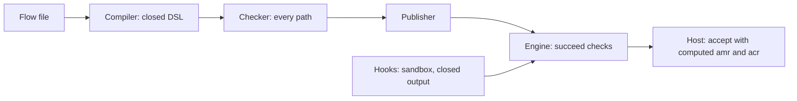

# Security model

This page states what Faye promises about sign in security and how the code keeps each promise. It is for security reviewers and for engineers who integrate Faye with an authorization server. Each guarantee links to the code that enforces it and names the tests that check it.

## The core promise

The [charter](../../CHARTER.md) sets one promise that comes before all others:

> No flow or hook, however written, can produce a successful sign in unless a built in handler verified or enrolled a credential for that subject, in this flow or in the session it reuses.

Faye does not trust a flow author or a hook author to keep this promise. The design keeps this promise in four layers. Each layer enforces its rules without relying on the others:

1. **A closed language.** A flow can only arrange built in blocks, handlers and screens. It cannot define new ones.
2. **The checker.** Before a version runs anywhere, the checker proves rules about every path through it.
3. **The engine.** At run time, the engine does not let an entry succeed if the entry did not verify a credential, whatever the flow says.
4. **The hook sandbox.** Tenant JavaScript runs in a sandbox. A hook can return nothing, or one of three closed results: set values, fail the step, or pick an option.

The diagram shows where each layer sits between a flow file and the authorization server.

## Static guarantees

The compiler and the checker run before a version can become current. [`Publisher`](../../src/faye-engine/src/main/java/faye/check/Publisher.java) is the only way to make a version current. It runs the checker on publish and on rollback. The server checks every current version again at startup. It also checks every draft before a preview runs the draft. The [IR design](ir-design.md) explains why the checker can see every path.

| Guarantee | Where it is enforced | How it is tested |
|---|---|---|
| A flow names only handlers, screens and options that exist, with valid arguments. | [`Verifier`](../../src/faye-engine/src/main/java/faye/engine/Verifier.java) | `CheckerTest.theVerifierRefusesUnknownScreenOptionsAndBadArgs`, vector [`catalog-unknown-handler`](../../src/conformance/vectors/catalog-unknown-handler.yaml) |
| Every success path of a login verifies a credential that binds the subject. | [`Checker`](../../src/faye-engine/src/main/java/faye/check/Checker.java) | `CheckerTest.branchWithoutCredentialPointsAtItsLine`, `CheckerTest.skippedCredentialPointsAtTheCondition`, `MilestoneThreeTest.publishRefusesABranchWithoutACredential` |
| A credential runs only after a handler identified the person. | `Checker` | `CheckerTest.credentialBeforeIdentityIsAnError` |
| If the tenant requires multi factor authentication (MFA), every success path reaches `faye:2fa`. | `Checker` | `CheckerTest.mfaPolicyNeedsTwoFactorsOnEveryPath`, `MilestoneThreeTest.mfaTenantPolicy` |
| Enrolling a factor, adding a passkey or adding a phone happens only after a credential verified the subject. | `Checker` | `CheckerTest.aCredentialWriteNeedsAVerifiedSubjectFirst`, `CheckerTest.aPasskeyRegistrationScreenNeedsAVerifiedSubjectFirst`, `CheckerTest.addingAPhoneNeedsAVerifiedSubjectFirst` |
| A consent entry cannot verify a credential or bind a subject. | `Checker` | `CheckerTest.aConsentEntryCannotVerifyACredential` |
| A hook cannot stand in for a credential. | `Checker` | `HookCheckTest.hookCannotStandInForACredential` |
| No version becomes current, or runs in a preview, without passing the checker. | `Publisher`, [`DraftPreviews`](../../apps/server/faye-app/src/main/java/faye/app/DraftPreviews.java) | `CheckerTest.publisherChecksBeforePublishingAndOnRollback`, `MilestoneThreeTest.startupChecksEveryTenantFlow`, `MilestoneSixTest.aDraftThatFailsTheCheckerIsNotRun` |
| The checker and the engine agree on how every path ends. | `Checker`, [`Engine`](../../src/faye-engine/src/main/java/faye/engine/Engine.java) | `GeneratedVectorsTest`, `EngineFuzzTest` |
| Every flow stays under fixed size and hook budgets ([ADR 0037](../adr/0037-hard-limits-on-flows-and-hooks.md)). | [`FlowLimits`](../../src/faye-engine/src/main/java/faye/engine/FlowLimits.java), `Checker` | `FlowLimitsTest`, `CheckerTest.anEntryRunsAtMost32HooksAcrossItsRequests` |

## Run time guarantees

The engine does not rely on the checker. It enforces the core rules again on every run. So a bug in the checker or a changed catalog cannot let a sign in succeed. [How the engine works](engine.md) describes the run time model.

| Guarantee | Where it is enforced | How it is tested |
|---|---|---|
| A login succeeds only if it passes three checks. Without a bound subject and a credential that proved a value of the authentication methods references (amr), it fails with `unauthenticated`. If it misses the tenant's MFA policy, it fails with `mfa_required`. If it misses the client's `acr_values`, it fails with `acr_not_satisfied`. | `Engine.succeeds` | Vectors [`no-credential`](../../src/conformance/vectors/no-credential.yaml), [`tenant-mfa-required`](../../src/conformance/vectors/tenant-mfa-required.yaml), [`acr-not-satisfied`](../../src/conformance/vectors/acr-not-satisfied.yaml), [`acr-values-as-a-string`](../../src/conformance/vectors/acr-values-as-a-string.yaml) |
| `amr` comes only from handlers that verified. A handler can prove less than it declares, never more. The authentication context class reference (`acr`) is derived from `amr`. | `Engine.proven`, [`Acr`](../../src/faye-engine/src/main/java/faye/engine/Acr.java) | Vectors [`email-after-password-is-1fa`](../../src/conformance/vectors/email-after-password-is-1fa.yaml), [`sms-after-password-is-2fa`](../../src/conformance/vectors/sms-after-password-is-2fa.yaml), [`passkey-without-uv`](../../src/conformance/vectors/passkey-without-uv.yaml), [`qr-approver-pwd-is-1fa`](../../src/conformance/vectors/qr-approver-pwd-is-1fa.yaml) |
| The subject cannot change. A credential for another subject ends the entry with `subject_mismatch`. In a step up, naming another account fails with `wrong_account`. | `Engine.checkSubject`, [`BuiltinHandlers`](../../src/faye-engine/src/main/java/faye/handlers/BuiltinHandlers.java), [`QrSignIn`](../../src/faye-engine/src/main/java/faye/handlers/QrSignIn.java) | Vector [`subject-mismatch-on-first-attempt`](../../src/conformance/vectors/subject-mismatch-on-first-attempt.yaml), `EngineTest.credentialForADifferentSubjectFails`, `BuiltinHandlersTest.aStepUpIdentifiesOnlyTheSubjectTheHostKnows`, `QrSignInTest.anApproverOtherThanTheIdentifiedAccountIsRefused` |
| An identifying handler replaces everything that the flow knew about the person. So `user.*` never mixes two accounts. | `Engine` | Vector [`identify-replaces-user`](../../src/conformance/vectors/identify-replaces-user.yaml) |
| A remembered session counts as `faye:1fa` with no amr. If that is not enough, the flow runs as a step up for the same subject only. | `Engine.start` | `EngineTest.rememberedSessionIsReusedWhenItMeetsTheRequestedAcr`, `EngineTest.rememberedSessionStepsUpForTheSameSubjectOnly`, vector [`tenant-mfa-remembered-session`](../../src/conformance/vectors/tenant-mfa-remembered-session.yaml) |
| A flow keeps the version that it started on. So a publish never changes a sign in in progress. | `Engine` | `EngineTest.flowStaysPinnedToItsVersion`, `MilestoneThreeTest.publishingMidLoginDoesNotAffectThatUser`, vector [`publish-mid-flow`](../../src/conformance/vectors/publish-mid-flow.yaml) |
| Faye fails closed: when in doubt, it refuses. A state that cannot be read or does not fit its version reads as no flow. A version that names a handler or screen the engine lacks does not run. An issuer that cannot issue fails the step. | [`FlowStateCodec`](../../src/faye-engine/src/main/java/faye/engine/FlowStateCodec.java), `Engine.load`, `Engine.pinned` | `StoredStateFuzzTest.corruptStatesAreNotFound`, vectors [`catalog-unknown-handler`](../../src/conformance/vectors/catalog-unknown-handler.yaml), [`issuer-fails-closed`](../../src/conformance/vectors/issuer-fails-closed.yaml) |

## Hook guarantees

Hooks are tenant JavaScript. They can score risk, route a sign in, and set values. They can never decide that someone is signed in.

| Guarantee | Where it is enforced | How it is tested |
|---|---|---|
| A hook returns only `{}`, `{set}`, `{fail}` or `{pick}`. Anything else is `hook_error`. No result can make a flow succeed, bind a subject, write `auth` or show a screen. | [`HookOutput`](../../src/faye-engine/src/main/java/faye/engine/HookOutput.java) | `MilestoneFourTest.hookReturningSucceedCannotSignAnyoneIn`, vectors [`hook-output-succeed`](../../src/conformance/vectors/hook-output-succeed.yaml), [`hook-set-cannot-write-auth`](../../src/conformance/vectors/hook-set-cannot-write-auth.yaml) |
| A hook reads a frozen copy of `request`, `client`, `host`, `tenant`, `user` and `vars`, never `auth`. | `Engine.runHook`, [`QuickJsRuntime`](../../src/faye-core/src/main/java/faye/hooks/QuickJsRuntime.java) | `QuickJsRuntimeTest.ctxHasNoAuthAndIsFrozen`, `MilestoneFourTest.hookCannotReadOrWriteAuth` |
| Each run gets a fresh QuickJS instance on WebAssembly, with 16 MiB of memory. QuickJS has no file, network, clock, timer or process access of its own. | `QuickJsRuntime` | `QuickJsRuntimeTest.memoryBombHitsTheCapNotTheHeap`, `QuickJsRuntimeTest.nothingSurvivesFromOneRunToTheNext`, `QuickJsRuntimeTest.noHostAccessOrAmbientIo` |
| Each run has a deadline: 200 ms by default, 2,000 ms at most. If a run passes the deadline, it is stopped and fails with `hook_error`. | `QuickJsRuntime`, [`HookDef`](../../src/faye-core/src/main/java/faye/ir/HookDef.java) | `QuickJsRuntimeTest.infiniteLoopIsStoppedAtTheDeadlineAndTheRuntimeRecovers`, `MilestoneFourTest.infiniteLoopFailsTheSignInAtTheDeadline` |
| A hook reaches only targets that it declared and that its tenant granted. It makes at most 4 calls per run. The checker refuses a target that is not granted at publish. The runner refuses it again at run time. | [`SandboxedHooks`](../../src/faye-engine/src/main/java/faye/engine/SandboxedHooks.java), `Checker` | `SandboxedHooksTest.egressNotGrantedToTheTenantIsRefusedAtRunTime`, `SandboxedHooksTest.egressCallsAreCappedAt4PerRun`, `HookCheckTest.egressTheTenantDidNotGrantIsAnError`, `QuickJsRuntimeTest.callingTheHostFunctionsDirectlyStillGoesThroughTheGrantCheck` |
| Egress makes only GET requests. It follows no redirects, connects within 2 seconds, and refuses a response over 64 KiB. | [`HttpEgress`](../../src/faye-core/src/main/java/faye/hooks/HttpEgress.java) | No dedicated test yet. |

## Browser and request guarantees

| Guarantee | Where it is enforced | How it is tested |
|---|---|---|
| A flow is bound to the browser that started it. The binder cookie is HttpOnly and SameSite=Lax. The state keeps only the binder's SHA-256 hash, and Faye compares hashes in constant time. A wrong or missing binder looks exactly like no flow. | [`FlowController`](../../apps/server/faye-app/src/main/java/faye/app/FlowController.java), `Engine.load` | Vector [`binder-mismatch`](../../src/conformance/vectors/binder-mismatch.yaml), `FlowApiTest.aFlowNeedsTheBinderOfTheBrowserThatStartedIt` |
| An answer is accepted once. Each screen has a single use nonce, and each save is a compare and set on the revision. Only the winning request applies writes and tells the host. | `Engine.submit`, [`SqliteFlowStore`](../../apps/server/faye-app/src/main/java/faye/app/SqliteFlowStore.java) | `EngineTest.replayedNonceIsRefused`, `EngineTest.concurrentDoubleSubmitAcceptsOnce`, `EffectsTest.aLostRaceEnrollsNothingAndTheWinnerEnrollsOnce`, vector [`double-submit-sees-the-winners-screen`](../../src/conformance/vectors/double-submit-sees-the-winners-screen.yaml) |
| A credential cannot be replayed in another flow. A TOTP code is used once. A delivered code is bound to its flow. A QR code is approved once. | `guard` handlers, [`DeliveredCodes`](../../src/faye-engine/src/main/java/faye/handlers/DeliveredCodes.java), `QrSignIn` | `EffectsTest.aTotpCodeIsGoodForOneFlowOnly`, `IdentityFlowTest.aTotpCodeIsAcceptedOnce`, `DeliveredCodesTest.aCodeIsBoundToItsFlow`, `QrSignInTest.theStoreApprovesOnceAndOnlyPendingCodes` |
| Input has a size limit. The screen API takes at most 64 KiB, as JSON only, with no repeated keys or null values. | [`BodyLimit`](../../apps/server/faye-app/src/main/java/faye/app/BodyLimit.java), the Login UI's [submit route](../../apps/web/apps/login/app/api/flows/[flowId]/submit/route.ts) | `FlowApiFuzzTest.repeatedKeysAndHugeBodiesAreRefused`, `FlowApiFuzzTest.nullInAPayloadIsRefused` |
| The browser follows only safe redirects: an absolute http or https URL with a host and no control characters. The server checks, and the Login UI checks again. | `FlowController.checked`, [`redirect.ts`](../../apps/web/apps/login/lib/redirect.ts) | `FlowApiFuzzTest.onlySafeRedirectsReachTheBrowser`, `redirect.test.ts` ("hostile redirects are refused") |
| The Login UI refuses to be shown in a frame. It sets `frame-ancestors 'none'` and `X-Frame-Options: DENY`. | [`next.config.ts`](../../apps/web/apps/login/next.config.ts) | No automated test yet. |

## Data guarantees

| Guarantee | Where it is enforced | How it is tested |
|---|---|---|
| Secrets stay out of what hooks and conditions read. Issued material, such as challenges, secrets and the message authentication codes (MACs) of codes, stays with the waiting screen. It is never in `env`. The flow keeps a delivered code only as a hash based message authentication code (HMAC). The outbox clears the code once the code is delivered or the outbox gives up. A QR grant keeps only the token's hash. What the person typed is not saved in the state. | [`CredentialIssuer`](../../src/faye-engine/src/main/java/faye/engine/CredentialIssuer.java), `DeliveredCodes`, `QrSignIn` | `EngineTest.persistedStateNeverContainsTheSubmission`, `DeliveredCodesTest.anEmailedCodeGoesToTheVerifiedAddressAndOnlyItsMacIsKept`, `QrSignInTest.theGrantKeepsOnlyTheTokensHash` |
| Faye resists account enumeration. An unknown account looks like an account with only a password. Its password check costs one Argon2 verification against a dummy hash. A delivered code screen looks the same for an unknown account, and no code verifies. A wrong credential gets the same code whether the account exists or not. The code is `invalid_credentials`, or `invalid_code` for one time codes. | `BuiltinHandlers`, [`Passwords`](../../apps/server/faye-identity/src/main/java/faye/identity/Passwords.java), `DeliveredCodes` | `BuiltinHandlersTest.unknownAccountsResolveLikePasswordOnlyAccounts`, `FlowApiTest.unknownUserGetsThePasswordScreenAndTheSameFailure`, `PasswordAuthenticatorContract.noAccountFailsLikeAWrongPassword`, `DeliveredCodesTest.anUnknownAccountLooksTheSameAndNeverVerifies` |
| Handlers treat an account of one tenant as unknown to another tenant's clients. | `BuiltinHandlers` | `BuiltinHandlersTest.anAccountOfOneTenantIsUnknownToTheClientsOfAnother` |
| A consent sees a login only if it has the same tenant, the same preview flag and the same subject. | `Engine` | `EngineTest.consentForAnotherSubjectDoesNotSeeTheLogin`, `EngineTest.consentForAnotherTenantOrAPreviewDoesNotSeeTheLogin` |

## Operations guarantees

| Guarantee | Where it is enforced | How it is tested |
|---|---|---|
| The admin API is served only over HTTP on a Unix domain socket, never on the TCP port. It needs a bearer token, compared in constant time. If the socket or the token is not set, the admin API does not exist ([ADR 0028](../adr/0028-admin-api-on-a-unix-domain-socket.md)). | [`AdminSocket`](../../apps/server/faye-app/src/main/java/faye/app/AdminSocket.java), [`AdminAuth`](../../apps/server/faye-app/src/main/java/faye/app/AdminAuth.java) | `AdminSocketTest.theAdminApiIsNotOnTheTcpPort`, `AdminSocketTest.theSocketServesNothingButTheAdminApi`, `MilestoneThreeTest.adminApiNeedsTheTokenAndAKnownTenant` |
| Previews are off unless `FAYE_PREVIEW_ENABLED=true`. Only a client registered as a preview client runs a draft. Preview only accounts and scenario values reach preview flows only. | `DraftPreviews`, [`PreviewController`](../../apps/server/faye-app/src/main/java/faye/app/PreviewController.java), `BuiltinHandlers` | `PreviewsOffTest.aPreviewClientIsRefusedAndThePreviewApiIsAbsent`, `MilestoneSixTest.previewClientRunsTheDraftAndProductionClientsTheCurrentVersion`, `MilestoneSixTest.seededAccountsSignInOnlyThroughPreviewClients`, `MilestoneSixTest.theScenarioOverridesTheRequestOfPreviewFlowsOnly`, `BuiltinHandlersTest.previewAccountsAreUnknownExceptToPreviewClients` |
| Preview traces carry ids and codes, never what the person typed. | [`TraceEvent`](../../src/faye-engine/src/main/java/faye/engine/TraceEvent.java) | Vectors `preview-trace-*` |

> [!NOTE]
> Faye also runs coverage guided fuzzing on its parsers, handlers, stored state, screen API and engine ([ADR 0007](../adr/0007-fuzz-and-adversarial-testing.md)). Pull requests that touch the server get 2 minutes per harness, and a nightly run gets 30 minutes per harness. Faye treats a finding as a security bug until someone triages it. The finding is then added as a readable regression test.

## What Faye does not protect against

Faye secures the sign in flow. Some parts of a deployment are outside that scope. Some hardening is not built yet.

- **Protocol and tokens.** Faye is not an OAuth2 or OpenID Connect provider and not a token service. It does not issue or sign tokens, register clients, or own the authorization server's sessions. The authorization server turns Faye's result into tokens.
- **The authorization server's own security.** Hydra's endpoints, client authentication, signing keys and session storage are Hydra's responsibility. Faye trusts what the host reports, such as the client, the tenant (`metadata.tenant`) and the remembered subject.
- **The Admin UI on a shared network.** The Admin UI has no sign in, and it proxies the admin API with the server's token. So anyone who reaches the Admin UI can manage every tenant. See [Keep the Admin UI on your own machine](../console/overview.md#keep-the-admin-ui-on-your-own-machine).
- **Production hardening.** High availability, rate limiting at scale and key rotation are not built. [ADR 0036](../adr/0036-retire-the-roadmap.md#open-gaps) plans a decision on them after a second host proves the design (gap R1). Faye limits attempts within one flow. It also limits code sends per screen and across flows. It has no account lockout and no rate limit on sign in attempts across flows. The production tenant model is not decided yet (gap R9).
- **Accessibility checks.** No automated accessibility check runs on the Login UI yet (gap R8 in [ADR 0036](../adr/0036-retire-the-roadmap.md)).

## Next steps

- [How the engine works](engine.md): the run time model behind these guarantees.
- [The IR design](ir-design.md): why a closed IR lets the checker see every path.
- [Hooks](../flows/hooks.md): what a hook can do, and its limits.
- [Core IR specification](../ir-spec.md): the normative checks and failures.
